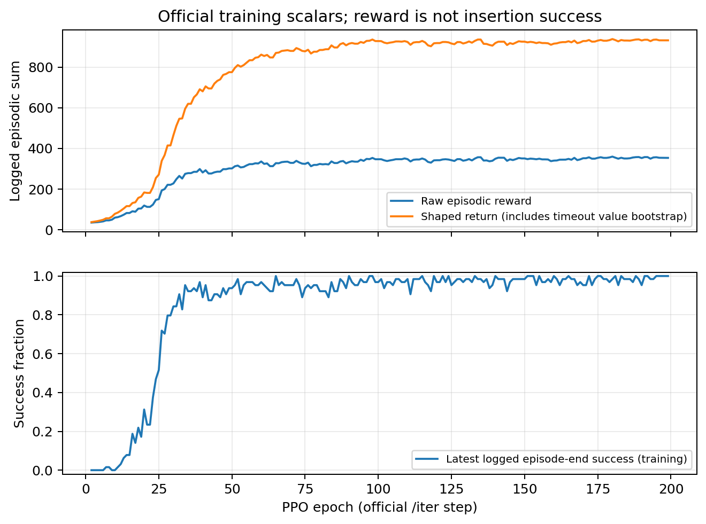
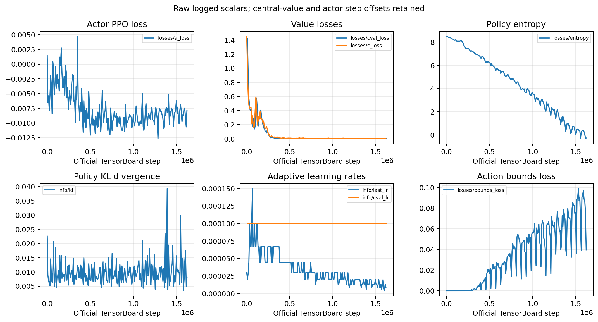
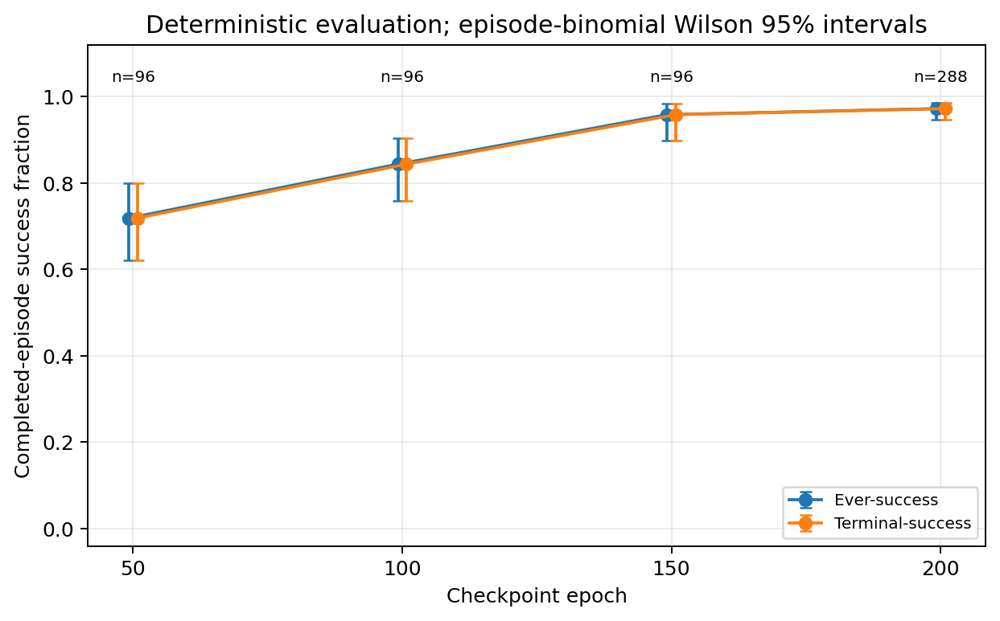
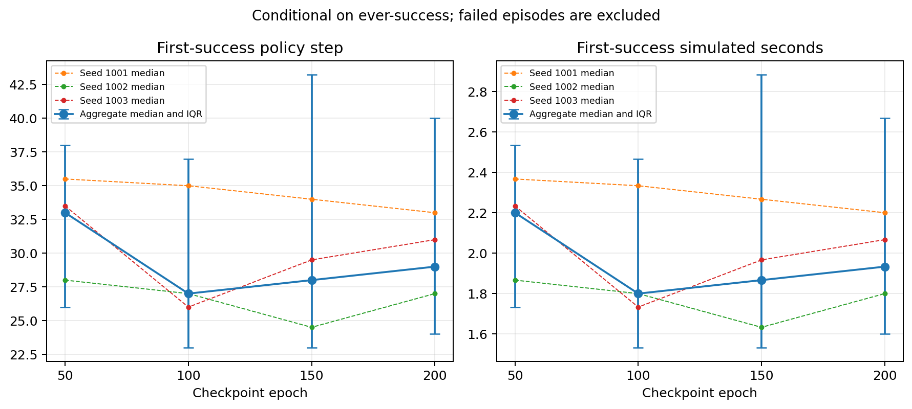
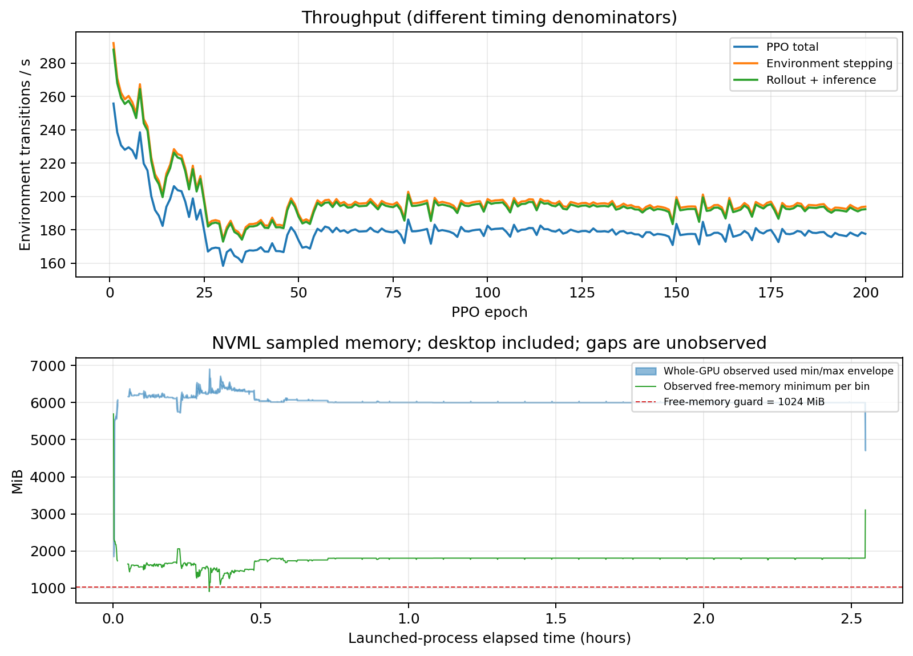
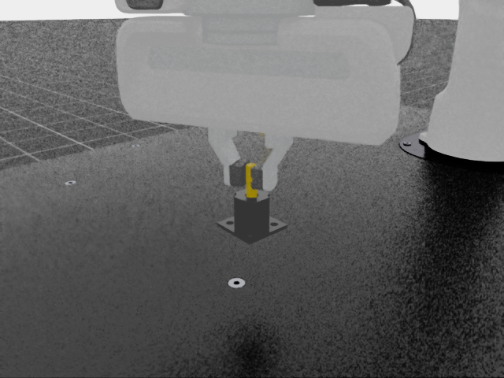

# G2：Isaac Factory PegInsert 首个完整 PPO 基线

训练及主要评估于 **2026-10-23（Asia/Seoul）**完成；报告与补充回放核验于 2026-10-25 完成。对象为 `Isaac-Factory-PegInsert-Direct-v0`、64 环境、训练 seed=0、官方 RL-Games PPO。

**决策：PASS，适用范围为本次资源受限的初步基线。** 全新连续训练达到 200 epochs、1,638,400 transitions；最终 checkpoint 的独立确定性评估为 **ever-success 280/288=97.2222%，terminal-success 同为 280/288**，三个评估 seed 均完成。该结论包含下述监测缺口，不表示所有工程验收项无缺，也不表示官方 128 环境等样本复现或多训练 seed 复现。

## 1. 实验身份和允许覆盖

| 项目 | 实际值 |
| --- | --- |
| 复现仓库起点 | `0efe7fc5f5ab96b15008e8195fa936755b182a84`（D001） |
| Isaac Lab | v2.1.1，`90b79bb2d44feb8d833f260f2bf37da3487180ba`，运行前后上游工作树干净 |
| Isaac Sim / GPU | 4.5.0；RTX 3070 8 GiB；Ubuntu 22.04.5 |
| 运行时 | Python 3.10.12、Torch 2.7.0+cu128、RL-Games 1.6.1、NumPy 1.26.4、Gymnasium 1.2.0 |
| 唯一正式 run | `g2_peginsert_64env_seed0_baseline_rerun` |
| 训练入口 | pinned Isaac Lab 官方 `scripts/reinforcement_learning/rl_games/train.py` |
| 用户指定配置 | `--num_envs 64 --seed 0 --max_iterations 200`；无 checkpoint 参数 |
| [ENGINEERING] | 唯一实验/输出路径、`save_frequency=50`、只读训练观察与外部显存 guard |
| 实际 runtime | 64 actors，actor obs=19，central-value state=43，actions=6 |
| 网络与 PPO | actor/central critic 各两层 1024 LSTM、MLP[512,128,64]；horizon=128、minibatch=512、mini_epochs=4、seq_length=128；其它官方设置保持 |

初始 policy、optimizer 均从头创建；`load_checkpoint=False`、`load_path=""`，训练观察的 checkpoint 事件没有 restore。没有改学习率、clip、entropy、奖励、随机化、动作/观测、控制器、物理或成功阈值。保存的 [agent.yaml](../configs/resolved/g2_peginsert_64env_seed0_baseline_rerun/agent.yaml) 是官方 **runner 创建前快照**，其中仍有 `num_actors=128`、环境 placeholder；官方入口在 dump 后才更新 actor 数。实际 64/19/43/6 由 [env.yaml](../configs/resolved/g2_peginsert_64env_seed0_baseline_rerun/env.yaml) 和 [training_audit.json](../evidence/g2/training/training_audit.json) 共同确认。

源文件与覆盖逐项核验见 [final_source_verification.json](../evidence/g2/final_source_verification.json)；冻结配置、工程脚本 hash 与评估协议见 [manifest](../evidence/g2/g2_manifest.json)、[evaluation amendment](../evidence/g2/evaluation_amendment.json)。[训练前检查](G2_PREFLIGHT.md)包含 CUDA/GPU PhysX、64 环境、可用资源、已知 checkpoint 完整 episode 和测试证据；沿用现有环境，没有重装。

## 2. 完成证据与监督事故

正式训练开始约为 **10 月 23 日 21:12:02.992 KST**，原训练进程消失观测为 **23:44:55.718 KST**。近似墙钟 **9,172.727 秒（2 小时 32 分 52.7 秒）**，起点是 pipeline 启动而非精确 child spawn；分析记录约 1.2 秒的估计时间误差，不作为校准置信界。预算为 200×64×128=**1,638,400 transitions**。

完成判断交叉依赖：同一训练 PID=230594/start ticks=4135139 的观察、无重复且连续的 epoch 1…200 audit、总 transitions、官方 `MAX EPOCHS NUM!` 结束标记，以及 epoch200 checkpoint 内部 epoch/frame 和 optimizer 状态。训练没有恢复、重启或拼接；没有把另一 run 的数据计入。

必须保留的工程缺口如下。

1. 第一次 detached launch 在训练目录创建前监督进程消失，未观察到 epoch/checkpoint，结束原因未知。为新名称生成 manifest 时覆盖了原 manifest；原 hash/status 保留，原文件未完整保留。它不构成一次可分析的正式训练。
2. 正式 run 的原 pipeline/monitor 也在启动约 54 秒后消失，训练子进程继续运行。随后通过独立 systemd user service 对同一 PID/birth 重新挂接只读显存 guard；**约 122.747 秒没有 NVML 样本和 guard 保护**。确切父进程消失原因未建立，不能声称已证明是主机终止。
3. 原训练 OS exit code 无法回收，明确记录为 **null**。不能报告 exit0；200 epochs 完成结论依赖上面的独立证据。重新挂接的 guard 未触发停止，后续 12 次主要评估各自 exit0。
4. TensorBoard 尾端未保存 epoch200 scalars。已持久化的 actor/cval loss 各 199 点，reward 198 点（epoch2…199），最后原始 reward=353.4007 属于 epoch199。该现象与异步 writer 尾端未 flush 相容，但缺乏确证根因。没有补造 scalar 或插值填补监控。

详细经过见 [launch_monitor_incident.json](../evidence/g2/launch_monitor_incident.json)、[monitor_segments.json](../evidence/g2/monitor_segments.json)、[continuation_status.json](../evidence/g2/continuation_status.json)。原始 stdout、长显存序列、TensorBoard 事件与 checkpoint 保留于仓库外，用 [raw_artifact_inventory.json](../evidence/g2/raw_artifact_inventory.json) 中的路径、大小和 SHA256 追踪。事故 guard 的原代码只作为历史文本快照保存，不作为可直接运行的通用命令。

## 3. 训练奖励与优化稳定性

原始 `rewards/iter` 从35.10上升，前10个已记录点均值45.15、最后10点均值354.34，最大359.67。它是训练期滚动 episode reward meter，相邻点含重叠样本。`shaped_rewards` 含 RL-Games 在 timeout 添加的价值 bootstrap，最高937.96不是物理任务原始奖励。训练 `successes` 是 episode 结束时的当前成功比例，也不能替代独立 episodic ever-success。奖励上升只作为学习现象，性能判断使用第4节的独立计数。

200 个 epoch 的 observer 返回 loss 数组均有限、instrumentation errors 为空。53 个已记录 TensorBoard scalar tags 中没有非有限值。actor-network value-head 的 `c_loss` 与独立 central critic 的 `cval_loss` 是两种真实 loss，本次默认 `use_experimental_cv=True`，不能把 `c_loss` 称为零占位。已落盘 `c_loss` 首/末约1.45188/0.0042673，`cval_loss` 约1.42395/0.0012412。observer 的200组数组不覆盖独立训练的 central-value loss；后者只有199个落盘 scalar 和里程碑 checkpoint 的有限性证据。

actor loss 的 TensorBoard frame 在该 epoch 累加前记录，central-value loss 在内部累加后记录，同 epoch 横坐标相差8192；图保留原横坐标，不能将最后 cval frame=1,630,208 当作 epoch200。最后 audit/checkpoint frame 才是1,638,400。Gaussian differential entropy 可为负；actor adaptive LR 变化和 critic LR 保持1e-4均保留官方行为，未人为调参。

actor 共12,800次更新尝试，**12,792次实际 Adam step**；GradScaler 在 epoch 1、9、80、111、126、156、170、170 共跳过8次（0.0625%），独立 central-value Adam 为12,800次。没有关闭或修改 AMP。checkpoint tensors 均有限，逐里程碑 actor 22组和 critic 18组参数发生变化。本轮 observer 不检查梯度张量，因此不作“全部梯度有限”或“无 overflow”的结论。完整 console 未出现已记录 OOM/Traceback/fatal；保留 MaterialX/OmniHub、dynamic-control/AMP API 弃用、render interval 等既有告警。

## 4. 独立确定性评估

主要协议在首次 G2 评估前固定：每 checkpoint 32 环境，seed=1001/1002/1003；50/100/150 各每环境1 episode，共96；200每环境3 episodes，共288。每次评估独立于训练依次运行，GPU无并行训练争用。模型使用 policy mean、`model.training=False`、checkpoint normalization buffers 的 eval 模式、`torch.inference_mode()`、官方 action clipping，done 边界将 LSTM hidden/cell 清零。

独立 evaluator 在官方成功函数调用时、自动 reset 之前记录当步 mask；tracker 对 episode 累积 ever、终点 terminal、首次成功步。不使用官方 `ep_success_times` 缓存。12次运行均完成，所有分母实际达到目标；所有 episode 为149 policy steps 的 timeout，policy dt=1/15秒。完成前 metadata amendment 只修正 partial 输出的 provenance/hash，未改策略、成功定义或样本协议。

| checkpoint epoch | seed1001 ever/terminal | seed1002 | seed1003 | aggregate ever-success | aggregate terminal-success | Wilson 95% |
| --- | --- | --- | --- | --- | --- | --- |
| 50 | 22/32 | 25/32 | 22/32 | 69/96，71.875% | 69/96，71.875% | 62.174–79.893% |
| 100 | 27/32 | 31/32 | 23/32 | 81/96，84.375% | 81/96，84.375% | 75.808–90.296% |
| 150 | 32/32 | 32/32 | 28/32 | 92/96，95.833% | 92/96，95.833% | 89.772–98.368% |
| **200** | **95/96** | **96/96** | **89/96** | **280/288，97.222%** | **280/288，97.222%** | **94.615–98.586%** |

本批 completed episodes 的 transient-only（ever真、terminal假）为0。ever与terminal相等不证明中间每步都保持成功，也不证明其它随机场景没有暂态成功。Wilson 区间是 episode-binomial 描述；同一 policy、同 seed/向量环境以及连续 episodes 存在潜在相关性，不能把它当跨训练 seed 的置信区间。三个评估 seeds 不等于三个独立训练 seeds。150与200区间重叠、分母不同，不能声称200显著优于150。

最终失败8例：seed1001 env11/episode0；seed1003 env4/0、12/0、25/0、29/0、5/1、1/2、5/2。主要评估没有保留这些失败例的完整几何轨迹，不能由统计臆测接触、滑动或卡滞原因。

| epoch | 成功条件样本 n | 首次成功 mean step / 秒 | median step / 秒 | step IQR | step range |
| --- | --- | --- | --- | --- | --- |
| 50 | 69 | 35.2464 / 2.3498 | 33 / 2.2000 | 26–38 | 20–102 |
| 100 | 81 | 33.6543 / 2.2436 | 27 / 1.8000 | 23–37 | 19–141 |
| 150 | 92 | 35.5543 / 2.3703 | 28 / 1.8667 | 23–43.25 | 18–141 |
| 200 | 280 | 33.5357 / 2.2357 | 29 / 1.9333 | 24–40 | 18–105 |

首次成功时间以成功 episode 为条件，排除失败；它是模拟 policy 时间，不含 reset/init，不是计算墙钟。失败较多的 checkpoint 可能只留下容易成功的样本，因此不能据条件均值给策略整体排序。

逐 episode 小型原始数据、pre-reset几何样本、checkpoint hash、terminal/reset一致性与每次运行 exit code 在 [evaluation/](../evidence/g2/evaluation/)，汇总见 [evaluation_summary.json](../evidence/g2/analysis/evaluation_summary.json) 和 [per-seed CSV](../evidence/g2/analysis/evaluation_per_seed.csv)。

## 5. checkpoint 与选择效应

| epoch / frame | checkpoint SHA256 | actor Adam step |
| --- | --- | --- |
| 50 / 409600 | `fdc0637d49844bc8463a9da3428039604fbd0e51e752eb28a00a91b5e6296cca` | 3198 |
| 100 / 819200 | `fd5b63985441f2286b5700e57edbd5d74668492e2d7936fb1e250a76e272114f` | 6397 |
| 150 / 1228800 | `b24fa2215b04466bd42f4b3374e1cce2f9c6a01cf633ed59295ce995c6b01487` | 9595 |
| 200 / 1638400 | `f5e9da77553f51c8fad430eb254fbeabc8963425d89cdc28af8f071944b08f2f` | 12792 |

最终使用 `last_Factory_ep_200_rew__350.4961_.pth`。50/100/150/200为预先指定的里程碑，未根据独立评估改选最佳 checkpoint。`Factory.pth` 由训练 reward 选出的 best alias 单独留档，不是测试集最优。200的周期/最终保存可能有两个文件，文件 hash不同不能直接推断参数不同；只将指定final作为一次结果。[selected_checkpoints.json](../evidence/g2/selected_checkpoints.json)保留完整检查、文件名与参数差异；大文件未入 Git。RL-Games checkpoint 的 critic Adam/RNG/物理状态等精确续训边界仍见 [D001说明](CHECKPOINT_REPRODUCIBILITY.md)，本次没有利用恢复。

## 6. 计算效率、显存与样本预算

| 量 | 实测与口径 |
| --- | --- |
| 官方 PPO 聚合总时长 | 9,093.065 秒，200轮 rollout/inference + optimization 之和 |
| 官方 PPO 聚合 FPS | **180.181 transitions/s** |
| 稳态 epoch11…200 聚合 FPS | 178.145；单 epoch mean45.985秒，median45.839秒 |
| 纯 environment-step 聚合 FPS | 197.236 |
| 含初始化、保存、退出等墙钟 FPS | **178.616**，近似 wall9,172.727秒 |
| 采样全卡 used 峰值 | **6,909.6875 MiB**，含桌面，其它进程及GPU图形资源 |
| 采样 free 最低值 | **907.9375 MiB**；driver reserved374.375MiB另计 |
| Torch allocator 记录峰值 | allocated602,504,704bytes，reserved775,946,240bytes；不等于全卡用量 |
| 显存样本 | 90,244条，原542 + reattached89,702；约10Hz |

guard 沿用 free<1024MiB **连续3次**才终止的规则。可观察区间仅1次低于1024，最长连续1次，发生于21:31:34.405 KST；前后分别1537.5625/1212.75MiB，未满足停止条件。不能写“全程 free>1GiB”。分段样本跨度覆盖约98.6607%墙钟，约123秒空白及10Hz采样均可能漏掉峰值；以上是**观测到的极值**。原 monitor 的compute-process memory只覆盖最初54秒，其峰值4212.676MiB不能代表完整训练进程峰值。

D001短测64环境约227.5FPS/5725MiB与本次长跑180.2FPS/6909.7MiB来自不同时间范围，桌面占用、接触状态及其它因素可能变化；没有受控实验，不能归因于某一因素或将差异全算作observer开销。本轮200epoch未因超过两小时估计而提前终止。

64环境同200 epochs仅为官方128环境的 **1/2 transitions**：1,638,400对3,276,800。每epoch minibatch更新次数也相应较少，保持mini_epochs不等于相同优化预算。本报告不宣称等样本、等优化步或官方完整性能复现；也不由64环境结果推断128环境容量。

## 7. 代表性回放与几何

主要评估保留144条成功 pre-reset 几何样本，均与官方 predicate 独立重算一致。PegInsert 原成功条件为 XY距离<2.5mm、**单侧**z displacement<1mm（height0.025m×threshold0.04）；没有绝对z下界、接触力、保持时长或旋转门槛。这里的成功严格遵守这一官方定义，不能扩展为机械装配质量认证。

补充渲染回放单独记录于 [playback/](../evidence/g2/playback/)，不并入主要288分母。该回放采用同一final checkpoint、1环境、确定性策略，在官方reward阶段自动reset前同时截取图像与几何，并断言render-only没有改变物理状态/计数。1环境额外rollout不冒充32环境主要评估中的逐位重放。回放的具体结果、截图与失败启动说明在该目录索引。

最终补充回放完成 **1/1 ever/terminal成功**，首次成功step37，终点step149；终点XY=0.397044mm、z=+0.044391mm。149步独立几何复核全部一致，官方终点extras与pre-reset mask一致，返回后episode计数归0。guard exit0、无stop，采样free最低1043.1875MiB。下图为该完整episode自动reset前截图（performance渲染preset，640×480，图像有噪声）。

两次补充尝试同时保留：首次遗漏既有Torch可信checkpoint兼容环境变量，未完成恢复/episode后停止；第二次800×600 balanced渲染在终点已拍到成功，但随后guard按原1024MiB/连续3次规则停止，未完成episode统计。第三次只使用官方performance渲染preset与640×480展示分辨率，完成1episode；准确渲染差异另存 [render_config_diff.json](../evidence/g2/playback/render_config_diff.json)，不改policy或物理。第二次较清晰的[终点截图](../evidence/g2/playback/attempt_2/episode_00_step_149_terminal_success.png)保留为guard停止尝试的帧，不把它称为完成episode。所有补充数据均未加入主要分母。

## 8. 科学审阅、限制及 G3 提案

42项CPU测试通过，包含D001成功统计、pre-reset可选几何回调、partial provenance与完成分母、Wilson汇总、缺失评估处理和分段监控时间轴。离线分析没有errors，保留监控缺口/未知退出码warnings。只读交叉审阅见 [scientific_review.md](../evidence/g2/scientific_review.md)。复现命令见 [G2_COMMANDS.md](G2_COMMANDS.md)，全部图另附PDF。历史G0/G1/D001证据与提交保留。

本次 gate 的依据是完成预算、独立评估高成功计数、pre-reset/terminal/几何核对与代表性回放的一致性；没有事后发明一个数值阈值来宣告通过。监控/退出/TensorBoard缺口仍在 [OPEN_ISSUES](OPEN_ISSUES.md)。单训练seed、有限评估场景、episode相关性、官方成功条件的物理含义及失败轨迹缺失限制了推广结论。

建议 G3 按以下顺序单独立项，当前仅提出计划：

1. **先补工程监督**：训练与guard持久化监督、独立liveness、完整退出码、显式日志flush及末epoch检查；用短smoke验证父进程消失时行为和guard，无需改PPO/任务。
2. **诊断8个失败**：保留final200，固定并记录复现实例及完整几何/动作轨迹，分别检查终点失败和首次成功后保持；额外诊断分母与G2主要统计分开。
3. **估计训练随机性**：预注册额外training seeds1、2，各64环境/200epochs、相同官方配置；每final继续固定1001/1002/1003及288episodes协议，合并时以训练seed为单位报告。
4. **再讨论等样本或扩容**：独立评估128环境容量/显存后再决定预算实验。当前不自动扩至400epochs或128环境，不调PPO/奖励，不启动GearMesh/NutThread。
