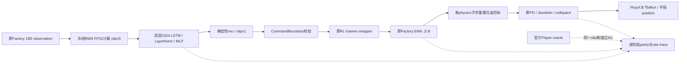

# G4-I1：独立 PPO 策略推理实现与真实运行验收

日期：2026-10-26（Asia/Seoul）。结论：**G4_I1_PASS**。用户学习状态：**PENDING**，按本次用户安排推迟至 Sim2Sim 后的独立会话，不作为当前工程阻塞。

新的入口直接加载冻结 actor/RMS/LSTM，驱动原 Factory PegInsert 环境，未创建训练 Runner、optimizer 或 PPO 更新。最终单环境运行完成149步timeout，再实际执行下一episode首动作；150次policy调用、1200次physics/controller调用。所有832,800个对照数值完全相等，真实child wait=0，原GPU guard全程有效。完整CPU回归360/360通过，含88项新增I1测试。

本阶段只验收I1。未开展I2时延基准、Sim2Sim、GearMesh、NutThread、seed2或任何额外训练。一个episode的success不能替代既有288episode科学评估。

## 身份、起点与历史保护

安全同步：`git fetch origin main`、祖先检查、`git pull --ff-only origin main`；实现起点 `3f41e0618dcdb033c95b79ff77af3998e81a0436`，I0为PASS。已重读README、路线、I0报告/冻结接口/接受计划及学习门禁。I0文件和冻结数值不改动。

主模型固定为G2 final epoch200：

```text
/home/ubuntu2004/Documents/Codex/2026-10-23/the-github-repository-has-now-been/work/runs/logs/rl_games/Factory/g2_peginsert_64env_seed0_baseline_rerun/nn/last_Factory_ep_200_rew__350.4961_.pth
SHA256 f5e9da77553f51c8fad430eb254fbeabc8963425d89cdc28af8f071944b08f2f
training seed0, 64env, epoch200, frame1638400
```

R4 epoch400（`da72a148ebe2b1e2f11f79c4316c24f515510780a3975e2304a41077436b3c36`）仅做CPU兼容/actor对照；R5 epoch400（`2b266c9b64574dc075634e10e3c6b9856899870cbabe54b157a70b7a8c9de54e`）保持为已完成附加证据，没有替换主模型。完整路径、架构和RMS沿用I0 identity/audit。

加载流程在反序列化前核验完整allowlist SHA，仅可信本地文件进入 `torch.load(map_location='cpu', weights_only=False)`；核验checkpoint key全集、epoch/frame、模型张量key/shape/dtype/有限值、完整19维float64 RMS mean/var/count、冻结架构，再strict load_state_dict。optimizer数据虽随checkpoint读入CPU内存，未恢复optimizer对象或执行更新。

依赖仍为Isaac Lab v2.1.1 commit `90b79bb2d44feb8d833f260f2bf37da3487180ba`、Isaac Sim4.5.0、Python3.10.12、Torch2.7.0+cu128、RL-Games1.6.1、NumPy1.26.4、Gymnasium1.2.0。14个冻结科学/评估源码SHA全部匹配I0，见 [scientific_source_preservation.json](../evidence/g4_i/i1/scientific_source_preservation.json)。

[历史保全审计](../evidence/g4_i/i1/historical_preservation.json)：基线1397个tracked文件中1395个内容/权限完全一致，只有用户授权的两份前瞻文档追加说明，旧全文行序保留；I0 manifest37项及manifest本身不变。987个历史文件共16,207,906,067 bytes重新流式SHA全部匹配，G3V五个无关文件也匹配旧哈希并保持untracked。未改写旧结果、失败记录、checkpoint或原始日志。

## 新入口与控制数据流

实现文件：

| 文件 | 用途 |
|---|---|
| `scripts/g4i1_policy.py` | FrozenPolicy：可信加载、RMS、显式h/c、FP32 mu推理和RNG；CommandBoundary负责命令准入 |
| `scripts/g4i1_runtime.py` | 可独立执行的原PegInsert闭环；可选 `--validate` 官方Player oracle、逐子步只读instrumentation、真实错误退出 |
| `scripts/g4i1_parity.py` | 不启动GPU的固定容差NPZ复算，禁止覆盖已有结果 |
| `scripts/g4i1_cpu_check.py` | 实际G2/R4 checkpoint对官方Player的CPU actor对照 |
| `scripts/g4i1_edge_cpu.py` | SHA验证后提取原Factory pre-step，独立验证极端mu裁剪/EMA |
| `scripts/g4i1_acceptance.py` | 从raw trace、NPZ、真实wait和guard重新判定，拒绝“有异常但exit0”的假成功 |



standalone调用官方ModelBuilder构造冻结网络，直接把手动归一化结果送入 `model.a2c_network`，不经过外层模型二次normalization。`--validate` 才额外构造原 evaluator 使用的 `PpoPlayerContinuous`；提供env_info避免它创建第二环境，不使用Runner。oracle的state_dict严格复制自已核验模型，独立维护自身h/c；standalone的动作实际驱动环境。不是改名运行旧play.py/evaluator。

19D顺序、坐标、单位不变：relative position3（世界轴m，减带episode噪声的fixed frame）、世界wxyz quaternion4、单physics-dt差分线速度3/角速度3（m/s、rad/s）、EMA cache6。RMS存储float64，运算转换float32，`clamp((obs-mean.float())/sqrt(var.float()+1e-5),-5,5)`；buffer全过程未变化。

LSTM为2层×1024，h/c分别 `[2,1,1024]` FP32；LayerNorm后MLP512/128/64 ELU，mu6无bounded激活。策略输出经原wrapper clip，再由原 `_pre_physics_step` 更新EMA；后三维按轴角0.097rad/单位，前三维0.02m/单位，位置±0.05m约束、roll字面值3.14159/pitch0、PD/J转置/nullspace及执行器限制均沿用原方法。EMA后不额外clip。

记录的是原 `generate_ctrl_signals` 的全部arm controller函数参数、wrench/effort、完整joint-position command和手指目标；没有重写实际机器人控制器。软件校验不代表真机安全认证。

## 数值对照与覆盖

预注册保持不变：evaluation/reset seed1001、torch起始seed1001、B=1、deterministic mu、FP32。主模型training seed仍为0。CPU容差 `1e-6+1e-6*abs(ref)`，同device GPU容差 `1e-5+1e-5*abs(ref)`；四元数符号等价角误差≤1e-4rad。没有看到结果后放宽阈值。

最终GPU trace结果如下，所有行max_abs/max_rel=0、violation=0：

| stage | 比较元素数 |
|---|---:|
| 原始19D observation | 2,850 |
| normalized observation | 2,850 |
| raw mu | 900 |
| hidden | 307,200 |
| cell | 307,200 |
| clipped action | 900 |
| 原始pre-step后实际EMA | 900 |
| Cartesian target position | 3,600 |
| target quaternion | 4,800 |
| 17项controller inputs/commands/output诊断 | 201,600 |
| **合计** | **832,800** |

1200组target quaternion最大角误差0rad。完整结果见 [最终parity](../evidence/g4_i/i1/episode_verified/parity.json)、[严格覆盖复算](../evidence/g4_i/i1/runtime_acceptance_strict_coverage.json) 和 [独立CPU离线复查](../evidence/g4_i/i1/independent_parity_review.json)。离线复查同时把NPZ actual数组与raw JSONL逐项对应，并独立重算成功几何条件。

边界覆盖分清证据来源：

- **真实轨迹**：普通运动、149步timeout、auto-reset和下一episode首动作。
- **CPU注入fixture**：使用官方Player.get_action对已知极端mu执行裁剪，调用经源码SHA验证的原Factory pre-step，再与独立clip/EMA对照；包括非零且可超过±1的pose-cache。四case均精确0误差，不修改真实actor权重。
- **GPU tensor proxy fixture**：normal/action_clipping/near_zero_rotation/position_saturation，直接调用原 `_apply_action` 检查位置和upright quaternion目标，不推进physics、不向simulator提交命令；独立NumPy复算也通过。

没有声称真实actor自然触发了所有极端case。fixture、真实episode的case集合被固定REQUIRED_CASES门禁检查，缺失任一项不能通过。

CPU实际actor对照使用G2和R4各10个固定synthetic observation，分别维护官方和standalone状态，含中途reset；两者raw/norm/mu/h/c/clip最大误差均0，各10次RNG检查一致，RMS未变化。它是actor算术/兼容测试，不是R4的GPU episode或科学评估。

## 真实episode、reset和RNG

最终运行 `episode_verified`：

| 项目 | 结果 |
|---|---|
| 完整episode分母 | **1**（另有下一episode首动作，不计入成功率分母） |
| ever-success | **1/1** |
| terminal-success | **1/1** |
| 首次成功 | 第37步，**2.4666667模拟秒** |
| 终止 | 原timeout，第149步，9.9333333模拟秒 |
| 实际policy/physics调用 | 150 / 1200，含下一episode首动作 |
| h/c reset | done后清零，在下一动作前完成 |
| EMA cache reset | 按初始pose恢复，非全零；与独立pose公式误差0 |
| RNG | **150/150** 检查一致 |
| RMS | 完整buffer未变化 |
| 原生child wait | **0**，termination_reason=child_exit |

成功由原 `_get_curr_successes` 在auto-reset前采集，每步保存官方bool、step counter和几何快照；ever、terminal、first timing从raw记录离线独立复算一致。没有修改成功阈值或将post-reset观测误作末态。

standalone复制官方Normal.sample，即使最终只使用mu也消耗同样随机数。oracle在fork_rng隔离区内运行并恢复live RNG；之后standalone的CPU/CUDA RNG状态必须与oracle隔离区末态一致。首次reset前种子固定为1001，reset中的原始随机化继续使用live RNG。相等证明本实现的调用序列，不证明任意其它入口只要同seed就等价。

物理120Hz，decimation8，策略仿真时间15Hz。每个policy步只更新一次cache，8个physics子步以最新pose重新生成target。最终raw robot-scene timestamp从0.5666667到11.125s，其中150步策略物理时间10s，loop内辅助reset物理0.5583333s；初始reset另记，不混进149步episode时长。SimulationContext timestamp也原样记录，不能把两种计数强行当作相同墙钟。

## GPU资源、时长及真实失败证据

每次GPU运行前保存资源快照。RTX3070 8GB、driver580.178.04；开始最终运行时free6119MiB。compute清单仅有原用户远程桌面服务，保持运行。原独立guard与gated durable supervisor未改动：1024MiB连续3次、0.1s采样、0.5s gap、2s stale；元数据放唯一tmpfs目录，结束后拷贝到外置永久日志。没有继承R4/R5 no-guard例外、更改驱动或终止无关进程。

最终supervisor wall **54.9505s**，提交到收尾 **55.1333s**，episode/记录loop **41.6821s**。guard551个样本、无gap，采样全卡峰值 **5421.625MiB**、最低free **2396MiB**；Torch峰值allocated158.016MiB/reserved220MiB，只覆盖Torch分配器，不包含PhysX/Vulkan等。采样可能漏短峰，且全卡数值含桌面。

这些wall time含oracle、逐子步重复验证和同步落盘，不是单次forward延迟、P95/P99或硬实时能力；I2尚未执行。

保留四次工程执行，不合并或覆盖：

| 执行 | 真实child wait / 工程结果 |
|---|---|
| preflight，2步 | 0；actor/target/controller parity与guard通过 |
| episode，首次完整尝试 | **历史wait=0，但runtime_error存在，判FAIL**；150步已执行，额外joint-effort诊断9个元素超差，max_abs1.502037e-5；所有预注册策略/target/controller输入与wrench均精确0误差 |
| exit_probe，故障注入 | **1**；无environment或robot command，证明异常经Kit shutdown后仍为真实非零。launcher依其原规则返回124，该值不替代child1 |
| episode_verified，最终验收 | **0**；全832,800项精确一致，完整episode/reset和guard通过 |

首次超差来自验证器将PhysX9×9矩阵的7×7切片clone成packed布局：原stride(81,9,1)，clone后(49,7,1)。控制器的inverse/nullspace路径受布局影响。改为使用同一原始tensor view重算参考，最终全部精确相等；没有改控制算法、矩阵数值或容差。

首次异常已经写入runtime_error.json，但Kit fast shutdown默认returnCode造成原生wait0；这不是成功。修复在close前向原生IApp `post_quit(code)`登记退出状态，并显式保留失败，先通过CPU清理故障测试，再经真实exit_probe验证child1。离线process_gate额外要求无runtime_error、完整result、真实wait0和guard有效，防止再次误判。

首次失败的18.6MB trace、原始NPZ/异常/历史wait0、准确SHA匹配的原入口源码快照均保存。工程修正计划事先记录为 [engineering_correction_plan.json](../evidence/g4_i/i1/engineering_correction_plan.json)，没有以改变科学参数自动重试。

## CPU回归和证据清单

最终完整CPU回归 **360 passed / 0 failed / exit0**，14.42s，未排除任何旧测试。其中I1新增88项：核心/命令边界49、parity22、source edge9、Kit退出4、假零退出验收4。覆盖所有指定负例：19/6维shape、NaN/Inf、错误SHA、缺失/不兼容RMS、device、LSTM shape/reset失败、cache错误和controller rejection；无效输入验证mock提交数为0。原CUDA错误处理不禁用，没有实际制造OOM。

真实执行命令、真实child wait、guard状态和小型结果在 [evidence/g4_i/i1/](../evidence/g4_i/i1/README.md)。大raw产物位于：

```text
/home/ubuntu2004/Documents/Codex/2026-10-23/the-github-repository-has-now-been/work/logs/g4_i/i1/g4i1_seed1001_20261026T084829Z
```

[raw inventory](../evidence/g4_i/i1/raw_artifact_inventory.json) 包含118文件、50,111,735 bytes的完整路径/大小/SHA，含全部尝试、失败源码快照、guard采样、console、JSONL和NPZ；大文件不提交Git。小文件副本和inventory hash用于追溯，不声称raw文件已远程托管。

[使用说明](G4_I1_USAGE.md) 提供CPU检查、受监督GPU运行及独立离线复算；每次必须用新目录，禁止覆盖历史产物。对照结果、原始trace和接受checker可脱离训练循环重复检查。

## 证据边界与停止点

I1工程准备已足以进入I2讨论，但I2未获本次运行授权，没有启动。尚无GPU同步的forward/端到端P50/P95/P99、deadline miss或288episode新分母；当前1/1不能估计总体可靠性，也不替代G2/G3结果。actor仍隐含依赖simulator fixed-frame/末端真值，controller依赖J/M等仿真内部量，未验证真机感知、力控安全或第二物理引擎。

结论：**G4_I1_PASS**。冻结策略独立入口、严格身份链、中间parity、RNG/reset、真实完整episode、真实退出码、负例与CPU回归证据齐全。用户学习保持PENDING，不要求理论问答；到I1结束即停止。
