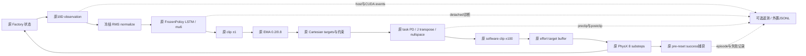
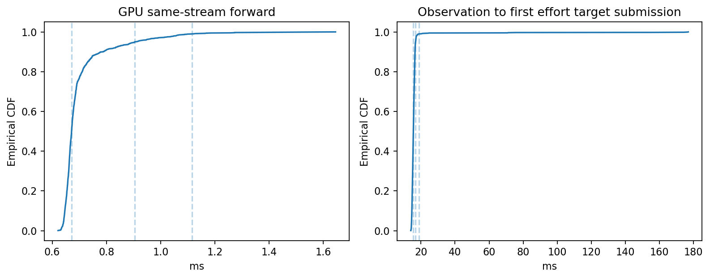
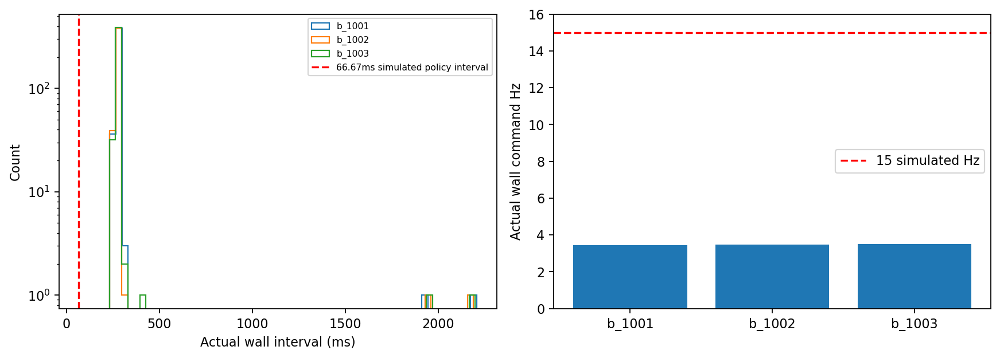
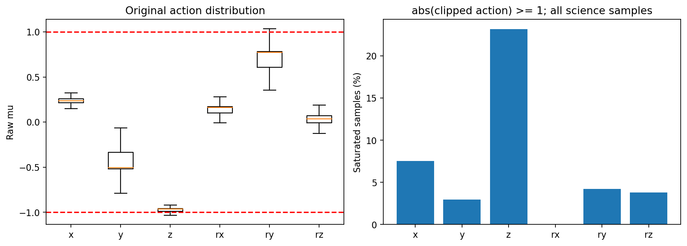

# G4-I2：Standalone 推理性能、控制时序、动作饱和与失败分析

**G4_I2_PASS**。本报告仅覆盖 PegInsert 的 G4-I2。学习状态 **PENDING**。未开始 G4-S0、Sim2Sim、GearMesh、NutThread 或任何训练。

## 冻结基线与实现范围

起点 `ed0310d074254a5110c5f3895aaf09f2a6829be5`；在独立 sibling clone 工作，原工作树的 G3V 未跟踪文件保留。主 checkpoint SHA256 为 `f5e9da77553f51c8fad430eb254fbeabc8963425d89cdc28af8f071944b08f2f`。权重/RMS、19D observation、6D action、2×1024 LSTM 与 reset、discarded Normal.sample 的 RNG 消耗均沿用 G4-I1。上游 Factory、controller、reward、success、physics 等固定源码哈希复核见证据。

本轮扩展原 `g4i1_runtime.py` 的可选 `--i2` 路径；`FrozenPolicy.infer(..., profiler=None)` 默认无探针。未创建第二个 actor 或训练 Runner。`g4i2_runtime.py` 只观察原环境、原 controller 与原 success predicate。控制器 probe 以同一原 code object、同一输入/strides 执行一次，私有 torch proxy 在唯一的原 `clamp(-100,100)` 处只读捕获；不重算或替换控制律。

## 预注册、时钟与预算

以原 `evidence/g4_i/i2/experiment_manifest.json` 和工程修订 `experiment_manifest_r1.json` 为两份保留的执行前清单。历史 G2/G3B 的确切 seeds 为 1001/1002/1003，32 env × 每 env 3 episode = 96/seed，共288；每 episode 实际149 policy steps、timeout终止，成功不会提前结束。上限450 steps/seed。原 G2 max_steps=480，447步已完成；本轮450上限与G3B相同。历史原始资料不包含全部初态与 RNG 流，比较限定为 **descriptive_unpaired**。

初始预算：顺序运行单环境 A-events、A-minimal，各600s；B每seed1800s，合计6600s上限；外置磁盘20GiB。原 guard 与 gated supervisor 均未修改：free<1024MiB 连续3样本、0.1s采样、0.5s gap、2s stale。A单环境预检free≥3000MiB，B≥5600MiB。每次独立保存 nvidia-smi、进程与磁盘预检，未终止无关进程。A任何强制失败即停止，无失败后自动重试。

模拟 physics 120Hz；decimation8；policy15Hz，间隔66.6666667ms。主机时间使用同一进程 `perf_counter_ns`。命令时间为每决策第一个原 `set_joint_effort_target` 所在 `generate_ctrl_signals` 返回后的主机时间，表示软件 target buffer 已提交；不代表 PhysX 已施加，更不代表物理执行器时间。wrapper准入时间另记。真实 wall Hz 为 `(N-1)/(last-first)`；不以网络延迟倒数代替。RTF 为 nominal policy-time / wall；reset辅助物理推进另记，不加进该分子。

每run前20次真实policy决策作为暖机，保留原始数据但从性能分布排除；科学评估分母、动作统计与回合统计不排除暖机。百分位线性插值，std 为总体标准差。CUDA event 在同一 current stream 成对记录，在每决策结束同步最后事件后读取。事件间隔包含host发射空隙，不等于隔离kernel总和；嵌套scope不能相加。

| Scope | 定义与限制 |
|---|---|
| observation_construction | 原 `_get_observations`，包含actor/critic拼装；本row对应本次动作后产生的下一观测 |
| normalization | 原冻结RMS算式及输出有限性检查 |
| forward | 唯一原 `a2c_network` 调用，含LSTM和MLP；GPU分布取 `device_ms` |
| action_postprocess | 原输出校验、discarded采样、clip、RMS冻结检查和detached clones |
| cpu_gpu_transfer_h2d | 主通路obs/action已在GPU，无H2D数据copy；空scope只测探针成本，不能称传输耗时 |
| cpu_gpu_transfer_d2h | 延后批量诊断Tensor->CPU序列化scope；其他success/reset快照同步计入各自上层及完整wall interval，不冒称全局memcpy分解 |
| ema | 原 `_pre_physics_step`，无新增EMA或clip |
| controller_target | 原 `_apply_action` 入口到原generate入口，含必要中间状态刷新；每physics substep重建 |
| physics_step | 原 `sim.step`；reset调用也保留，不能把reset成本删掉 |
| observation_to_command | 输入观测construction开始至第一原effort-target buffer提交，含实际等待/诊断；另记available->wrapper准入 |
| control_loop / command_interval | 相邻第一effort target的完整wall间隔，包含所有上一回合body、日志、reset和调度 |

`event_profile` 保存逐scope wall/device统计；`timing.stages_ms` 对8个substep等重复scope按决策累计，原始每call记录仍保留。A-events含官方oracle和完整parity开销。A-minimal关闭CUDA events、torque probe及详细action/controller trace，只保留必要回合、时钟与健康检查；不宣称绝对零观测开销。两者比较混合oracle、详细日志与events成本，不将差值冒称纯CUDA事件开销。

## 保留的启动失败与工程修订 R1

首次 A-events 与 A-minimal 均 PASS 后，第一次 B1001 在首个策略动作前失败：G4-I1 单环境 reset 诊断 reference quaternion 为 `[1,4]`，原 `tu.quat_mul` 不广播到 `[32,4]`。本次扩展遗漏了批量形状。该次没有完整episode，分母为0；`runtime_error.json` 与 requested_exit_code=1 均保留。Kit关闭挂起后，只向本轮自有原supervisor发送TERM；其按身份核查停止自有child，最终真实wait=1、launcher=124、termination_reason=supervisor_signal，不能按成功计数。一次不受旧systemctl支持的参数尝试也保留，随后使用本机支持的`--kill-who=main`。

R1仅将只读reset参考四元数repeat到实际batch，并在setup失败时先close原wrapper再关闭Kit；未改任何科学公式。10项独立batch/partial-reset CPU controls覆盖此缺陷。`engineering_revision_r1.json` 与执行前新 `experiment_manifest_r1.json` 明确旧失败、代码SHA、全新raw/tmpfs位置及总wall预算修订为9000s（R1自身6000s）。重新执行单环境events+oracle验证后，才运行R1三seed科学评估。旧资料未覆盖；R0运行源码按执行前manifest SHA精确保全，R1源码另存，见source snapshot审计。

历史/current bootstrap顺序存在差异：历史Runner在gym构造后重新seed，再由Player构网；当前FrozenPolicy构网后seed，最后在wrapper.reset前显式torch.manual_seed。默认CPU构网随机消耗和未存档CUDA/Warp流不能混为一谈，不能据顺序差异断言GPU初态必不同，也不能宣称已验证配对。B无oracle，`rng_comparisons=0` 的 `rng_all_equal=true` 是空集合真；本报告只引用A的150次实际RNG parity，绝不把B该布尔值当作实测证据。

## 动作与控制语义

逐维记录 mu、clip±1、EMA、米/弧度增量及最终target。pos scale=.02m，rot scale=.097rad；EMA=.2 incoming+.8 previous，无EMA后clip，reset cache仍是原pose公式。位置相对fixed action frame限制±.05m；roll约束为原字面3.14159、pitch0、yaw保留。约束flag记录 xyz：roll/pitch恒启用、yaw未锁定；位置flag由裁剪前target与原bounds比较。

严格分开 `abs(mu)>1` 的裁剪率和 `abs(clipped)>=1` 的边界饱和率。task-space PD output 是controller计算出的wrench，非接触力传感值。requested torque为原软件clip前值，software torque为原±100之后；实际配置 arm1–4 87Nm、arm5–7 12Nm从运行时 `joint_effort_limits` 保存。超过配置限值不等于测得求解器实际施加同值。实际applied effort 标为 **UNKNOWN**，不从requested或limit推断。

## Deadline与错误契约

研究运行 `log_only`：推理计算超过66.6667ms时记录，若仍fresh则提交原动作，不改科学轨迹。60s freshness ceiling是本模拟软件准入参数，容纳慢reset，绝非ROS/真实控制时效标准。stale/future/unordered观测拒绝；`reject`不调用submit；`stop`锁存拒绝并要求调用者停止。实际entry任意异常记录runtime_error、请求Kit非零退出；原supervisor/guard负责进程生命周期。没有实现hold，不能把reject描述成保持硬件安全。

CPU synthetic fault controls覆盖人工延迟、NaN obs/output、错action维度、stale obs、错LSTM、controller拒绝、checkpoint SHA不符；拒绝时submit计数0。另验证log-only保持原action、stop latch；没有实测ROS时延、硬件watchdog或故障注入GPU。

## 实测结果

最终工程状态：**G4_I2_PASS**。这里的PASS表示原standalone推理、计时接口、负控与已注册288回合评估在定义范围内完成；不表示硬实时或物理接触安全。

### 数值parity与单环境功能

修订后的A重新完成150次决策、1200个policy physics substeps、1个完整149步episode及下一episode首动作。832,800个原Player/原controller比较值的最大绝对误差为0，150/150次实际RNG比较一致，RMS冻结。A前20步暖机，130条GPU forward有效。首次A和修订A均通过；旧B失败已单独保留，不属于A失败后继续扩大评估。

### 延迟和完整wall时序

| 条件/指标 | mean ms | P50 | P95 | P99 | max | std | n |
|---|---:|---:|---:|---:|---:|---:|---:|
| A单env GPU forward（含LSTM） | 0.562669 | 0.519056 | 0.809102 | 1.150257 | 1.254272 | 0.122120 | 130 |
| A单env obs→首effort target | 13.872128 | 13.805015 | 15.305972 | 18.009733 | 20.854193 | 1.050699 | 130 |
| B batch32 GPU forward | 0.701929 | 0.671456 | 0.904448 | 1.115808 | 1.645280 | 0.098710 | 1281 |
| B下一观测construction / host | 0.166473 | 0.162320 | 0.190297 | 0.235318 | 0.292910 | 0.014984 | 1281 |
| B normalization / host | 0.235919 | 0.225219 | 0.310002 | 0.606792 | 0.768515 | 0.062069 | 1281 |
| B clipping+postprocess / host | 0.842694 | 0.738844 | 1.416954 | 2.029267 | 2.684837 | 0.264250 | 1281 |
| B原EMA / host | 0.213955 | 0.196840 | 0.298644 | 0.564679 | 0.874484 | 0.066211 | 1281 |
| B批量诊断D2H / host | 2.156148 | 1.901041 | 3.105671 | 3.561208 | 4.159746 | 0.453565 | 1281 |
| B target重建累计8次 / host | 25.654029 | 25.325677 | 28.971783 | 31.420567 | 35.425531 | 1.709369 | 1281 |
| B physics累计含reset / host | 217.791801 | 211.567153 | 221.198232 | 226.984443 | 1460.047803 | 102.883763 | 1281 |
| B obs→首effort target | 16.217070 | 15.533436 | 16.816600 | 18.896703 | 176.957622 | 9.153946 | 1281 |
| B完整命令间隔（同run暖机后） | 288.189425 | 282.061302 | 291.526351 | 298.552449 | 2207.514015 | 123.559952 | 1278 |

H2D主通路没有数据copy，空scope约0.001678ms均值只是探针成本。完整原始wall/CUDA scopes及所有均值、分位、max/std/n均在 `timing/timings_decision.csv`、`timing/scopes.csv.gz` 和 `timing/timing_summary.json`，包含暖机样本。

B实际wall command Hz **3.4699**，nominal policy-time RTF **0.231358**；模拟仍physics120Hz/policy15Hz。按forward事件总区间归一化的吞吐约 **45589 observations/s**（batch32），排除全部闭环其余成本，不能用它声称真实控制频率。

B命令间隔超过66.6667ms：**1278/1278=100%**；obs→首effort target超过该值：**7/1281=0.5464%**；决策准备→wrapper admission本身的deadline miss为0/1281。这三者不是同一时钟。7个E2E超时中，6个是reset后第150/299步首动作，另1个为seed1003第316步；后一异常的host调度成因未隔离。没有删除reset或异常长尾以改善统计。

最小遥测A（无events/torque probe/详细trace）wall Hz **4.3837**，命令间隔miss **128/128=100%**。相同初态、匹配第21–149步：原A-events+oracle+详细诊断平均interval271.396506ms，minimal228.117757ms，差43.278750ms（约18.97%）。该差包含oracle/日志/events综合成本，不是纯事件探针开销。Minimal E2E P50/P95/P99为6.189514/7.359631/7.793459ms。

### 动作、约束与controller

B共42,912个单env动作样本；每个arm joint共343,296个controller样本。含全部科学暖机，六维均值/分位/范围与EMA、物理增量详见results summary及full episode export。

| 维度 | abs(mu)>1次数 | 裁剪率/边界饱和率 |
|---|---:|---:|
| translation_x | 3236/42912 | 7.541014% |
| translation_y | 1266/42912 | 2.950224% |
| translation_z | 9947/42912 | 23.179996% |
| rotation_x | 11/42912 | 0.025634% |
| rotation_y | 1810/42912 | 4.217934% |
| rotation_z | 1633/42912 | 3.805462% |

本数据中两种频率相等，但定义保留区分。位置约束x/y触发0，z触发4759/343296=1.386267%；roll/pitch始终采用原约束，yaw未锁定。7个arm joint的软件±100Nm裁剪率和请求超过各自87/12Nm限值率均为0%；这不能证明物理/接触安全。task-space PD wrench、请求/软件torque、target与limit的全部逐维分布在机器证据中；实际applied effort仍UNKNOWN。

### 固定科学评估与失败

| seed | 完成/目标 | ever-success | terminal-success |
|---|---:|---:|---:|
| 1001 | 96/96 | 95 | 95 |
| 1002 | 96/96 | 96 | 96 |
| 1003 | 96/96 | 89 | 89 |
| 合计 | 288/288 | 280（97.2222%） | 280（97.2222%） |

与历史280/288的描述性差为0个百分点。原初态/RNG未验证配对，不能声称逐回合一致、复现了原始随机流或做配对显著性检验。episode-binomial Wilson95%区间[94.6154%,98.5859%]仅描述该样本，不代表训练seed不确定性。成功回合首次成功时间为模拟时间：mean2.235714s、P50=1.933333s、P95=4.066667s、P99=5.157333s，不能冒充wall耗时。

所有回合均149 policy steps、timeout终止；逐回合完整初始randomized state、观测/缓存、LSTM、pre-reset terminal state、timing、action和controller统计保存在外置 `episode_statistics/episodes_with_statistics.json/csv`。288/288的coverage COMPLETE：每回合149条完整19D obs/normalized/action、1192个controller substeps、149条官方success和timing。Git内 `results/episodes.json/csv` 是含源指针和SHA的索引，完整状态没有被该精简索引替代。

8个失败均never_success，无transient-success-loss。原判据为XY<0.0025m，signed Z<0.025×0.04=0.001m；曾将held Peg高度0.05误用于说明，已由冻结源码与实际env.yaml双重纠正为fixed Hole高度0.025，未改运行判据。5个末态仅Z失败、3个XY和Z均失败，全部诊断重算与原success flag无差异。

| seed/env/episode | 末态XY mm | signed Z mm | 未满足项 |
|---|---:|---:|---|
| 1001/11/0 | 0.284994 | 20.508401 | Z_CRITERION_UNMET |
| 1003/4/0 | 0.582604 | 3.166795 | Z_CRITERION_UNMET |
| 1003/12/0 | 5.603245 | 25.106799 | XY_AND_Z_CRITERIA_UNMET |
| 1003/25/0 | 0.561979 | 2.543204 | Z_CRITERION_UNMET |
| 1003/29/0 | 0.995462 | 23.850486 | Z_CRITERION_UNMET |
| 1003/5/1 | 3.367521 | 25.004491 | XY_AND_Z_CRITERIA_UNMET |
| 1003/1/2 | 0.563958 | 2.941631 | Z_CRITERION_UNMET |
| 1003/5/2 | 7.852663 | 25.199449 | XY_AND_Z_CRITERIA_UNMET |

每失败的全部149步几何/官方success/mu/clip/EMA CSV和完整原trace SHA、byte/line/env/step引用在 `failures/`；原batch控制器与状态轨迹保留在外置JSONL。高度停留只说明原成功条件未达到，不能据此认定jam、摩擦或接触力成因。保存reset后RNG和实际初态有助复现与诊断，但没有验证PhysX位级重放。

### 资源、退出、CPU回归

GPU为RTX3070 8192MiB；7次owned GPU-job wall总计 **840.807516s**（含旧失败227.594336s），R1科学三组 **453.025505s**，均在修订后的9000s总预算内。guard全程采样记录无gap/低内存stop；全GPU peak used **5379.4375MiB**、min free **2438.1875MiB**，不等同本进程独占显存。外置raw与完整episode导出约619MiB，小于20GiB预算。

成功的原A-events/A-minimal、R1 A与三个R1 B的launcher/真实child wait均为0，termination_reason=child_exit；旧B启动失败真实child wait=1、launcher124，保留supervisor_signal及manual abort记录。单看wrapper退出不能替代这些检查。源码14项固定依赖、checkpoint、原G3V五文件及原工作树HEAD/status复核未变。

完整相关CPU回归 **534 passed, 1 skipped，exit0**；原先360项全部保留。Factory环境未安装matplotlib，唯一skip由现有system Python的同一分析/绘图测试集 **35 passed，exit0**补充验证；未安装包或修改冻结环境。实际frozen checkpoint对官方Player的CPU数学parity另通过，11项mock fault机器证据保留。新增postprocessing导出曾把450上限误当实际步数而失败一次，原部分输出已外置保留；修正为检查actual447≤cap450后新导出成功，不涉及GPU重跑或科学参数变更。

工程判定覆盖原pipeline数值parity、runtime功能、GPU测量、完整wall时序、动作饱和、负控与固定评估；对实时性和物理安全的结论保持独立。

## 复现与证据

初始A与失败启动使用原manifest；最终R1使用 `python3 -m scripts.g4i2_run_registered --manifest evidence/g4_i/i2/experiment_manifest_r1.json --phase a_events` 执行原guarded入口；A接受记录通过后，依次 b_1001、b_1002、b_1003。minimal性能参考为原清单中已通过的a_minimal。清单路径为本轮唯一位置，重放必须新建明确revision和全新raw/tmpfs路径，工具拒绝覆盖。需要同一冻结环境、checkpoint与外置IsaacLab依赖；未把大模型、NPZ、JSONL或完整console纳入Git。

CPU：`CUDA_VISIBLE_DEVICES='' PYTEST_DISABLE_PLUGIN_AUTOLOAD=1 ../../work/envs/factory-g01/bin/python -m pytest -q`。完整checkpoint数学parity用 `python -m scripts.g4i1_cpu_check --output NEW.json`；绘图用已有system Python/numpy/matplotlib，不改Factory环境。

完整可复现入口和证据索引见 [I2 evidence README](../evidence/g4_i/i2/README.md)，接受检查见 [acceptance.json](../evidence/g4_i/i2/acceptance.json)。

## 局限与下一阶段边界

本轮结果仅验证单GPU、同一Isaac Factory环境与固定checkpoint；不能推出跨机器性能、硬实时、接触安全或Sim2Sim可迁移性。GPU统计受桌面进程、主机调度、探针和CUDA host gaps影响；区分profile/minimal条件，未训练或调参。失败分类是原成功谓词下的描述分类，不能从分类名推定力学原因。历史比较没有逐episode配对资格。

工程上已具备进入G4-S0接口范围审查的前提；本机闭环未达到15Hz，必须作为后续约束保留。G4-S0需要独立授权，后续须另行冻结目标仿真器、19D observation/坐标/四元数 convention、action+EMA+controller映射、asset/physics、RNG/reset和成功判据；还需显式处理硬件安全与接触模型差异。本轮到G4-I2停止，学习状态继续PENDING。
