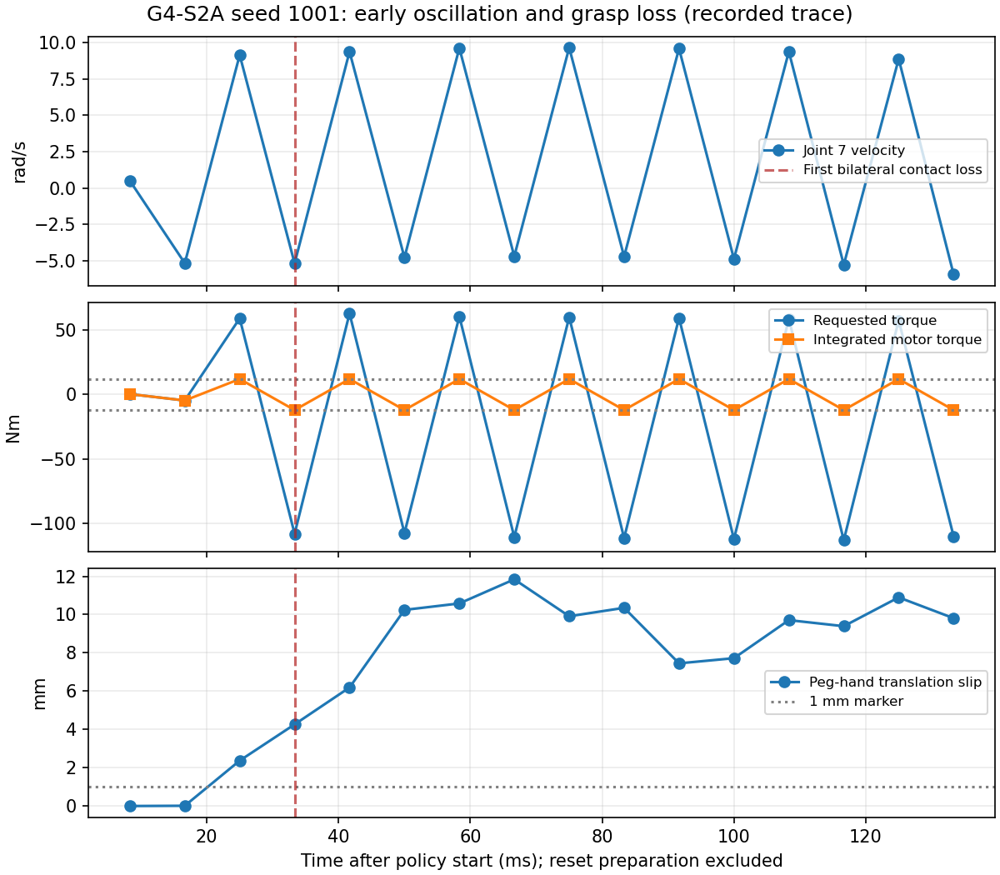

# G4-S2A：冻结 PPO 跨引擎闭环 smoke test

日期：2026-10-26。起点：`5b39da565b4e579aaf600739d2e8fb180222a5da`，分支 `main`。

**结果：`G4_S2A_PARTIAL`。** 首次真实冻结策略 MuJoCo 回合完成了149次决策和1192个物理步，
但关节限位与物理状态质量不满足预先登记的后续回合门禁，因此没有运行1002、1003。
初始物理抓握有效，推理/控制接口、checkpoint和RMS检查通过；这不能弥补回合内的振荡、脱抓和穿透。
不发布工程PASS，不把本次失败解释为PPO算法本身有缺陷，也不估计zero-shot成功概率。

这是 **ADAPTED ZERO-SHOT SIM2SIM**。G4-S1A对精确Factory资产/cooked SDF重建的NO-GO不变。
仅完成S2A；S2B、训练、微调、GearMesh、NutThread均未开始。学习和理论考核仍为 **PENDING**。

## 1. 冻结基线与授权范围

已审阅I0/I1/I2、S0/S1A/S1B报告、S1B reconstruction gate以及三个指定实现文件。
本次仅新增S2A桥接、reset/记录、证据收集、测试与报告；所有1724个起点tracked文件保持原字节，
包括S1B环境与控制器、原Factory源码、历史实验和证据。3个外部checkpoint、20个源码/配置、
4个原USD、78个Panda文件及5个无关G3V文件均通过保留审计。

| 项目 | 实际冻结值 |
|---|---|
| 策略 | 原 `FrozenPolicy`；G2 epoch200、frame1,638,400；不是新建actor |
| checkpoint SHA256 | `f5e9da77553f51c8fad430eb254fbeabc8963425d89cdc28af8f071944b08f2f` |
| 目标引擎 | MuJoCo3.5.0；CPU，无安装变更 |
| Panda | Menagerie `8161bba264d7fa7c99ca301e91e7fb44737676ad`，Apache-2.0 |
| 生成XML SHA256 | `c60c33ee11eb4806294aee259f97d987308b23e83da62f2219cbc9950fb195c9` |
| 几何 | 原S1B 256扇区开孔；peg直径7.986mm、hole直径8.1mm，名义径向间隙57µm |
| 自由度 | Panda7臂+2指；独立6DOF free-joint peg；无weld |
| 时序 | dt=1/120s，decimation8，149次决策，策略仿真频率15Hz |
| 观测/动作 | 原19D/6D；世界坐标参考、WXYZ、native hand quaternion符号 |
| 控制 | 原S1B PD/Jacobian/nullspace、限幅、finger驱动、solver、重力补偿全部不变 |
| 实验seed | 1001；这是评估/初始化seed，不是训练seed；1002/1003未尝试 |

未复制或转换NVIDIA原资产；使用S1B已批准的独立解析装配几何及固定Apache Panda。
没有加载优化器、修改权重/RMS、reward、success predicate、动作统计或网络。
[执行前协议](../evidence/g4_s/s2a/run_20261026T140338/preregistered_protocol.json)保存了完整配置及运行源码SHA。

## 2. 一次性物理reset与准入

S1B默认reset不足以开始策略回合。本阶段使用原源代码reset关节向量
`[.0015178,-.19651,-.0014364,-1.9761,-.00027717,1.7796,.78556]`作单次DLS IK起点，
不是nullspace默认向量。目标TCP使用hand-local z=0.112071m的原centered frame；
控制器Jacobian仍是原S1B的平均finger-body-origin Jacobian，不混淆两者。

每seed先建立attempt记录，再由本地NumPy RNG一次抽取TCP位置噪声±[.02,.02,.01]m、
yaw±.785rad及held peg噪声±[.003,0,.003]m。TCP基准为hole root+[0,0,.025+.047]m。
peg在翻转TCP frame中按`.05−.017608=.032392m`偏置放入物理夹爪，然后保持独立free joint，
执行30个120Hz物理闭指步（.25s），没有weld。孔从准备开始就处于任务位置。

与原Factory的差异明确保留：孔root固定[.6,0,.05]m、yaw0，以适配冻结支撑体；
没有复现原固定件±.05m xyz及0..2π yaw随机化。使用单次最多300迭代IK而非有利重试；
闭指时arm torque=0，而非原PhysX reset hold controller。finger、solver和策略阶段控制器参数不变。
本地随机流不与Torch/PhysX配对，因此相同seed不表示相同跨引擎初态。

最后10个闭指步必须持续存在左右pad正法向力>1e−6N；相对hand平移稳定性≤1mm、旋转≤.05rad；
初始臂/指限位超越≤1e−6（rad/m数值容限）；不得存在peg非pad干涉或其他>1µm非抓握穿透；
整个peg必须在孔口之上，且无weld。失败保留分母、记录原因并停止，不重试。

seed1001的一次正式初始化：

| 检查 | 实测 |
|---|---:|
| TCP目标(m) | [0.604503797, −0.019371981, 0.115753792] |
| yaw(rad) | 0.561887401 |
| IK迭代/位置误差/角误差 | 18 / 2.807µm / 4.330µrad |
| 最终左右pad法向力 | 0.226727 / 0.226601N |
| 最后10步相对平移/转动变化 | 2.790µm / 6.938e−5rad |
| 初态关节限位超越/非pad干涉 | 0 / 无 |
| peg底端距hole root | 34.145mm，整个peg在25mm孔口之上 |
| 闭指阶段最大全接触穿透 | 316.328µm（夹指软接触，单独披露） |

随后用一个只允许一次no-motion reset的view调用**未修改的**`ReferenceRunner.reset`，
复用原噪声、FD置零、EMA公式和frame初始化，并核查qpos不变。EMA平移为
`(TCP−(fixed_tip+noise))/.05`，保持原未夹紧的reset值；yaw采用原公式。
LSTM h/c形状[2,1,1024]、全零，RNG显式seed1001。策略开始后没有reset或teleport peg。
详见[reset admission](../evidence/g4_s/s2a/run_20261026T140338/seed_1001/reset_admission.json)。

开发阶段曾进行多次无策略IK/闭指探针，包括名义位置、偏置和peg翻转frame排查。
其中一些探针没有同期原始文件，无法恢复精确次数和总执行时间；不能称为从未试探过的reset设计。
正式首回合前才冻结一个带原可实现噪声范围的方案，没有选择开发中成功的中心位姿。
这些开发探针不算独立PPO回合，也不能冒充统计样本或抹去其局限。
[开发披露](../evidence/g4_s/s2a/development_disclosure.json)明确该证据缺口。

## 3. 冻结推理桥接与回合记录

MuJoCo进程使用现有MuJoCo Python，JSONL子进程使用现有Factory Python/Torch2.7/RL-Games。
两套安装均未改动。bridge复用原`FrozenPolicy.from_checkpoint`和`infer`：
raw FP32 obs19 → 原RMS一次归一化 → 原LSTM actor eval/无梯度 → deterministic mu → clip±1 →
原EMA .2 incoming+.8 previous（无EMA后clip）→ 每物理步重新构建target → 原S1B控制器 → 实际MuJoCo motors。
保留原discarded Normal.sample的RNG消耗。服务端独立持有h/c，显式reset一次；协议不重试。

在控制前持久化每次推理请求和完整返回，包括h/c；NPZ保存149次post-forward状态，
输入状态由零初态和上一返回状态确定。逐物理步保存机器人q/qdot、TCP、target、requested/software torque、
积分时实际actuator force、post-forward actuator force、arm/finger generalized contribution、
peg/hole位姿及相对姿态、接触名称/法向力/距离、限位、平移与旋转滑移。
滑移参考是准入时、首个策略动作前的状态。

bridge的合成观测独立测试覆盖直接原实现与子进程μ/clip/h/c逐元素相等、独立冻结RMS公式、
LSTM递推/重置和非法输入无forward。回合后checkpoint hash、RMS、eval、维度、有限性、
独立peg及轨迹步数均通过。由源码/测试保证推理递推逻辑；没有为此额外重跑一遍物理回合。

## 4. 正式回合结果与门禁

| 项目 | seed1001 |
|---|---:|
| 正式尝试/初始准入/完整轨迹 | 1 / 通过 / 1 |
| 满足全部技术门禁的回合 | 0 |
| 策略决策/策略物理步/额外reset物理步 | 149 / 1192 / 30 |
| 结束原因 | 原149-step timeout，无自动reset |
| official geometric ever / terminal | false / false |
| 首次几何成功时间 | 未发生，null |
| 最终physical insertion candidate | false |
| 最终contact-quality validated success | false |
| 最大arm限位超越 | 0.321998rad（约18.45°） |
| 最大finger限位超越 | 0.873067mm |
| 最大arm速度 | 63.6524rad/s |
| 最大peg-hand平移滑移 | 7.38673m（已完全脱抓） |
| 最大peg/hole穿透 | 0：没有peg/hole接触，不代表完成装配 |
| 最大所有接触穿透 | 16.9174mm，手部/支撑体接触 |
| μ动作边界饱和分量比例 | 4.4743% |
| 实际arm motor饱和比例 | 45.9132%（按1192×7个积分时motor样本） |
| actor child exit | 0，正常close；149次infer、1次reset |
| 实验程序真实退出码 | 2，显式PARTIAL门禁失败；不是进程崩溃 |

程序只有在完整首回合的全部门禁通过后才允许继续。整回合arm/finger超越预先登记的1e−6rad/m容限，
因此1002、1003未尝试，没有换seed、重试、调gain、改solver或改几何。
`completed_valid_episode_denominator=0`表示没有通过全部门禁的回合，**不是没有完成149步轨迹**。
对这唯一完整、但物理质量不合格的轨迹，可以描述观察到0次几何成功；不能形成可信物理任务成功率。

保持三个成功字段：原Factory FP32 predicate为XY距离<.0025m且**带符号**Z差<.001m；
不会因深负Z自动更正原predicate。S1B物理candidate独立考虑整个圆柱、bore、孔底接触和10µm端点容限。
本次在此基础上预先登记更严格的quality成功：candidate且端点≤10µm，且**整回合peg/hole最大穿透≤10µm**。
全接触/夹指峰值另报，不把夹指软接触与装配孔底阈值混用。本回合candidate为false，故quality必为false。
S1B参考低速插入曾有96.49µm瞬态穿透、约.269µm端点穿透的限制仍然成立；没有追溯修改该证据。

## 5. 失败证据与解释边界

从原始物理步独立复核得到以下时序（从策略开始计时，不含.25s闭指）：

- 第3个物理步（.025s）peg-hand滑移>1mm；第4步（.033333s）右pad法向力为0，失去双侧接触。
- 关节7在首4步速度约`[+.505,−5.150,+9.127,−5.161]rad/s`，requested torque
  `[+.361,−4.605,+58.960,−107.758]Nm`；实际积分时motor为`[+.361,−4.605,+12,−12]Nm`。
- 第61步（.508333s）首先超finger限位；第76步（.633333s）首先超arm限位。
- 第685步（policy86）发生最大穿透16.9174mm，接触对为support与hand，法向力约1173.35N。
- 最终peg相对孔root为约[−3.934,+3.517,−5.692]m，已飞离装配区；整个回合没有peg/hole接触。

直接观察支持“控制器/执行器高频振荡、快速脱抓、限位超越、随后手部撞支撑体和timeout”的失败分类。
没有观察到卡孔、孔缘卡住或已插入但深度不足。raw观测、一次RMS、LSTM重置、EMA和动作传递复核通过，
当前没有证据将本次失败归因为已证实的frame/RMS/LSTM接口错误。

这里不声称全链路bitwise PhysX parity。只读源代码oracle复核中，归一化和观测跨进程传输误差为0，
EMA源FP32最大误差9.54e−8，1192个target最大误差2.42e−7；观测/FD源FP32最大误差3.97e−5，
反映原FP32与S1B FP64端口在高速差分状态下的舍入差异。完整Jacobian/质量矩阵未逐步保存，
故没有独立重算整回合torque的证据；h/c输入也未单独记录，保存的是零初态和逐次post-forward状态。
这些局限保留，不以合成测试通过替代所有真实轨迹内部量的独立证明。

最值得后续独立验证的假说是目标引擎惯量、接触/夹指驱动及PD离散控制响应与PhysX的差异，
其中12Nm腕部motor与快速速度反转有直接证据。没有进行隔离因果实验，不能断言唯一根因，
也不能断言策略学习本身错误。冻结参数下保留失败，比据结果调参数后重跑更符合本阶段边界。

## 6. 时序、资源与预算

| 测量范围 | 实测 |
|---|---:|
| 外部监督进程wall（含启动/加载/导出/关闭） | 11.856s |
| 主程序wall | 11.267s |
| 策略回合wall / 仿真时间 | 6.103s / 9.933333s |
| actor inference mean / P95 / P99 | 16.999 / 18.157 / 19.426ms |
| IPC完整往返 mean / P95 | 24.786 / 26.321ms |
| physics call mean / P95 | .522 / .634ms |
| policy-loop step mean / P95 | 39.490 / 41.982ms |
| 控制器准入cadence | 24.415Hz wall；仿真仍15Hz |
| 回合RTF（仿真时间/回合wall） | 1.628 |
| dynamics进程peak RSS | 352,772KiB |
| GNU time进程树最大单进程RSS | 740,668KiB（不代表两进程内存总和） |
| GNU time CPU user/system / job CPU% | 10.69s / 1.83s / 106% |

wall不是实时限速运行。`command_submit_hz`用进入ReferenceRunner前的相邻时间戳计算，
实际表示控制器准入cadence，不是精确motor提交或真实硬件频率。physics timing包含`mj_step`、
`mj_forward`、原snapshot的开销，不冒称纯积分器时间。CPU与IPC/日志开销也不等于GPU推理延迟。

正式执行远小于1200s上限，仅1次回合。开发早期未统一计时的无策略物理探针已披露；
不声称可从现有归档证明开发阶段每次探针的总wall。没有额外策略回合用于分析或回归。
所有回归中的actor运行是合成输入，物理回归为历史有界无策略探针，不能计作独立科学回合。

## 7. 回归、证据与下一阶段决定

正式启动前，全套CPU回归 **680 passed / 1 skipped**、exit0；独立系统绘图补测1 passed。
其中S1B曾排除的73项actor测试全部纳入，新增46项S2A接口与负控测试。
证据收集器新增4项哈希/计数/非法seed/无损压缩及不可覆盖负控；最终交付全套为 **684 passed / 1 skipped**、exit0，系统绘图补测1 passed。共50项S2A新增测试；合计685个不同用例均在各自依赖环境通过，其中1项在主环境跳过、以系统环境补测。
CPU测试通过不表示装配成功。

完整原始28.376MB证据无损压缩为11.025MB保存在
[run_20261026T140338](../evidence/g4_s/s2a/run_20261026T140338/collection.json)，包含全部149次policy、
1192次physics、30次closure、298个inference request/response事件及NPZ h/c。
逐文件SHA256、未压缩SHA、字节数、源码指纹、真实process receipt和资源日志一并保存；本地原始文件保留。
JSONL使用gzip，解压字节的SHA与原始文件完全一致。没有将checkpoint或原NVIDIA资产复制进新证据。

核心索引：

- [运行摘要](../evidence/g4_s/s2a/run_20261026T140338/summary.json)
- [收集与压缩完整性](../evidence/g4_s/s2a/run_20261026T140338/collection.json)
- [初始准入](../evidence/g4_s/s2a/run_20261026T140338/seed_1001/reset_admission.json)
- [独立物理复核](../evidence/g4_s/s2a/independent_physics_review.json)
- [独立接口/轨迹复核](../evidence/g4_s/s2a/independent_trace_review.json)
- [启动前完整回归](../evidence/g4_s/s2a/regression_20261026T_final/summary.json)
- [最终交付gate](../evidence/g4_s/s2a/completion_gate.json)

**G4-S2B决定：NO-GO（当前冻结配置）。** 在物理控制稳定性与抓握保持得到单独验证前，不宜扩大为288回合。
任何控制器/驱动适配排查和修订均应另行定义与授权，本次不实施、不自动开始下一阶段。
