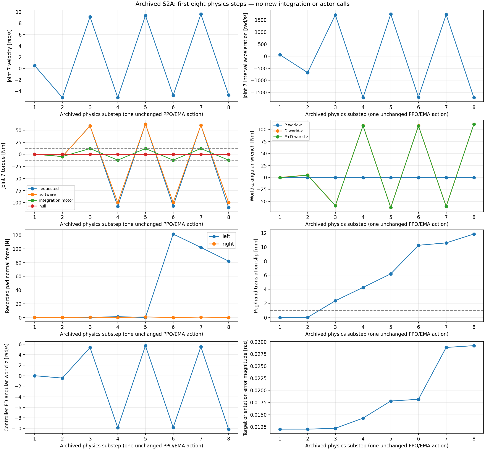

# G4-S2A-R1：可见 MuJoCo 故障诊断与工程案例

整理日期：2026-10-27（Asia/Seoul；执行阶段跨10月26/27日，机器记录以UTC为准）。
仓库`dreamerToTOE/isaac-factory-repro`，分支`main`；起点已fetch并fast-forward至
`9f521002cd1ee1694fabc1f2012a8bdd79e26434`。开始时工作区无无关修改。

**阶段结果：G4_S2A_R1_PASS。GUI_OPEN_VISIBLE。ROOT_CAUSE_PENDING / SOLUTION_PENDING / VALIDATION_PENDING。**

这里的PASS表示实际桌面viewer、归档故障重建、有界无策略对照及独立数值复核完成，
不表示成功Sim2Sim，不表示找到唯一根因，也没有获得修复后的PPO任务成功率。
历史S2A保持PARTIAL，S2B保持NO-GO。学习及理论/面试考核阶段仍PENDING；本次仅按授权更新面试案例文字。

## 1. 实际GUI与复现入口

实际Ubuntu用户X11桌面可用：`DISPLAY=:1`、`XAUTHORITY=/run/user/1000/gdm/Xauthority`，
active local seat0/tty2，X.Org1.21.1.4；没有Xvfb、EGL或OSMesa替代运行。
已有GLFW3.4.0通过GLX使用NVIDIA RTX3070，OpenGL4.6.0（驱动580.178.04只读查询，没有修改）。
实际MuJoCo3.5.0窗口标题为`MuJoCo : g4_s1b_adapted_panda_peg_insert`，1706×960，X11状态`IsViewable`。
调用原生`mujoco.viewer.launch_passive(model,data)`和`viewer.sync()`，主Python线程启动，MuJoCo自己的线程渲染。
截图从真实X11窗口矩形取得，不是离屏渲染或合成图。

交互只读归档回放命令（在现有图形桌面终端执行）：

```bash
cd /home/ubuntu2004/Documents/Codex/2026-10-23/the-github-repository-has-now-been/outputs/isaac-factory-repro-g4-i2
DISPLAY=:1 XAUTHORITY=/run/user/1000/gdm/Xauthority /home/ubuntu2004/miniconda3/envs/unitree_rl_mjlab/bin/python scripts/g4s2a_r1_viewer.py
```

Space播放/暂停，Right单步，Home初态，S切换0.1/0.25/1倍速；1初始夹持、2首动作状态，
3..9与0跳至physics1..8，F首次夹指越限、A首次臂越限、C手部撞支撑体；V全景、Z近景，鼠标旋转/缩放。
优先观察前8个物理步。界面明确标注`ARCHIVED STATE PLAYBACK; NO INTEGRATION`。
青色标记为**记录的接触位置**，文字为记录的pad法向力；历史接触法线未保存，不虚构原力方向。
R可切换**新重算的**contact point/force图示，界面显式提示不能当成历史冲量。

归档回放只设置已记录qpos/qvel、hole参考和control，并执行`mj_forward`，**没有mj_step**。
solver warmstart、完整接触/执行器内部量未记录；视觉回放不是精确物理重演。
原归档XML指纹保持`c60c33ee11eb4806294aee259f97d987308b23e83da62f2219cbc9950fb195c9`。

首次启动的窗口识别错误将带model后缀的真实标题漏判为GUI_BLOCKED；后续零积分启动检查还观察到被动viewer的
close请求未显式等待render thread时，进程在退出阶段发生139。没有native crash stack，不能声称完整证明该崩溃根因。失败记录保留。
修正仅涉及新viewer的标题识别与`close_and_join`，等待自己创建的render thread退出；没有改驱动或全局库。
之后归档viewer正常exit0，全部10个物理诊断viewer也exit0且无遗留render thread。
图形能力检查曾创建32×32隐藏GL上下文以查询OpenGL，**它没有执行物理、没有用作GUI通过证据**。

正式可公开截图见`evidence/g4_s/s2a_r1/visuals/`、[公开可用性清单](../evidence/g4_s/s2a_r1/visuals/public_manifest.json)及各诊断目录；每图带来源、step、sim time、model/config SHA、PNG SHA。
某轮真实窗口截图被桌面通知局部遮挡，完整原图私下保留于Git外并记录SHA；没有涂改或伪造。
另作零积分归档截图，未增加物理实验。公开归档早期帧来自v3、晚期事件来自v2选出的干净原图，
physics8由独立零积分回放补充；每张均保留原来源、SHA和模式。

## 2. 首八个物理步：一个策略动作中的反馈放大

读取并校验S2A报告、completion gate、两份独立复核及原summary/全部JSONL/NPZ。
第一动作raw μ约`[-1.2383,2.3206,-1.1223,.09106,.44552,-1.21837]`，
clip后`[-1,1,-1,.09106,.44552,-1]`；EMA约`[-.117192,-.104954,.441666,.018211,.089105,-.124110]`。
前8步只有这一次PPO决策和EMA更新。后续力矩反转不是另一个PPO动作造成。

下表来自**历史实测**，仿真dt=1/120s；加速度为相邻qvel差/dt的区间估计，不冒称历史solver qacc。

| physics step | J7速度rad/s | J7区间加速度rad/s² | requested Nm | software Nm | 积分时motor Nm | 左/右pad法向力N | peg-hand滑移mm |
|---:|---:|---:|---:|---:|---:|---:|---:|
| 1 | 0.5047 | 60.56 | 0.3606 | 0.3606 | 0.3606 | 0.2233 / 0.2301 | 0.0004 |
| 2 | -5.1497 | -678.52 | -4.6050 | -4.6050 | -4.6050 | 0.2565 / 0.1936 | 0.0135 |
| 3 | 9.1268 | 1713.17 | 58.9602 | 58.9602 | 12.0000 | 0.1377 / 0.5290 | 2.3718 |
| 4 | -5.1612 | -1714.55 | -107.7582 | -100.0000 | -12.0000 | 1.2520 / 0.0000 | 4.2648 |
| 5 | 9.3577 | 1742.26 | 62.7402 | 62.7402 | 12.0000 | 0.0000 / 0.8278 | 6.1915 |
| 6 | -4.7622 | -1694.39 | -107.2884 | -100.0000 | -12.0000 | 121.5663 / 0.0000 | 10.2433 |
| 7 | 9.6042 | 1723.97 | 60.4680 | 60.4680 | 12.0000 | 102.0539 / 0.5985 | 10.5816 |
| 8 | -4.6803 | -1714.14 | -110.3725 | -100.0000 | -12.0000 | 82.1272 / 0.0000 | 11.8402 |

最早可测的放大已经在**step2/0.016667s**出现：速度由+.5047变成−5.1497rad/s，幅度约10.20倍，
当时requested/actual为−4.605Nm，**尚未触及12Nm限幅**。step3才首次饱和并超过1mm滑移，step4失去右pad接触。
因此“饱和是最初且唯一原因”的解释与时序矛盾。

J7的直接nullspace torque前8步绝对值≤8.9e−17Nm，task torque主导。阻尼项−Kdω的负号正确，
但world-z derivative wrench在step2约+4.966Nm、step3约−58.600Nm，远大于约−.361Nm的比例项。
初期相邻四元数dot≥.999080、单位长度误差<7e−16，没有发现早期符号跳变。
原source确实用平均finger-body-origin Jacobian，同时用centered-TCP误差/FD反馈；端口没有偷偷换成TCP Jacobian。

完整q/qvel、TCP/target与SE3误差、FD、task/null/requested/software/integrated/post-forward torque、
广义力、夹指状态/力、接触转变及相对peg位姿见
[前八步JSON](../evidence/g4_s/s2a_r1/archived_analysis/first_eight_steps.json)与同目录CSV。
历史完整J/M、solver qacc及constraint force没有保存，明确UNKNOWN；记录中的condition number不等于完整矩阵。
新诊断额外保存每一步完整J/M、controller输入及post-forward qacc，便于独立复核，不能追溯补造历史数据。



## 3. 机器人惯量与控制器数学审计

只读核查原Factory USD惯量元数据、原源码与S0归档，未启动Isaac Sim，未分发USD/mesh或派生几何。
源`FactoryEnv._set_body_inertias`给每个返回body的3×3旋转惯量对角加`.01kg·m²`。
这是**刚体旋转惯量**；不是关节armature，也不是质量加.01kg。
原arm关节armature/damping/friction配置为0，机器人重力禁用；finger配置7500/173、40N为配置值，
不表示测得的PhysX实际输出。PhysX实际质量矩阵、cooked惯量和施加力矩仍UNKNOWN。

Panda关节逐轴一一对应。11个target robot body为link0..7、hand、left/right finger，
不包括独立peg。源码额外force_sensor和centered-TCP body在Menagerie没有一一对应，
源finger质量约.0297kg而Menagerie为.015kg；因此D06不是原Factory动力学的精确重建。
静态在归档准入q和physics4的q两处比较；source-authored FK Jacobian与目标最大差约1.35e−8。

初始姿态7臂DOF质量矩阵比较（`I_eff,j=1/(M7⁻¹)jj`，在该7×7子块定义下，不等于完整含指/接触约束系统的有效惯量）：

| 模型 | M7 condition | J7 I_eff kg·m² | 1Nm增量的qdd7 rad/s² | dt·λmax(M7⁻¹JᵀKdJ) |
|---|---:|---:|---:|---:|
| 冻结S1B | 616.86 | .00571095 | 175.10 | 13.8116 |
| 11个映射body各+.01I | 151.30 | .03058901 | 32.69 | 1.95766 |
| 臂关节armature+.01的M7子块 | 217.90 | .01598235 | 62.57 | 6.27725 |

独立验证`ΔM=Σ(.01 Jω,bᵀJω,b)`误差≤3.5e−16；body offset产生稠密off-diagonal变化，
而7个转动关节armature产生`.01I7`。两者严格不同。早期静态v2还给finger DOF加了armature；
prismatic DOF单位为kg，不能笼统称为kg·m²。实际预注册D07**仅改7个臂转动关节**，夹指保持不变，
静态文件与实际物理变体的范围差别保留并说明，不混成同一模型。

最后一列只是假设无约束、纯线性阻尼、显式Euler的局部提示；理想边界2不构成实际稳定性证书。
实际MuJoCo使用implicitfast，含FD、饱和、每步重构target、接触/指驱动和约束；
不能从1.95766直接推出全局或长时稳定。动态一致nullspace的代数残差≤4e−14；
新诊断独立重算零空间投影及力矩，误差≤5.69e−14Nm。未发现已证实的source控制律符号或投影实现bug。

静态证据：[dynamics](../evidence/g4_s/s2a_r1/dynamics/static_audit_20261026_v2/matched_dynamics.json)。

## 4. 预注册GUI对照：10×16步

[预注册矩阵](../evidence/g4_s/s2a_r1/diagnostics/gui_matrix_v1/preregistered_matrix.json)
在首个新`mj_step`前写入，冻结代码/helper/环境/控制器SHA、模型delta、初态与160步上限。
每变体仅一次尝试，固定16步；总计**160步**，低于12×16授权上限；
全部实际物理调用累计**.12605s**，包含GUI启动/显示/关闭的协调器wall为**45.802s**，低于600s。
新增策略调用**0**，没有训练、微调或新完整PPO回合，没有1002/1003或S2B。

每变体用相同归档准入qpos/qvel；复制控制时区分力/位置单位。
D09同时改affine actuator XML和命令分支，初始finger control=0m闭合目标，不能把N误当m。
`mj_setConst`会改传入data.qpos，因此只给临时data调用，再创建新data恢复归档状态。
所有变体的初始solver warmstart/internal state均UNKNOWN；重新forward生成新状态。

D01/D04/D05/D06/D07/D08在steps1和9分别使用原前两条**归档**clipped action，保持原EMA及每步反馈计算。
这不是在变体状态上重新调用策略，不能称为修改后PPO闭环表现。
D03固定初始TCP target，D02/D09/D10 arm torque=0，其他差异表内明确。
viewer同步不额外调用物理积分；检测意外外部GUI扰动力，存在则在下一步前停止。
各子进程均有实际native窗口mapped/IsViewable准入记录、真实exit0、16条积分请求/结果、无新数值warning及已回收render thread。
IsViewable不证明持续处于前景；部分积分截图被其他窗口遮挡；为谨慎公开，除已检查的D01两张原积分帧外，其余18张原积分PNG统一私有保留并记录SHA，不能据此声称每张都被遮挡。公开实验画面只采用已核查帧。
对D01/D06另用已记录状态作零积分GUI回放，窗口置前取得清晰对照；模式与原积分时截帧严格区分。
**数值有限/无warning不等于物理可信**，D08就是反例。

所有行均为DIAGNOSTIC_ONLY、0.133333s窗口，不是完整任务结果：

| ID | 唯一预注册主要差异 | 最大滑移mm | 首次双侧接触丢失step | 最大arm速度rad/s | 最大全接触穿透mm |
|---|---|---:|---:|---:|---:|
| D01 | 冻结控制/模型重新积分 | 14.241098 | 4 | 9.634010 | 4.753669 |
| D02 | arm torque=0 | 0.002791 | 无 | 0.000012 | 0.007813 |
| D03 | 固定初始TCP参考 | 16.167911 | 8 | 13.960966 | 4.703160 |
| D04 | 仅task torque | 11.829568 | 4 | 9.440763 | 3.311901 |
| D05 | 仅nullspace torque | 0.102875 | 无 | 1.183151 | 0.013425 |
| D06 | 11个robot body各+0.01I | 0.088564 | 无 | 1.109056 | 0.013320 |
| D07 | 仅7个臂关节armature+0.01 | 5.069043 | 3 | 3.969433 | 3.493854 |
| D08 | arm motor限幅改为±100Nm | 34982549.058221 | 3 | 78.292904 | 0.994324 |
| D09 | 零臂力矩+affine finger PD | 25.210726 | 3 | 0.382143 | 33.607652 |
| D10 | 零臂力矩+solref(.02,1) | 0.002053 | 无 | 0.000010 | 0.008191 |

D08中peg飞出数十公里量级是严重数值/物理失真，不能据“无warning”给质量PASS，也不解释为有效机器人行为。
D09虽arm命令为0，affine finger驱动仍可经接触/约束反力带动臂，不能叫“机器人完全固定”。
D10名义solref .005→.02不是实际4倍变化：冻结`.005`受refsafe限制为2dt=.016667，
新值.02只是较小幅度敏感性；不能据此排除其他接触设置影响。

D02稳定静态持握、D01在反馈控制下丢失，削弱“初态本身完全不能夹持”的解释。
D03固定target也失稳、D04去掉null仍失稳、D05仅null未丢抓，支持task/plant离散耦合的重要性。
D06相对D01最大滑移下降**99.38%**，16步内保持双侧接触；D07不等效且仍丢抓。
D08放宽限幅显著恶化，说明限幅具有抑制作用，不能把“取消饱和”当修复。
D09改变finger驱动反而导致无arm命令时丢抓，证明驱动/接触适配本身也敏感。

**D01不是历史轨迹精确重放**：重启16步的最大滑移14.241mm，历史前16步为11.840mm；
混合qpos最大差.1881、混合qvel最大差38.436（包含不同单位/物体DOF，不作为单一物理量），
requested torque最大差约.6252Nm。缺失solver内部量及新启动的forward/GUI同步等使精确重现没有依据。
所有反事实都与同样fresh-start的D01比较；原S2A失败记录保持不变。

下图是**保存的诊断状态在真实GUI中的零积分回放**，不是额外物理实验或积分时同期截图；两图均为step16/0.133333s。


独立复核：[diagnostic_review.json](../evidence/g4_s/s2a_r1/archived_analysis/diagnostic_review.json)。

## 5. 竞争假说与结论强度

| 假说 | 支持与反证 / 对照 | 当前等级与不确定性 |
|---|---|---|
| H1 惯量失配 | 源body+.01I与冻结模型不同；D06抑制短窗口振荡，D07不能等效替代 | SUPPORTED_BUT_NOT_PROVEN；修改同时影响plant和controller M，未隔离两者，源完整runtime I未知 |
| H2 饱和/过度加速度 | 饱和前已放大；D08放宽cap灾难性恶化 | 过度加速度相关机制SUPPORTED_BUT_NOT_PROVEN；“饱和最初且唯一致因”CONTRADICTED；不能断言提高cap能解决 |
| H3 task PD离散反馈 | 同一动作内D项快速反转；D03固定target仍失败；D04失败而D05保持 | SUPPORTED_BUT_NOT_PROVEN；局部线性指标不是非线性稳定证明 |
| H4 Jacobian/nullspace实现或动态失配 | source-authored J匹配；新J/M力矩代数复核通过；直接J7 null极小 | 广义问题INCONCLUSIVE；“J7直接null torque是初始唯一驱动”CONTRADICTED；完整源PhysX M/J未知 |
| H5 指驱动/接触 | D02无臂命令保持，D09换驱动丢失；D10仅轻微差异 | SUPPORTED_BUT_NOT_PROVEN；驱动敏感性已观测，但尚未隔离coupled contact/equality/指惯量 |
| H6 reset/分布 | 同一初态被动保持，来源分布确有固定hole/IK差异 | INCONCLUSIVE；只有一个初态，未测试其他分布，不推断reset绝对正确/错误 |
| H7 observation/quat/FD | 早期无sign跳；FD/PD/RMS/EMA审计通过；此阶段没有新actor | 广义解释INCONCLUSIVE；早期sign-jump特定解释CONTRADICTED，未来其他状态未验证 |

已VERIFIED的是：源惯量修改语义、短窗口条件差异、记录的物理事件，以及在指定fresh-start输入下D06的数值变化。
没有把整个迁移的唯一根因标为VERIFIED。**ROOT_CAUSE_PENDING**保留。
置信度：H1/H3对本初态短窗口的机制支持较高、对整个迁移根因仅中等；H2/H5中等；H4/H6/H7广义解释低。
具体早期时序和sign-jump/null直接驱动的反证置信度较高，但仅限已记录窗口。

## 6. 工程建议与未来验收

D06只作为**DIAGNOSTIC_ONLY**保留。可提出源惯量规则启发的**TARGET_ENGINE_ADAPTATION**候选：
明确映射各body的惯量与CoM，在目标中对齐源runtime inertia意图，同时保留peg独立物理和原reward/success。
这不是已验证修复。没有发现足以宣布`SOURCE_SEMANTIC_BUG_FIX`的策略接口bug；
不能将bodyoffset换成`.01`joint armature，也不建议通过放宽force limit“解决”振荡。

下一门应单独授权一个无策略的控制/动力学适配验收：分开plant inertia与controller M效应，
检查更长窗口、多个事先固定的姿态、质量/指驱动和接触约束、限位与持续夹持。
本次不执行这些新实验。之后若满足物理门禁，才另行授权有限PPO重验；完整S2B仍NO-GO。
**SOLUTION_PENDING / VALIDATION_PENDING**，没有任务级before/after成功率。

## 7. 回归、保全、案例与证据

新增43项纯CPU/归档负控全部通过。受阶段限制的完整可运行集合：652passed、1绘图skip，
系统绘图补测1passed。明确排除75项：73项既有actor相关测试、1项真实FrozenPolicy bridge forward测试、
1项会启动518个headless物理步的S1B collector；没有删除或修改任何测试。
actor/checkpoint/mj_step/viewer启动tripwire及3项dummy负控证明在入口前拒绝；本轮pytest零actor、零新物理积分。
相关证据：[regression_final_v2/summary.json](../evidence/g4_s/s2a_r1/regression_final_v2/summary.json)。

起点1790个受保护文件保持原字节；仅本任务授权的案例正文/index允许更新。
3个checkpoint、20个外部源码/配置、4个原USD、78个Panda文件及5个G3V文件保全。
`README.md`和`CASE_STUDY_TEMPLATE.md`未重建或修改。
已有[案例正文](case_studies/SIM2SIM_PANDA_CONTROL_INSTABILITY.md)已按其原结构补入真实GUI、短窗口对照、
分级因果判断、候选适配及30秒/2分钟面试表述；未解决部分明确PENDING。

证据主目录：`evidence/g4_s/s2a_r1/`。包括原始short-window JSONL、模型/源码哈希、参数delta、
每个进程exit、所有可公开PNG及metadata、归档前8步完整CSV、只读USD惯量映射、独立数值复核和回归保全。
共公开20张已核查的真实GUI PNG（10张v3归档、3张v2晚期归档、5张独立回放、2张D01同期积分帧）。未录制视频；没有把checkpoint/原USD/mesh或桌面其他窗口信息提交到Git。
Git提交和独立远端SHA核对在最终交付时记录；推送采用普通fast-forward，不force。
本阶段至此停止，无新的完整PPO回合、1002/1003、S2B、训练、GearMesh或NutThread。
