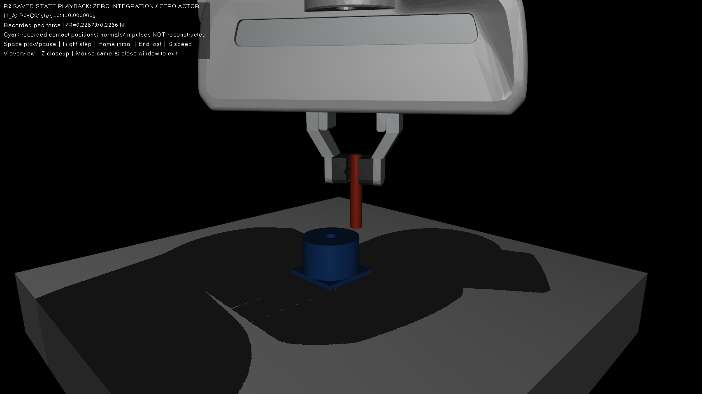
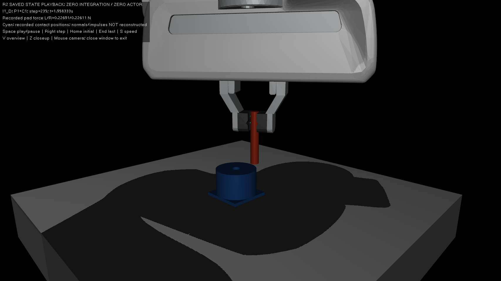
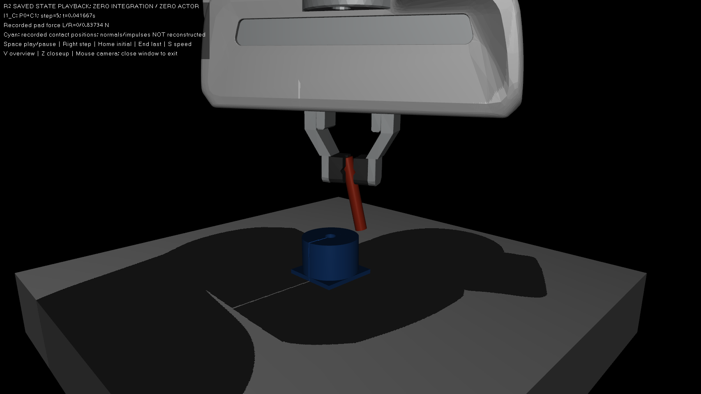
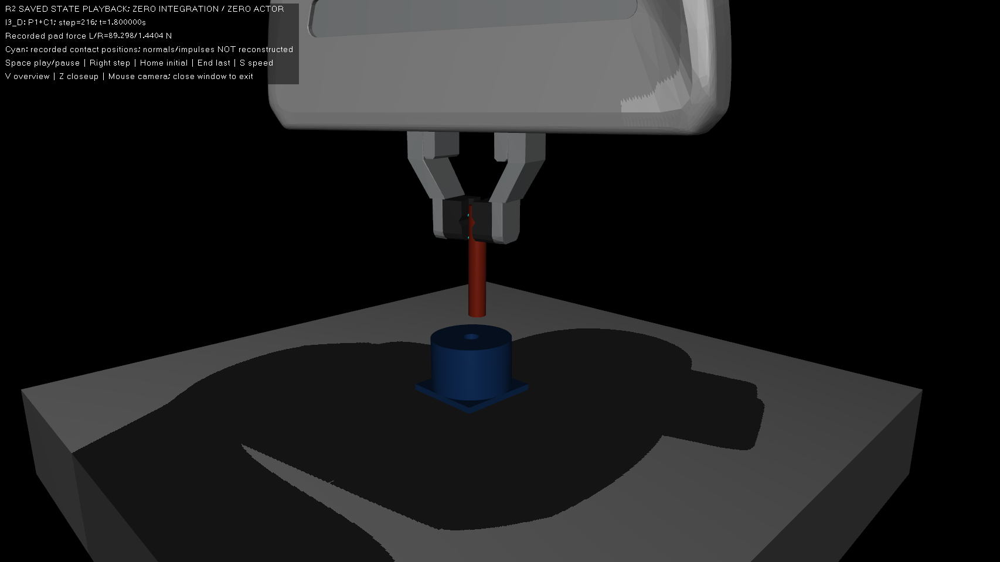
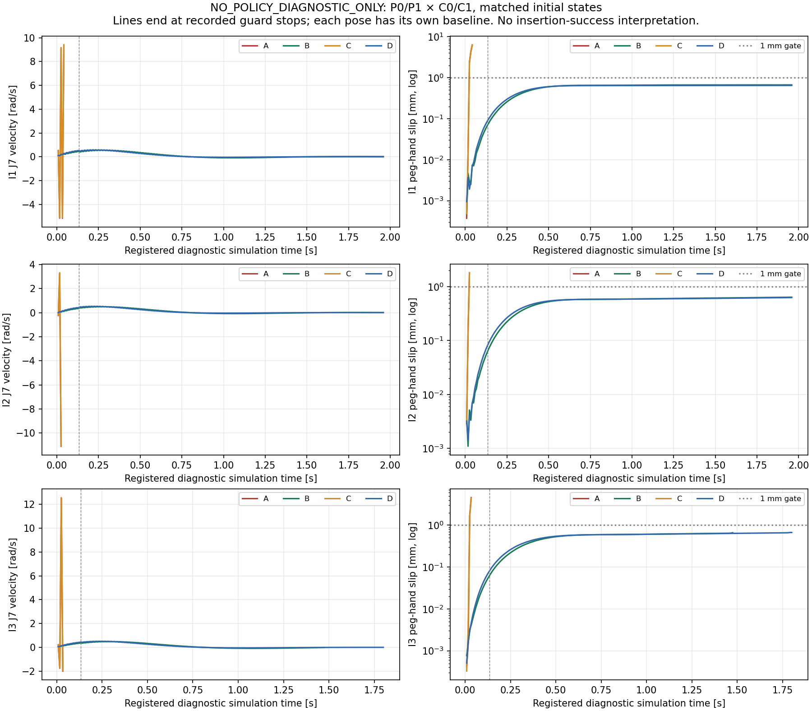
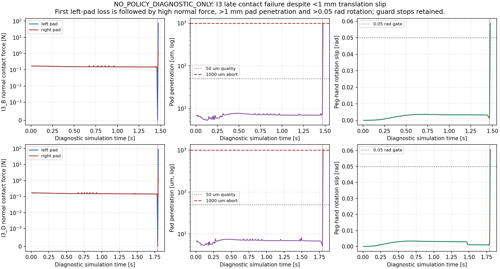

# G4-S2A-R2：Panda 动力学适配、plant/controller 分离与持续抓持验证

日期：2026-10-27（Asia/Seoul）。仓库 `dreamerToTOE/isaac-factory-repro`，分支 `main`。
预期并经核对的起点：`292ca516e4909cabe2de425b28909f790f4cf351`。

**工程结果：G4_S2A_R2_PASS。科学候选：CANDIDATE_PARTIAL。当前R3与S2B：NO-GO。**

PASS仅表示真实可见GUI、正确的plant/controller分离、完整预注册记账、长窗口正反结果、
独立数值复核、证据保全和回归交付完成。它不要求各变体稳定，也不表示持续抓持适配已全面通过。
第三初态的晚期接触反例阻止候选升级；没有获得新的PPO或任务成功率。

本阶段仅限 **NO_POLICY_DIAGNOSTIC_ONLY**。没有新 PPO 推理、策略回合、checkpoint 加载、
训练或微调。原 S1B 配置、S2A 失败轨迹和 R1 的 D01/D06 全部保留；R2 结果不追溯替换历史结果。
S2B 仍为 NO-GO；学习与理论考核仍为 PENDING。本阶段证据不足以推荐立即执行R3。

## 1. 问题与冻结边界

R1 在同一归档初始状态和前两条归档动作下，D06 的 16 步最大 peg-hand 平移滑移为
0.088564mm，fresh-start 冻结对照 D01 为 14.241098mm；最大臂速度分别为
1.109056 与 9.634010rad/s。D06 在 0.133333s 窗口内保持双侧正接触。
这是一项局部干预结果。D06 同时改变物理 plant 的 body 惯量和 controller 使用的质量矩阵，
因此 R1 没有隔离两者，也没有建立持续抓持或策略插入修复。

R2 保持原控制公式、PD gains、原 Jacobian 约定、关节顺序、dt=1/120s、finger 驱动、
software ±100Nm、前4臂轴87Nm/后3臂轴12Nm motor cap、peg/hole 尺寸、碰撞和成功阈值。
peg 仍为独立 free joint，无 weld，不关闭 contact。这里只改变预先登记的 plant inertia
和 controller mass-matrix 来源；不搜索 gains、solver、force cap 或几何参数。

历史依据：[S1B](REVIEW_G4_S1B.md)、[S2A](REVIEW_G4_S2A.md)、[R1](REVIEW_G4_S2A_R1.md)、
[R1 完成门](../evidence/g4_s/s2a_r1/completion_gate.json)、
[R1 独立复核](../evidence/g4_s/s2a_r1/archived_analysis/diagnostic_review.json)、
[R1 对照](../evidence/g4_s/s2a_r1/diagnostic_analysis/comparison.json)。

## 2. 资产、源惯量语义与可解释范围

继续使用 MuJoCo 3.5.0 和固定 Menagerie Panda commit
`8161bba264d7fa7c99ca301e91e7fb44737676ad`（Apache-2.0），以及本仓库独立解析 peg/hole/support
生成代码。没有向 Git 添加 NVIDIA 原 USD、mesh、cooked 数据或其转换几何。
S1A 对严格原资产和 PhysX cooked SDF 重建的 NO-GO 不变；本阶段不扩大已有许可结论。

Factory `_set_body_inertias` 的规则为每个返回刚体的 3×3 转动惯量张量加
`0.01 I kg·m²`，不是质量加 0.01kg，也不是关节 armature。
目标映射11个 body：link0..7、hand、left/right finger；源的额外 force_sensor 和 centered-TCP
body 没有一一对应。原 Factory finger 元数据质量约 0.0297kg，Menagerie 为 0.015kg。
质量、CoM、模型形状的这些差异没有被 body offset 消除。

对第 b 个 body，增量拉回关节空间为 `0.01 Jω,bᵀ Jω,b`，对所有映射 body 求和通常得到
稠密、随 q 变化的 ΔM；转动关节 armature 增量则为常数关节对角项。
所以不能用 `.01` armature 冒充 D06。P1 不改变 body mass、CoM、惯性主轴或 joint armature。
每个物理惯量张量的正定性及适配数值已在预注册编译记录中逐body保存，静态CPU门核验。
**原 PhysX runtime mass matrix、cooked inertia 和实际 actuator force 仍为 UNKNOWN。**


预注册编译模型的主惯量如下；P1每项均比P0增加0.01kg·m²，所有映射主惯量均正。
完整body CoM、inertial quaternion、armature、限位和actuator值保存在预注册models及每run identity。
固定link0也按源映射规则记录适配，但它没有随臂关节转动，不据此声称额外臂惯量贡献。

| 映射body | 质量kg（P0=P1） | P0主惯量kg·m² | P1主惯量kg·m² |
|---|---:|---|---|
| link0 | 0.629769 | 0.0043046501 / 0.0038798391 / 0.0031305108 | 0.01430465 / 0.013879839 / 0.013130511 |
| link1 | 4.970684 | 0.70713701 / 0.70343543 / 0.0085245563 | 0.71713701 / 0.71343543 / 0.018524556 |
| link2 | 0.646926 | 0.031032643 / 0.028300107 / 0.0027342505 | 0.041032643 / 0.038300107 / 0.01273425 |
| link3 | 3.228604 | 0.041501388 / 0.041479257 / 0.0012463544 | 0.051501388 / 0.051479257 / 0.011246354 |
| link4 | 3.587895 | 0.03495964 / 0.028148276 / 0.010620083 | 0.04495964 / 0.038148276 / 0.020620083 |
| link5 | 1.225946 | 0.036762538 / 0.028853091 / 0.0080343705 | 0.046762538 / 0.038853091 / 0.01803437 |
| link6 | 1.666555 | 0.0058427612 / 0.0043103737 / 0.0015978651 | 0.015842761 / 0.014310374 / 0.011597865 |
| link7 | 0.735522 | 0.012734493 / 0.010105477 / 0.00451803 | 0.022734493 / 0.020105477 / 0.01451803 |
| hand | 0.73 | 0.001 / 0.0025 / 0.0017 | 0.011 / 0.0125 / 0.0117 |
| left_finger | 0.015 | 2.375e-06 / 2.375e-06 / 7.5e-07 | 0.010002375 / 0.010002375 / 0.01000075 |
| right_finger | 0.015 | 2.375e-06 / 2.375e-06 / 7.5e-07 | 0.010002375 / 0.010002375 / 0.01000075 |

## 3. 预注册与入场条件

正式执行使用 [matrix_v2预注册](../evidence/g4_s/s2a_r2/matrix_v2/preregistered_matrix.json)。
较早matrix_v1在**0新增物理积分**时被保留并替代：独立审阅要求timeout时保存真实child returncode，
而不是把监督器自定124写成child exit。该监督修正没有改变阈值、几何、schedule或科学矩阵。
见[修订说明](../evidence/g4_s/s2a_r2/preregistration_amendment.json)。

| 初态 ID | 来源 | 尝试规则 | 准入结果 |
|---|---|---|---|
| I1 | 归档 S2A seed1001 admitted grasp | 复用保存 qpos/qvel；不是重新策略评估 | PASS；0新增准备步 |
| I2 | diagnostic seed2101 | 一次确定性 reset/物理闭指，不重采样 | PASS；30准备步 |
| I3 | diagnostic seed2102 | 一次确定性 reset/物理闭指，不重采样 | PASS；30准备步 |

额外两初态使用诊断 seed，与训练 seed 及 policy evaluation seed 分开；没有运行1002/1003。
物理闭指准备、最后窗口双侧接触、hand-relative pose 稳定性、joint limits、无初始插入、
独立 peg、完整初始状态和 initial-state SHA 均已记录。准入失败会保留在三个预注册初态的分母中。
未通过初态不得换姿态补足结果。实际3/3一次性准入通过，12/12轨迹均执行，无重试。
I2最后10步相对平移/旋转变化6.807µm/0.0001121rad，最终pad力0.194105/0.193080N；
I3为8.413µm/0.00003570rad，最终pad力0.169229/0.168349N；两者joint-limit越限均0、无非pad干涉、
peg完全在孔口之上。I2/I3闭指全接触瞬态峰值分别22.444µm/873.514µm。
**I3准备峰值873.514µm大于后续主轨迹采用的50µm pad接触质量门**，虽低于1mm即时早停。
准备准入按原协议检查末10步，没有把主轨迹质量门追溯变成新的准入条件；原准入PASS保持。
必须同时保留“初态准入PASS”和“准备全程接触质量存在明显限制”，不能用最终准入覆盖准备瞬态。
每初态都先在P0准备一次，再保存新data的完整可用 `mjSTATE_INTEGRATION` 并等值恢复给四个变体；
这包含本次可保存的warmstart，不会补造原S2A未保存的solver内部量。

输入 schedule 在首个新物理积分前冻结：前两条 archived action 各使用原8步区间；
steps17..235固定为该初态 admitted world TCP position/quaternion，之后不再更新EMA/action。
这是两段归档激励后返回固定初始参考的诊断；不是续接原策略，也不是新 PPO 决策。
固定目标不随变体状态移动，仍用原PD/J/FD/nullspace公式计算控制。
同一初态的 A/B/C/D 使用完全相同 schedule，其 schedule SHA 必须一致。
本次主动选择4×3=12条、每条235步/1.958333s，而非用满每条240步。
这样12×235=2820步，另为两次各30步的物理闭指准备预留60步，**全部新增积分最多2880步**。
归档I1没有新增闭指积分。协调器把GUI启动、paced观察和记录时间也计入900s上限，
较仅计纯物理调用更保守；普通CPU回归不占该预算。实际准备与诊断步数须分别报告。

## 4. 2×2 plant/controller 分离

| ID | 物理 plant | controller M | 含义 |
|---|---|---|---|
| A | P0：冻结 S1B body inertia | C0：冻结质量模型 | 匹配初态对照 |
| B | P1：映射11 body各+0.01I | C0：冻结质量模型 | plant-only 反事实 |
| C | P0：冻结 S1B body inertia | C1：适配质量模型 | controller-only 反事实 |
| D | P1：映射11 body各+0.01I | C1：适配质量模型 | R1 D06 概念的长窗口检验 |

B/C 故意允许模型与物理不一致，只是诊断反事实，不是忠实 Factory 实现。
每次控制都在 plant 当前的同一 q 计算独立 controller M；controller 模型不调用 `mj_step`，
不写 plant 的 body inertia、`qM`、`qacc` 或 solver state。P1 仅改变 plant 实际惯量。
Jacobian 仍来自原 source convention；task torque 和 nullspace 公式保持不变。
在固定当前状态/参考的单次算术中，`τtask = Jᵀ(Kp·error−Kd·FD)` 不含 M；
M 进入原动态一致 nullspace：`J#=(J M⁻¹ Jᵀ)⁻¹ J M⁻¹`，
`τnull=(I−JᵀJ#) M (10·wrap(qdefault−q)−6.3246·qdot)`。
因此 C 的定义是显式注入**臂控制器的7×7 M**，不能误写成将所有 task torque 乘 task inertia。
跨时刻状态改变后，J、FD 和 task torque 仍可间接受到 plant 或先前 null torque 的影响。

原 finger step-implicit 驱动从实际 plant 的完整 `M⁻¹` finger block 计算隐式预测力；
该公式、闭合参考和40N cap保持原样。P1 因此还会改变这条既有控制支路所读取的 plant 数值。
C0/C1 不替换 finger 的 M，也不改变 finger 公式。B 是 arm-controller-M 固定的 plant 干预，
不能解释为“全部控制器瞬时数值固定不变”；长期动力学机制还包括既有 finger/plant 耦合。

已记录 physical M、controller M、两者 condition/effective inertia、完整 J、pose error、FD、
task/null/requested/software torque、积分时 actuator force、q/qvel/区间加速度、
post-forward qacc 与接触约束力。独立 reviewer 已从原始日志重算，没有只接受runner摘要。

## 5. 固定诊断门禁

以下容限取自执行前固定的 `THRESHOLDS`；不得按结果放宽。

| 维度 | 通过门 | 早停门 | 物理解释 |
|---|---|---|---|
| 平移滑移 | <1mm | >5mm | 持握门；1mm约17.5倍名义径向间隙，不是插入精度 |
| 转动滑移 | ≤0.05rad | >0.2rad | 约2.86°持握门和更大的逃逸门 |
| 臂速度 | ≤3rad/s | >15rad/s | 本实验固定可接受值；不是厂家认证速度 |
| 臂越限 | ≤1e−6rad | >1e−5rad | 数值容限；早停阈值更大不使中间越限通过 |
| 指越限 | ≤1e−6m | >1e−4m | 1µm通过门，100µm早停；不改变关节物理范围 |
| 指垫穿透 | ≤50µm | 全接触>1mm | 软抓握接触质量，另报全程峰值 |
| 装配接触穿透 | ≤10µm | 全接触>1mm | 保留既有装配质量阈值；不得与pad混淆 |
| 双侧pad接触 | 每个记录步左右均>1e−6N | 连续3步不满足 | 一次失去已使持续抓持失败，3次才提前停止 |
| 数值与执行器 | 全有限、无新warning、force与原cap一致、trace完整 | 非有限/warning/非法输出 | 进程exit0不代替物理质量通过 |

全接触1mm严重穿透早停相对7.986mm peg直径约12.5%，用于阻止继续严重发散；
它不是新增合格接触容限，更不替代50µm/10µm的严格通过门。

分别判定 interface correctness、robot dynamical stability、sustained grasp stability、contact physical quality。
其中持续抓持至少要求：全状态有限，无严重数值失稳、无显著臂/指越限、无异常释放，
双侧正接触持续，平移滑移<1mm，速度物理可接受，没有严重穿透，记录完整。
非有限、solver failure、严重穿透、越限、异常速度、peg escape 或非法执行器行为会早停。
早停是该轨迹的记录失败，不是缺失样本；保留 exact step/reason、最后有效记录和子进程真实退出码。

## 6. 实际可见 MuJoCo GUI

当前Ubuntu用户session经只读核对为 `Remote=no / Type=x11 / Active=yes`，
`DISPLAY=:1`、`XAUTHORITY=/run/user/1000/gdm/Xauthority`，X.Org1.21.1.4。
实际MuJoCo3.5.0窗口 `MuJoCo : g4_s1b_adapted_panda_peg_insert` 为1706×960，
每个准备/诊断child有native `IsViewable` 准入收据；通过 `mujoco.viewer.launch_passive(model,data)`
打开并反复 `viewer.sync()`。每个child在积分前展示约3秒、结束后约2秒，每步另有25ms观察节奏；
额外截图暂停只影响wall。所有15个child关闭并等待自己创建的render线程结束，没有残留viewer。
实际桌面查询见[desktop_environment.json](../evidence/g4_s/s2a_r2/desktop_environment.json)。
不使用 headless、Xvfb 或 offscreen 替代。

同期live integration及早期playback画面在视觉QA中出现过大的接触/彩色几何图示，
遮住peg/部分fingers。native窗口确实创建，pad-force数值overlay可读，但这些图不作为清楚展示持握的主图。
全部原图与SHA保留。早期v2没有完整记录所有视觉选项，因此具体由哪个flag/渲染状态造成大色块并未证明。
新版viewer每帧用 `mjv_defaultOption` 重置完整MjvOption，保存所有visual flags和geom groups，
默认关闭新重算接触符号，仅以0.7mm青色标记显示**记录的接触位置**。
最终主图来自playback_v3真实GUI的零积分保存状态回放；没有改模型或重跑诊断轨迹，
不能把更清晰的回放截图标为积分同期图。IsViewable也不单独证明始终在前景且无遮挡。

另外逐张目视检查了38张原live图和18张较早回放图。其中2张捕获无关桌面窗口：
I3_D原live初态图和较早v2的I3_B step175图。两张原始字节保存在Git外，
[可用性清单](../evidence/g4_s/s2a_r2/visuals/private_capture_availability.json)记录原路径、私下路径和SHA；
不公开其他窗口内容，也不把它们当GUI实验画面。其余原图保留为非首选记录。
全部70张GUI原图均已核验（38 live、18 earlier playback、14 preferred v3）；
68张公开，2张私下保全，无改图。数值轨迹和全部失败结果完整公开。

独立交互检查命令（在现有Ubuntu图形桌面终端执行）：

```bash
cd /home/ubuntu2004/Documents/Codex/2026-10-23/the-github-repository-has-now-been/outputs/isaac-factory-repro-g4-i2
DISPLAY=:1 XAUTHORITY=/run/user/1000/gdm/Xauthority /home/ubuntu2004/miniconda3/envs/unitree_rl_mjlab/bin/python scripts/g4s2a_r2_viewer.py --matrix evidence/g4_s/s2a_r2/matrix_v2 --run I1_D
```

可把 `--run` 换成其他已执行的初态/变体。Space播放/暂停，Right单步，Home初态，End最后状态，
S切换慢速，V全景，Z抓握近景；鼠标调整相机。窗口持续打开直到用户关闭。
这是已保存状态的真实native GUI回放，0新积分、0actor；原积分的完整solver冲量不从截图重建。
图像中区分 live integration 与 saved-state playback，并为每张保存 experiment/init/config/step/time/SHA。
遮挡必须披露，不能把 IsViewable 当作每时每刻无遮挡的证明。

以下主图均为**保存的R2状态在真实GUI中的零积分回放**，不是额外物理实验或同期积分截图。
14张v3图的哈希、step、time、初态/模型、原trace哈希和目视QA归于
[图像清单](../evidence/g4_s/s2a_r2/visuals/public_manifest.json)。
近景可辨双指、独立peg、孔和支撑体；全景展示完整Panda。图片不能单独证明微米穿透，定量结果以raw trace为准。










## 7. 全部初态与轨迹结果

12条轨迹均有真实可见GUI和正常child exit0；科学早停由物理门禁记录，**exit0不表示稳定PASS**。
没有runtime exception、没有监督timeout、没有自动重试。A/C三初态都迅速失稳；
B/D在I1、I2维持235步，但I3发生更晚的抓持接触质量失败。

下表为各自实际已执行窗口的极值；长度不同，不能直接用整列极值比计算因果改善率。
全接触穿透含指垫，单位µm；不是peg/hole插入质量。所有轨迹臂/指joint-limit越限为0。

| Run | 实际步数 | 最大平移滑移mm | 最大转动滑移rad | 最大臂速度rad/s | 首次失去双接触step | 双接触比例 | 全接触最大穿透µm | 结束 |
|---|---:|---:|---:|---:|---:|---:|---:|---|
| I1_A | 5 | 6.191532 | 0.231540 | 9.357704 | 4 | 60.000% | 3314.793 | 早停 |
| I1_B | 235 | 0.667709 | 0.001521 | 1.244674 | 无 | 100.000% | 20.930 | 完整235步 |
| I1_C | 5 | 6.362574 | 0.234489 | 9.409768 | 4 | 60.000% | 3341.637 | 早停 |
| I1_D | 235 | 0.647856 | 0.001500 | 1.275303 | 无 | 100.000% | 21.874 | 完整235步 |
| I2_A | 3 | 1.814344 | 0.123956 | 11.099418 | 2 | 66.667% | 1678.437 | 早停 |
| I2_B | 235 | 0.638203 | 0.001360 | 1.223977 | 无 | 100.000% | 11.401 | 完整235步 |
| I2_C | 3 | 1.800379 | 0.121874 | 11.074204 | 2 | 66.667% | 1693.704 | 早停 |
| I2_D | 235 | 0.629252 | 0.001143 | 1.269792 | 无 | 100.000% | 11.232 | 完整235步 |
| I3_A | 4 | 4.567107 | 0.395141 | 12.510756 | 3 | 50.000% | 1637.800 | 早停 |
| I3_B | 177 | 0.662589 | 0.058837 | 1.221138 | 176 | 99.435% | 1000.772 | 早停 |
| I3_C | 4 | 4.437611 | 0.379449 | 12.549486 | 3 | 50.000% | 1646.272 | 早停 |
| I3_D | 216 | 0.671911 | 0.060769 | 1.262303 | 215 | 99.537% | 1047.671 | 早停 |

A/C在I1第5步因>5mm滑移、>0.2rad旋转和>1mm穿透同时早停；I2第3步因穿透早停；
I3第4步因转动逃逸和穿透早停。这保留了最早失败，避免重复R1放任严重发散继续积分的局限。

**I3的较长窗口失败是本阶段核心反例。** B在step176/1.466667s首次左pad正力消失，
177/1.475s出现1000.772µm的peg-left_finger_geom_7穿透并早停；D对应为
step215/1.791667s失去左接触、216/1.800s穿透1047.671µm并早停。
B/D最后一步左右pad总正法向力分别74.557/1.347N和89.298/1.440N，
转动滑移0.058837/0.060769rad超过0.05rad通过门，即使平移仍小于1mm也不能判定持续抓持通过。
接触反力可以超过40N motor cap，它不是被修改的指驱动力限制。
前一步仍只有约5–7µm穿透；失去左接触后下一步发生大接触响应，是已记录时序，
还不足以唯一归因于solver、几何面、指驱动或姿态误差。
这些事件均未发生peg/hole接触，不能解释成卡孔/插入碰撞。

独立trace复核的四维门如下；I3B/D虽没有大臂速度或joint-limit超越，
仍因早停/严重物理质量失败而不通过完整预注册horizon的robot stability门。

| Run集合 | interface | 完整窗口robot stability | sustained grasp | contact quality |
|---|---|---|---|---|
| I1/I2的B/D（4条） | PASS | PASS | PASS | PASS |
| I1/I2/I3的A/C（6条） | PASS | FAIL | FAIL | FAIL |
| I3的B/D（2条） | PASS | FAIL | FAIL | FAIL |

A/C motor额外限幅样本比例按各自已执行step×7为：I1 28.571%、I2 9.524%、I3 21.429%；
全部B/D为0。软件±100Nm clipping和actual-at-limit另在机器指标中分别记录，未混成同一个计数。
故低饱和与低振荡是P1干预的响应，不是放宽执行器限制所得。所有比较只在同一初态内进行，
另用共同已执行窗口I1前5步、I2前3步、I3前4步比较初始振荡；
完整235步到达与晚期失效单独报告，避免不同长度极值的暴露时间偏差。
机器原始结果：[矩阵收据](../evidence/g4_s/s2a_r2/matrix_v2/summary.json)。



只看平移滑移会遗漏I3反例，以下另列接触力、指垫穿透和转动滑移：



## 8. 独立数值、因果与候选决策

独立reader直接读取12条压缩原始trace的**1357个physics结果**和两次30步闭指，
不用runner summary代替计算；没有编译模型、没有新积分、没有policy调用。
[numerical_review_v2](../evidence/g4_s/s2a_r2/numerical_review_v2/numerical_review.json)
报告 `numerical_review_passed=true`、完整预注册记账与独立准入均通过。
较早v1与本报告引用的v2均保留；两者分析读取已有轨迹，均不重新执行物理实验。

| 独立重算项 | 全轨迹最大绝对差 |
|---|---:|
| 物理M选择 / controller M选择 / 同q注入 | 0 |
| body tensor `.01I`（11体） | ≤1.90e−16kg·m² |
| 质量矩阵pullback `ΔM=Σ.01JωᵀJω` | 8.05e−16 |
| pose error / task torque | 5.56e−17 / 1.78e−15Nm |
| null / requested / software torque | 2.65e−14Nm |
| motor force限幅 / finger force预测及实际输出 | 2.65e−14Nm / 0N |
| 平移 / 转动滑移 | 4.94e−17m / 3.84e−10rad |
| pad总法向力 / joint-limit / 穿透 / 区间加速度 | 0 |
| FD linear / angular | 0m/s / 6.65e−15rad/s |

P0/P1的mass、CoM、armature、force limit、DOF地址和关节范围差为0；
11个适配tensor前后均正定。仅有许可独立的body惯量数值适配，不涉及NVIDIA几何转换。
[I1_B初始physical/controller J7有效惯量](../evidence/g4_s/s2a_r2/numerical_review_v2/factorial_effects.json)
分别0.0305890/0.00571095kg·m²，I1_C则交换两者，验证了反事实没有误改两条路径。
这一定义来自7×7臂子块 `1/(M7⁻¹)77`，不代表含接触/夹指约束的整系统有效惯量。

`qvel_interval_acceleration`是相邻qvel差/物理dt，含该步接触/约束总效果；
`qacc_post_forward`、记录的contact forces为步后重新forward得到的量，不能冒称积分时原始接触冲量。
实际motor force则在积分后、再次forward前保存，限幅检查有正确阶段含义。
“持续接触PASS”仅覆盖已保存120Hz步状态；没有连续时间、亚步双侧接触证书。

独立共同窗口的“最大臂速度rad/s / 最大平移滑移mm”如下；每行A/B/C/D长度严格相同。
所有候选都与本行A比较，不跨姿态合并：

| 初态/共同步数 | A=P0C0 | B=P1C0 | C=P0C1 | D=P1C1 |
|---|---:|---:|---:|---:|
| I1 / 5 | 9.357704 / 6.191532 | 0.421336 / 0.007371 | 9.409768 / 6.362574 | 0.487546 / 0.006947 |
| I2 / 3 | 11.099418 / 1.814344 | 0.261747 / 0.005147 | 11.074204 / 1.800379 | 0.315169 / 0.003874 |
| I3 / 4 | 12.510756 / 4.567107 | 0.335224 / 0.004089 | 12.549486 / 4.437611 | 0.395396 / 0.004601 |

B相对A在各自同态共同窗口速度峰值分别降低95.50%、97.64%、97.32%，
滑移峰值分别降低99.881%、99.716%、99.910%。这不是重复试验统计或全程修复率。
完整2×2 contrasts和非线性极值的descriptive interaction在factorial_effects中；
不能从一个 `D−B−C+A` 极值差证明唯一动力学交互机制。

| 问题 | 当前证据与结论强度 |
|---|---|
| P1能否抑制初始快速振荡？ | B=P1+C0在全部三初态把腕部快速大速度反转抑制为约1.22–1.25rad/s的全程臂峰值；同态A在3–5步失败。局部干预为VERIFIED_LOCAL_EFFECT，且有同态共同窗口的独立重算支持。 |
| C1单独是否足够？ | C=P0+C1在三个初态仍于与A相同的5/3/4步早停；“只换controller M即可抑制最早失稳”CONTRADICTED。 |
| 是否必须同时P1+C1？ | B已在I1/I2完成235步，故本地抑制初始振荡并不要求C1；D相似但不全等。 |
| plant/controller交互是否完全不重要？ | 不能如此断言。I3的B/D晚期失败相差39步，且状态会反馈到J/FD/task torque；交互存在敏感性，唯一/全局因果INCONCLUSIVE。 |
| 改善是否跨姿态、跨16步保持？ | 初始低振荡跨三个固定初态；持续双侧抓持只在I1/I2保持至235步，I3B/D在177/216步失败。不能称三态持续稳定已验证。 |
| 源惯量缺失是否唯一根因？ | 源body offset规则已核对；目标plant数值对反馈稳定性重要，支持SUPPORTED_MECHANISM。PhysX runtime M/实际force未知，finger、contact与缺失body仍有差异；全局ROOT_CAUSE_PENDING。 |

**工程适配决定：CANDIDATE_PARTIAL。R3当前门禁：NO-GO。**
P1有明确的局部改善，值得保留为后续调查对象；但预注册的三个初态持续抓持/接触质量要求未全过，
不能以I1/I2的正结果掩盖I3。当前只保留matrix_v2中显式版本化的P0/P1诊断XML和全部惯量值，
不自动建立policy-ready候选，不修改S1B default，也不覆盖S2A/R1。
版本化P1是源规则启发的TARGET_ENGINE_ADAPTATION诊断，不是SOURCE_SEMANTIC_BUG_FIX。

下一步应先对I3晚期接触丢失/穿透进行另行授权的无策略调查，保持同一初态和固定门禁；
在持续抓持和接触质量门满足后，才可申请单独的G4-S2A-R3有限冻结策略验证。
本任务不执行这些新实验。**ROOT_CAUSE_PENDING / SOLUTION_PENDING / VALIDATION_PENDING**保持，
S2B仍NO-GO；无策略235步不建立完整插入成功或zero-shot迁移成功。

## 9. 时间、资源、完整性和回归

[执行总收据](../evidence/g4_s/s2a_r2/matrix_v2/summary.json)记载完整15个child：
3个初态准备/重建，12条主诊断；全部真实exit0、无timeout，owned render threads均正常join。
原始JSONL.gz、identity、每图metadata、模型/controller/初态/schedule/source/trajectory SHA完整保存。
所有预注册run都有结果，早停不是丢失样本；没有自动续跑或重试。

| 范围 | 实测 |
|---|---:|
| 主诊断积分步 / 准备积分步 | 1357 / 60 |
| 全部新增积分 / 上限 | 1417 / 2880 |
| 主诊断仿真时长总和 / 准备总和 | 11.308333s / 0.5s |
| 完整单条诊断时长 | 235步 / 1.958333s |
| `physics_step`方法累计wall（含已有wrapper forward/snapshot） | 0.988218s |
| viewer.sync累计wall（准备+诊断） | 4.706259s |
| 协调器wall（含GUI启动、paced观察、日志、关闭） | 166.970163s / 上限900s |
| 最大诊断child peak RSS | 833768KiB（I3_B） |
| 独立纯数值review wall / peak RSS | 10.384s / 407156KiB |
| 新actor / checkpoint反序列化 / 策略回合 | 0 / 0 / 0 |

时长总和只是不同诊断窗口的资源记账，没有拼接成一条物理episode。
记录的0.988s包括冻结环境wrapper工作，不冒称纯 `mj_step` 内核耗时；
GUI sleep/sync/日志和编译开销不改变物理dt，不从wall推断离散控制稳定性。
RSS为单child进程峰值，不是所有进程加总。

正式执行前的[CPU门v2](../evidence/g4_s/s2a_r2/regression_prelaunch_v2/summary.json)：
695 collected、694 passed、1绘图skip；系统Python绘图补测1 passed；新增42项R2纯CPU测试。
四个模型选择的真实MuJoCo静态编译/forward检查通过，0新积分、0actor；
四项tripwire dummy负控分别在actor/physics/viewer/R2入口前exit97。
明确排除75项原测试：73项actor相关、1项真实bridge forward、1项会新增518步headless物理的collector。
历史测试文件保持，没有把违反本阶段禁令的测试称为已运行。

早期prelaunch_v1的普通selected tests虽通过，但编译器重新对角化full inertia后，
principal-axis quaternion约4.13e−14舍入差超过当时混用的3e−16静态同一性断言；
再加上并行新增来源文件使before/after不同，整体门为FAIL。
证据原样保留；静态审计随后把仅限inertial-axis quaternion的roundoff界单列为<1e−12，
其余物理参数仍保持3e−16检查，并用完整tensor/pullback独立验证实际+.01I。
这是积分前的编译数值审计修正，未改任何抓持/速度/穿透科学门。重跑v2且PASS后才开始新积分。
该失败未执行物理，没有科学参数重试。
最终交付[回归收据](../evidence/g4_s/s2a_r2/regression_final_v1/summary.json)为PASS：
694 passed、1 skipped，系统绘图补测1 passed；42项新增R2全部通过，四种真实MuJoCo静态模型选择通过。
耗时49.008s，源码before/after一致，所有tripwire负控通过，0新增积分、0actor、0checkpoint反序列化。
最终回归与预启动使用相同75项显式排除，没有删除原测试。

保全审计：起点1979个受保护tracked文件前后字节一致；仅授权案例正文和index为既有文档例外。
3份checkpoint只哈希，20份Factory源码/配置、4个原USD、78份固定Panda资产及5个无关G3V文件一致。
S1B default、S2A/R1证据未改，案例第10节追加R2并更新30秒/2分钟表述；模板及root README未改。

## 10. Git 发布与停止

科学诊断主体、源码、报告、案例与完整证据的实际提交为：

`db2ea97f84f43a4015591936e6bc23339105f926`。

已从起点`292ca516e4909cabe2de425b28909f790f4cf351`普通fast-forward推送至GitHub `main`，
push真实exit0；于UTC `2026-10-27T01:38:36.112269+00:00`独立执行`git ls-remote origin refs/heads/main`，
远端返回同一SHA。工作区当时干净。
本节及[发布收据](../evidence/g4_s/s2a_r2/publication_evidence.json)通过仅文档/发布记录的后续提交保全；
没有新增积分、推理或改动科学结果。最终文档提交与远端head在交付答复中再次核对。

STOP after G4-S2A-R2：未开始 R3、S2B、训练、微调、GearMesh、NutThread。
学习与理论面试考核仍为 PENDING。
