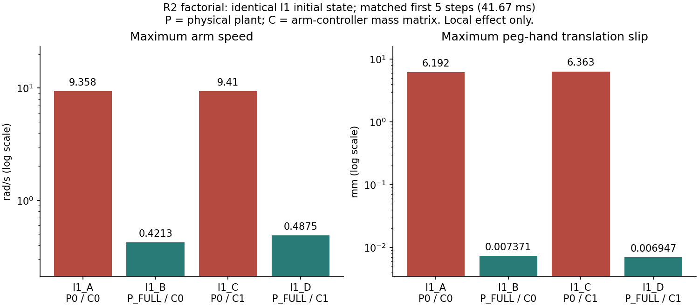
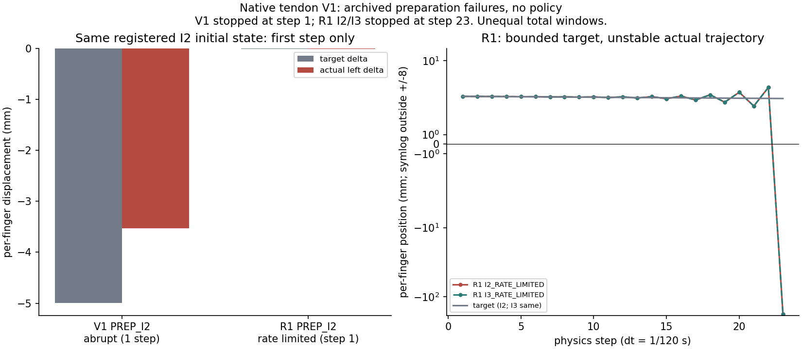
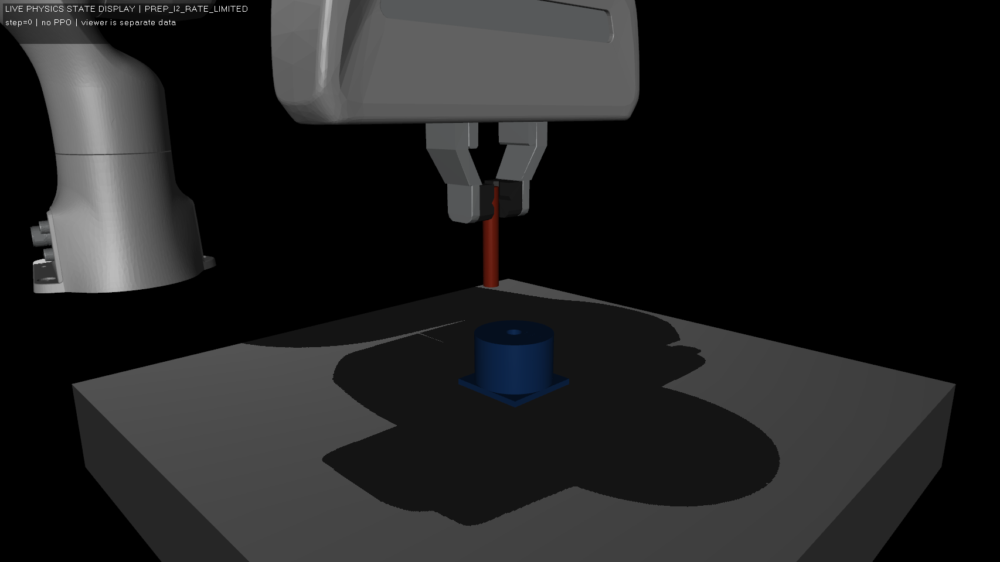
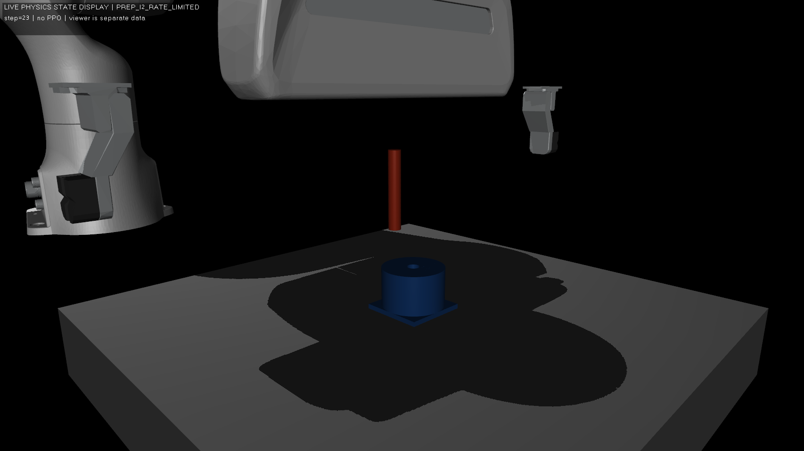

# G4-SIM2SIM-CLOSEOUT：工程里程碑结项与证据保全

日期：2026-10-27，Asia/Seoul。仓库 `dreamerToTOE/isaac-factory-repro`，分支 `main`。
本地和远端起点均核验为 `85017ba626e123ed95c397c32c4b852e9118abe4`。

**当前适配型 Sim2Sim 工程里程碑为 PARTIAL；当前夹爪路线以负面结果关闭；任务级零样本迁移未证明。**
源 PPO 训练、独立推理链路、目标环境执行以及部分局部动力学改进成立；持续物理抓持和有效 MuJoCo 插入未成立。原生 tendon V1 在已测配置下被拒绝。不能将全部 G4 写成失败，也不能将其描述成成功的零样本迁移。

本阶段仅整理文档、读取归档、制作数值图和做 CPU 完整性核验。没有运行 MuJoCo 积分、actor、策略回合、训练、checkpoint 反序列化或新的夹爪实验。历史阶段结论保留原样；本结项决定不追溯改写任何门禁。

## 1. 研究目标与源基线

目标是将源 Isaac Lab / PhysX 的同一份冻结 PPO 策略迁移至 MuJoCo Panda PegInsert，不训练或微调，检验跨引擎物理接触操纵能力。源环境为 Isaac Lab v2.1.1（`90b79bb2d44feb8d833f260f2bf37da3487180ba`）/ Isaac Sim 4.5.0 / Factory Franka **Panda**，不是 FR3。

G2 使用官方 PPO、64 环境、training seed 0、horizon 128，完成 200 epochs / 1,638,400 transitions。epoch-200 独立确定性评估 ever/terminal 均为 **280/288 = 97.22%**。evaluation seeds 1001/1002/1003 各 96 回合，分别 95/96、96/96、89/96；这些不是 training seeds。

该数字仅是**源 PhysX Factory 原几何成功率**，不是 MuJoCo 迁移结果。原训练 child exit 未知及 TensorBoard 尾端 epoch200 缺失的限制也保留；训练完成由审计、checkpoint 和官方结束标记交叉确认。见 [G2 报告](RESULTS_G2.md)及[原评估摘要](../evidence/g2/analysis/evaluation_summary.json)。32-env seed0/1 训练属于其他保留实验，不混入本次 G2 源基线分母。

冻结主 checkpoint：

```text
f5e9da77553f51c8fad430eb254fbeabc8963425d89cdc28af8f071944b08f2f
```

G4-I0→I1→I2 完成接口审计、独立推理实现和同源闭环集成。I2 独立执行的另一组 288 回合也得到 280/288，比较口径是 **descriptive unpaired**，不是逐回合 RNG 配对或新的训练种子统计；不得合并成 560/576 来夸大证据。源仿真策略 15 Hz；I2 实测整条 wall 闭环约 3.47 Hz，不是硬实时证明。见 [I0](REVIEW_G4_I0.md)、[I1](REVIEW_G4_I1.md)、[I2](REVIEW_G4_I2.md)及[I2 数值摘要](../evidence/g4_i/i2/results/summary.json)。

## 2. 跨引擎架构与不能消除的差异

```text
冻结 checkpoint / RMS / LSTM
    → 独立 actor 进程（原19D输入 / 原6D动作）
    → EMA / 每物理步 Cartesian target / task PD + nullspace
    → 7轴限幅力矩 / 实体双指驱动
    → MuJoCo 3.5.0 Panda + 独立自由 peg + 有开口的 hole
    → 物理步 FD / 原观测 / 几何成功与物理质量分开记录
```

S0 审查为 COMPLETE / CONDITIONAL。S1A 的**精确 Factory 重建**仍 BLOCKED、原 S1B 门为 NO-GO：原 NVIDIA 资产转换/分发权限没有建立，PhysX cooked SDF 和实际源施加力矩等未知。后续 S1B 是另行授权的 **ADAPTED ZERO-SHOT SIM2SIM**，没有推翻该许可和保真结论。见 [S0](REVIEW_G4_S0.md)、[S1A](REVIEW_G4_S1A.md)。

目标使用 MuJoCo **3.5.0** 和 Apache-2.0 Menagerie Panda，固定 commit `8161bba264d7fa7c99ca301e91e7fb44737676ad`。机器人 7 臂 + 2 指；自由 peg 使 nq/nv=16/15。独立原创 peg 直径 7.986 mm、质量 0.019 kg；孔直径 8.1 mm，256 个保孔凸扇区和实体孔底，名义径向间隙 57 µm，理想内弦侵入约 0.305 µm。原 raw Factory 直孔段测得间隙下界 505.921 µm 属于**不同参考几何**，不得将其与 57 µm 视为转换误差。没有分发 NVIDIA 原始/衍生 mesh，没有焊接 peg，也没有以单凸包填死孔。

资产、接触、惯量、驱动与离散数值方法不能声称 PhysX 等价。原模型和历次变体全部保留；P_FULL 不是悄悄替换默认 S1B 模型。见 [S1B 适配协议](REVIEW_G4_S1B.md)、[模型来源](../models/g4_s1b/README.md)。

## 3. 冻结接口：含义、时序和边界

| 层 | 保持的确切含义 | 证据/限制 |
|---|---|---|
| actor | 原 checkpoint；2层1024 LSTM、before-MLP/layer norm、512/128/64 ELU MLP；确定性 clipped μ | [身份与形状](../evidence/g4_i/i0/checkpoint_and_source_identity.json)；没有重训/微调 |
| RMS / recurrent | FP32 `(obs-mean)/sqrt(var+1e-5)`、clip[-5,5]；统计冻结；h/c shape `[2,batch,1024]`，episode列结束清零 | [策略实现](../scripts/g4i1_policy.py)；保留源 discarded Normal.sample 的 RNG 消耗 |
| 19D 顺序 | 相对 noisy reset hole-tip 的 TCP world position 3；world quaternion **wxyz** 4；world linear FD 3；world angular FD 3；EMA cache 6 | [contract](../scripts/g4s1b_contract.py)；raw quaternion不作符号规范化；角FD用相对四元数 shortest-sign axis-angle |
| reset | FD归零；hole tip = root + R·[0,0,0.025] m；episode noise一次固定；action cache按原位置/yaw分支初始化 | 初始cache不强行归零/裁剪；不是感知部署，使用特权仿真状态 |
| 6D action | μ clip[-1,1]；cache = .2·new + .8·old；平移增量 .02 m × cache，world旋转增量 .097 rad × cache | 每物理子步从当前pose重建target；不是每步累积积分指令 |
| target约束 | 相对固定 reset action frame xyz±.05 m；目标 roll=3.14159、pitch=0，yaw保留源分支 | [controller contract](../evidence/g4_s/s1b/controller_contract.json) |
| 臂控制 | task KP=[100,100,100,30,30,30]，KD=2sqrt(KP)；平均左右finger-body-origin Jacobian；动态一致nullspace（10/6.3246） | 不偷换TCP Jacobian；目标端NumPy float64不能冒称逐位PhysX一致 |
| 执行器 | 软件±100 Nm；实际目标motor前4轴±87、后3轴±12 Nm；requested/software/integration actuator分开 | 源 PhysX实际施加力矩仍UNKNOWN，配置限幅不等于测量 |
| 时序 | 物理 dt=1/120 s，decimation=8，策略模拟15 Hz；FD每物理步更新 | 无新增前馈/控制增益；目标引擎驱动是显式适配 |
| 夹持与成功 | 两实体指、自由peg、真实接触；原几何谓词独立计算 | 夹爪实现按变体分别归档，不能称与源等效；几何成功≠接触质量通过 |

原几何成功函数的 FP32 条件为 `||held_xy-fixed_xy|| < .0025 m` 且 `held_z-fixed_z < .025*.04 m`；它没有自动证明连续接触或物理插入。保持该谓词原样，另外报告 physical insertion / grasp / penetration / joint limits，不用放宽门槛制造成功。

## 4. 按时间归档的工程与失败结论

下表保留原机器门禁文字，PASS 的范围见原报告；“失败”列描述物理结果，不把有意义的诊断工程 PASS 改写成实验成功。

| 阶段 | 原工程门 | 实际完成/失败与科学边界 | 直接证据 |
|---|---|---|---|
| S0 / S1A | COMPLETE / CONDITIONAL；COMPLETE / 精确重建BLOCKED | 资产/接口审查完成；精确复刻许可与cooked几何门未通过 | [S0 gate](../evidence/g4_s/s0/summary.json) / [S1A gate](../evidence/g4_s/s1a/reconstruction_gate.json) |
| S1B | G4_S1B_PASS | 适配环境、数学链、518次无策略物理步；未执行actor，不是策略成功 | [gate](../evidence/g4_s/s1b/reconstruction_gate.json) |
| S2A | G4_S2A_PARTIAL | seed1001：149次策略决策、1192策略物理步；全长1条但技术有效0条；振荡、脱抓、越限、无插入；1002/1003未运行 | [gate](../evidence/g4_s/s2a/completion_gate.json) / [报告](REVIEW_G4_S2A.md) |
| S2A-R1 | G4_S2A_R1_PASS | 10×16步无策略对照；发现饱和前放大；body惯量适配改善短窗；未修复全任务 | [gate](../evidence/g4_s/s2a_r1/completion_gate.json) / [报告](REVIEW_G4_S2A_R1.md) |
| S2A-R2 | G4_S2A_R2_PASS；CANDIDATE_PARTIAL | 3初态×2×2共12条；物理惯量是局部效应主要来源；I1/I2部分长窗通过，I3晚期失败 | [gate](../evidence/g4_s/s2a_r2/completion_gate.json) / [报告](REVIEW_G4_S2A_R2.md) |
| R2-R1 | G4_S2A_R2_R1_PARTIAL | 被动臂也失败；移除指惯量不改善；I3_FULL_C1请求212没有最终结果/exit，不能回填或重试 | [gate](../evidence/g4_s/s2a_r2_r1/completion_gate.json) / [报告](REVIEW_G4_S2A_R2_R1.md) |
| R2-R2 | G4_S2A_R2_R2_PASS | 0新积分；核实自由运动隐式PD算术与EFC映射，完成监督器合成测试；新修正CANDIDATE_BLOCKED | [gate](../evidence/g4_s/s2a_r2_r2/completion_gate.json) / [报告](REVIEW_G4_S2A_R2_R2.md) |
| R2-R3 | G4_S2A_R2_R3_PARTIAL | 177+154+235=566步仪器化；区分积分/forward接触量；未建立唯一根因或选定修正 | [gate](../evidence/g4_s/s2a_r2_r3/completion_gate.json) / [报告](REVIEW_G4_S2A_R2_R3.md) |
| GRIPPER-V1 | G4_S2A_GRIPPER_V1_PARTIAL；NATIVE_GRIPPER_PARTIAL | 静态sum-tendon映射PASS；I2第1步穿透1.901796 mm；I3实际初态无效 | [gate](../evidence/g4_s/gripper_v1/completion_gate.json) / [报告](REVIEW_G4_S2A_GRIPPER_V1.md) |
| GRIPPER-V1-R1 | G4_S2A_GRIPPER_V1_R1_PASS；NATIVE_GRIPPER_REJECTED | 状态隔离、有效初态和46/46账本通过；I2/I3准备各23步FINGER_LIMIT；两个DIAG未启动 | [gate](../evidence/g4_s/gripper_v1_r1/completion_gate.json) / [报告](REVIEW_G4_S2A_GRIPPER_V1_R1.md) |

S2A 的实验 exit 2 与 actor exit 0 分开；后续诊断正常 exit 0 只表示有监督地结束。R2-R1 的历史 613 requests / 612 results 和未知child退出保留。不能把上述数据混为同类策略回合，也不能从唯一无效全长轨迹的零成功估计目标域成功概率。

## 5. 问题 A：动力学与控制的局部改进

首次失稳定位到原S2A第2物理步（16.667 ms）：J7速度从 +0.5047 反转为 −5.1497 rad/s；该步请求/实际 −4.605 Nm，尚未触及 ±12 Nm。第3步才饱和，第4步右pad正力消失。因此“饱和是最初且唯一原因”被时序反驳；提高限力的D08反而恶化。前8步只有一次策略动作/EMA更新，不能把每物理步反馈振荡解释成actor不断改命令。

物理惯量适配 P_FULL 对11个映射机器人body各加 `.01 I kg·m²`，不改质量、CoM和碰撞。静态同姿态J7有效惯量由 .00571095 增至 .03058901 kg·m²，1 Nm响应由175.10降至32.69 rad/s²。质量矩阵条件数616.86→151.30。该修改贡献 `ΔM=Σ Jωᵀ(.01I)Jω`，不是 joint armature `.01I7`；后者构型耦合和末端质量作用不同，不能互换。显式离散阻尼指标13.8116→1.95766仅是机制提示，实际implicitfast含接触、饱和和非线性反馈，不是全局稳定证明。

R2用 P0/P_FULL 与 controller C0/C1 的2×2对照隔离：A=P0/C0，B=P_FULL/C0，C=P0/C1，D=P_FULL/C1。**C只改变臂控制器所见质量矩阵；原手指预测器仍使用physical full M**，不能将其描述成全控制器解耦。



I1统一前5步（41.667 ms）A/B/C/D最大臂速分别9.357704/.421336/9.409768/.487546 rad/s；peg-hand平移滑移6.191532/.007371/6.362574/.006947 mm。B相对A的臂速/滑移分别减少约95.50%/99.88%。这是同初态确定性局部对照，没有重复统计置信度，也不比较5步与235步的极值。其他初态共同窗口为I2前3步、I3前4步，原数据见 [factorial_effects](../evidence/g4_s/s2a_r2/numerical_review_v2/factorial_effects.json)。

## 6. 问题 B：晚期接触失败和夹爪路线关闭

P_FULL缓解臂振荡后，I3仍在晚期失去接触。R2-R3 BASE_I3_ACTIVE的第175步最后通过所有质量门；175/176/177步积分阶段有4/3/2个接触、16/12/8接触标量行，另有1个等式行。接触集合早在34–70步已经变化，176不是第一次变化。176步步后左pad正力为零，177步旋转.05884 rad和穿透1.00077 mm越门。被动臂I3也在154步失败（最大臂速仅.00260 rad/s），因此主动臂命令不是必要条件；这不证明臂运动完全无影响。

自由运动隐式PD方程已核实：`[I+dt(Kd+dtKp)A]f=Kp(qd−q)−(Kd+dtKp)v`，`A=(M⁻¹)ff`。I3第一步有效质量约.0149277 kg，raw PD −25.798 N变为实际约−.195670 N，重算残差为零。这只说明该自由运动算术与归档一致，未包含完整接触/偏置耦合，不是接触稳定证明。condim4接触按`efc_address`取4条标量约束；不能把contact下标当EFC行。

仪器化在原`mj_step`返回、额外`mj_forward`之前记录solver量。步末qpos/qvel与该步求解约束有阶段差异；177步积分接触广义力两指约0/+.07177 N，后续forward的左pad 74.56 N不是已积分力，更不是冲量。173–177步solver迭代2/5/5/5/8，无足够证据认定不收敛。**接触/约束转换与失败相关，唯一根因未建立。**

V1使用原生单位系数sum tendon `L=qleft+qright`，目标为`2*q_target`，每指moment arm +1；移除旧finger equality，允许差动而非硬同步。历史配置 Kp3750 N/m、Kv86.5 N·s/m、±40 N和1/120 s仅用于说明已测身份，不是下一版推荐。静态传动/力限通过，骤闭I2却在第一步穿透1.901796 mm；I3使用错误初态，该执行必须INVALID_INITIAL_STATE，不能归因给注册I3物理条件。

R1不改该驱动模型，只将参考每步最多减少10 µm；首次正pad力后冻结目标，连续10次双侧接触再额外10次保持。两组有效初态均未进入接触取得/hold，23步越限早停。每指目标只减少.23 mm，实际最后位置约−177.324 mm、速度−21.989 m/s，最大单步位移183.242 mm；20–23步积分执行器力约+19.14/−26.19/+35.83/−40 N。



左图仅比较相同注册I2初态的第一步；右图是R1的23步记录。骤闭仅1步、限速23步，不能以不等窗口极值推断无偏性能优劣。参考限速没有约束实际速度或离散动力学；步后无正接触/穿透不等于高速步内无碰撞。

原生V1被拒绝的范围是**该固定模型、步长及R1协议下的I2/I3**，不是所有原生执行器或所有MuJoCo夹爪。既有P_FULL仍CANDIDATE_PARTIAL；新修正仍CANDIDATE_BLOCKED；没有通过的替代候选。

## 7. 问题 C：状态完整性、监督和可复现性

V1 I3的状态变更发生在哪个调用仍UNKNOWN。本次结项不重新追查或运行实验。历史R1共享路径无积分复现没有复现失配，不能把责任指定给viewer。

已实施的R1工程修正为：权威物理与GUI各用独立model/data，只单向复制显示；每次真正积分前按位核对完整integration-state及显式授权的ctrl变化；模型选定物理数组另有指纹。I2/I3的16个状态篡改负控在积分前拒绝；46/46真实记录状态链通过。选定数组指纹不等于所有不透明plugin内存证明；图形截图也不是物理接触测量。

监督器使用持久化request/result和真实child wait；crash/signal/timeout/unknown分开；没有自动重试或伪造缺失结果。历史I3_FULL_C1账本缺口不补写。新的可靠监督不能反过来消除历史未知。

以下为**既有、已过隐私QA的截图**，没有新渲染或积分。来源和SHA见 [image_qa](../evidence/g4_s/gripper_v1_r1/image_qa.json)，均为独立显示副本的 `LIVE_PHYSICS_STATE_DISPLAY`，只展示保存时的状态。旧V1受污染截图继续不展示。





## 8. 可复现索引、哈希与本次 CPU 回归

机器总览 [milestone_summary.json](../evidence/g4_s/closeout/milestone_summary.json) **读取原机器门禁字段**，并保存每个引用文件SHA；不以本文摘要覆盖原门禁。所有原始轨迹、历史报告、失败账本和模型变体原位保存，详见[证据入口](../evidence/g4_s/closeout/README.md)。

保全快照覆盖起点所有Git跟踪文件、外部固定Panda的78文件、四份原USD、固定源/配置和已知无关checkout文件；`work/runs`下全部76个`.pth`（16,179,528,601 bytes）逐文件SHA256只读核对。三份主要checkpoint也与历史清单一致，不进行反序列化。检查范围是该明确归档根目录及引用外部文件，不声称扫描整台机器所有任意checkpoint。

源代码与配置身份见[起点清单](../evidence/g4_s/closeout/preservation_before.json)和[核验后清单](../evidence/g4_s/closeout/preservation_after.json)。例如原推理、S1B、P_FULL、native V1、R1状态/参考脚本的SHA均在`tracked`映射中，未修改；外部源文件SHA在`external`中。旧case正文自第1节起逐字保留，只更新开头状态并增加外部读者导读。README历史导航标为历史，防止把旧“下一步”当当前授权。

本次回归仅为新的6项stdlib CPU用例和文档/证据核验：原门禁与源分母一致、虚假迁移成功拒绝、历史门改写拒绝、证据/checkpoint篡改拒绝、缺失链接检测、禁止runtime导入。完整性脚本检查所有本次文档相对链接、历史正文保留及允许修改清单；对比图只解析历史JSON/JSONL。没有调用全仓pytest、历史actor/physics测试或MuJoCo编译；不能将历史803 passed等数字写成本次回归结果。本次结果见 [cpu_tests.txt](../evidence/g4_s/closeout/cpu_tests.txt)、[consistency_checks.json](../evidence/g4_s/closeout/consistency_checks.json)。

在仓库根目录下，只读复核命令（新输出用独占创建，已存在会拒绝覆盖）：

```bash
python3 tests/test_g4_sim2sim_closeout.py
```

`scripts/g4_sim2sim_closeout.py snapshot/build/check`和`plot_g4_sim2sim_closeout.py`是本阶段的生成过程记录，不应覆盖已提交证据重跑。`snapshot`还要求HEAD为上述起点；未来需要重新保全时另建输出目录/新任务。本次没有下载、转换或分发新资产。

## 9. 唯一建议的未来架构（未实施、未测试）

建议另立项研究**第二代具有可推导物理传动的双指MuJoCo夹爪**：从执行器/传动坐标、力和能量一致性开始推导，对耦合系统的有效手指质量/惯量与最小动态尺度作建模；将物理阻尼和执行器限位/限力明确进入模型，而非只限制参考增量。需要验证所选积分/离散控制组合在自由运动、触碰和约束切换下的适用稳定范围，再设计接触感知的接近→取得→保持状态机。

下一任务应先独立验证指端轨迹、双侧接触、穿透和关节限位；多个注册初态均完成稳定准备并保持之后，才考虑移动手臂。模型/状态守卫、求解阶段仪器和持久化监督应继续保留。这里**没有选择新增益、步长、接触参数或控制器实现**，也没有承诺该架构必然有效。

未来若获授权仍须保持冻结PPO权重、原19D/6D接口、物理Panda、自由peg、实际指端接触和原成功谓词；不能以焊接、kinematic peg、禁碰撞或放宽门槛替代。实现和任何策略测试须另行授权，不自动启动。

## 10. 最终结项决定

```text
G4_SIM2SIM_MILESTONE=PARTIAL
G4_CURRENT_GRIPPER_ROUTE=CLOSED_WITH_NEGATIVE_RESULT
G4_S2A_R3=NO_GO
G4_S2B=NO_GO
ROOT_CAUSE=PARTIALLY_CHARACTERIZED_NOT_UNIQUELY_IDENTIFIED
TASK_LEVEL_ZERO_SHOT_TRANSFER=NOT_DEMONSTRATED
```

学习与理论考核仍PENDING；[面试指南](case_studies/SIM2SIM_INTERVIEW_GUIDE.md)是证据支撑的准备材料，不是本人已通过考核的证明。[工程案例](case_studies/SIM2SIM_PANDA_CONTROL_INSTABILITY.md)保留完整调查链。

本任务止于证据保全与文档发布，不进入R3、S2B、任何Sim2Sim调试、训练、GearMesh或NutThread。推送仅允许正常fast-forward；发布核验记录见 [publication.json](../evidence/g4_s/closeout/publication.json)，最终交付HEAD及独立远端SHA在交付答复中列出，避免文件自引用自身commit哈希。
