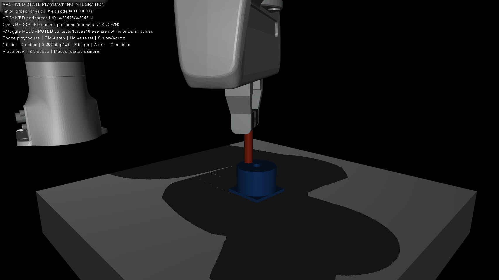
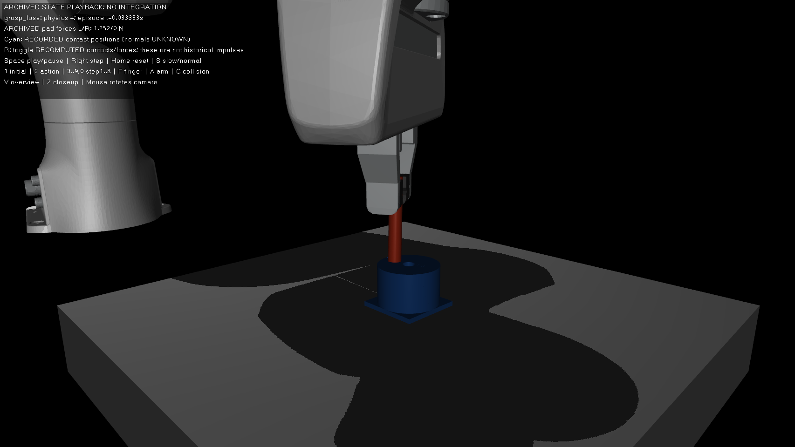
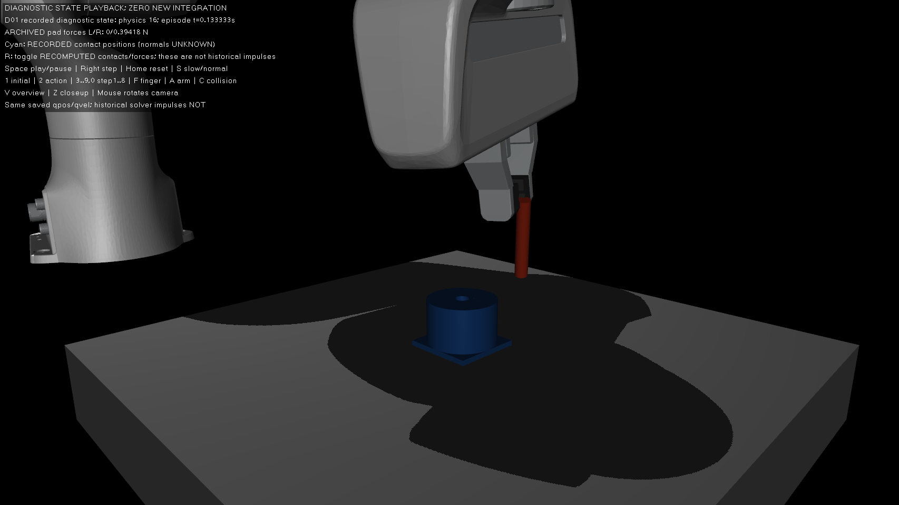
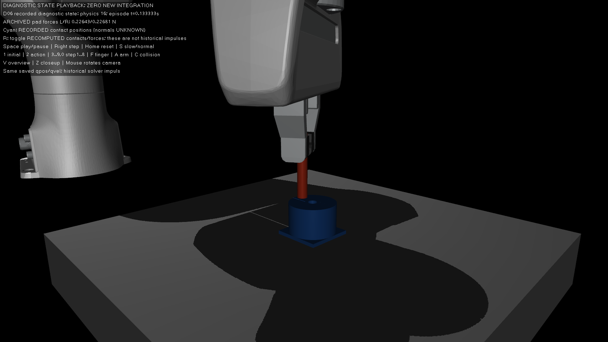
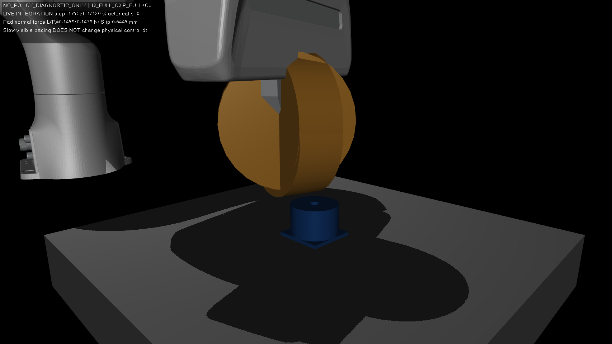
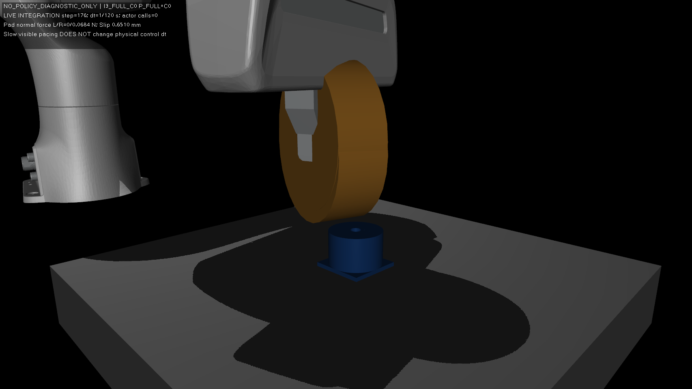
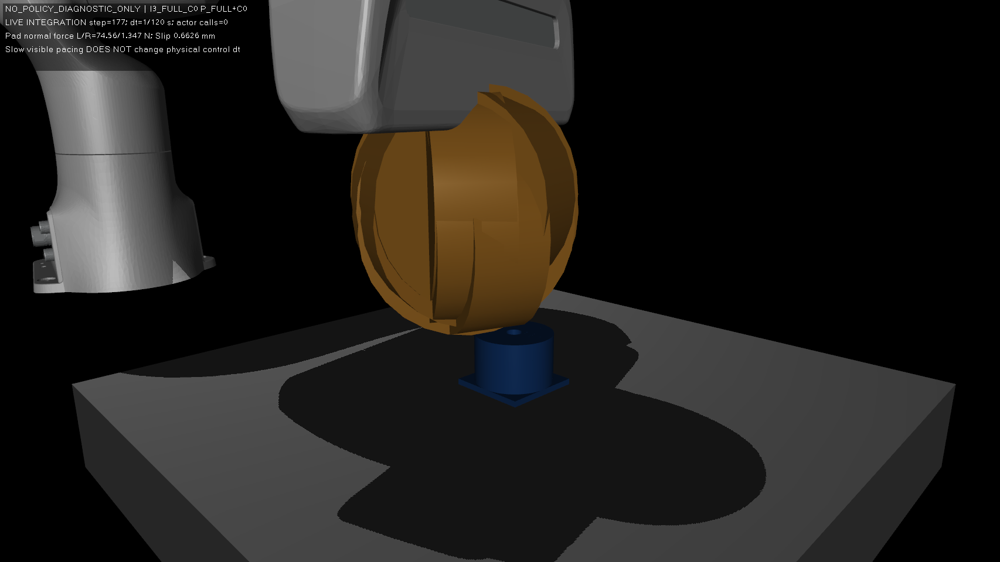

# Panda Sim2Sim：冻结 PPO 策略迁移后的控制振荡与脱抓

> **状态：INVESTIGATING — ROOT_CAUSE_PENDING / SOLUTION_PENDING / VALIDATION_PENDING**
>
> 首次记录：2026-10-26；仓库：`dreamerToTOE/isaac-factory-repro`。
>
> 本文是**正在推进的真实工程排障案例**，不是已解决的成功案例。G4-S2A-R1 已完成可见 GUI、归档重建及10×16步无策略对照，阶段 **G4_S2A_R1_PASS**；**当前 G4-S2B NO-GO**。没有修复后的完整PPO任务评估，未修改或微调PPO。
>
> R2已完成三初态2×2的12条预注册无策略对照及独立数值复核：plant惯量抑制初始振荡，但第三初态晚期抓持/穿透失败。**CANDIDATE_PARTIAL；R3仍NO-GO**，新证据见第10节。

## 1. 背景：为什么要做 Sim2Sim

使用 Isaac Lab v2.1.1 / Isaac Sim 4.5.0 (PhysX) 的 **Factory Panda PegInsert** 任务训练官方 PPO。冻结的 G2 epoch-200 策略在源 PhysX 环境的独立确定性评估中，原 Factory **几何判据** ever/terminal 成功率均为 **280/288 = 97.22%**。

研究目标是将**同一份 PPO checkpoint** 零微调部署到 **MuJoCo 3.5.0** 的 Panda PegInsert 中，判断策略是否仍能完成真实的接触插入。本项目采用明确标记的 **ADAPTED ZERO-SHOT SIM2SIM**：目标环境使用固定 MuJoCo Menagerie Panda 和独立建模的 peg/hole，不能声称 PhysX 与 MuJoCo 的资产、惯量、接触物理完全一致。

冻结 PPO checkpoint SHA-256：`f5e9da77553f51c8fad430eb254fbeabc8963425d89cdc28af8f071944b08f2f`。MuJoCo 目标生成 XML SHA-256：`c60c33ee11eb4806294aee259f97d987308b23e83da62f2219cbc9950fb195c9`。

对应工程验收：[S1B 环境报告](../REVIEW_G4_S1B.md)（环境和接口 PASS，不是策略成功）、[S2A PPO 闭环报告](../REVIEW_G4_S2A.md)（PARTIAL）。

## 2. 问题：策略可运行，但早期物理失稳（OBSERVED）

S2A 使用 seed **1001** 完成首个 **149 次 PPO 决策 / 1192 次 MuJoCo 物理步**，原冻结策略、19D 观测、6D 动作、EMA、LSTM、RMS 与跨进程推理桥均通过审计；初始化抓握的末 10 个闭指步双侧接触有效。机器人进入策略控制后，很快发生脱抓和振荡。

| 观察事件 | 数值与时刻（仿真时间，排除 0.25s 预夹持） | 直接证据 |
| --- | --- | --- |
| 脱抓开始 | **第 3 物理步 / 0.025s**：peg-hand 滑移超过 1mm | [独立轨迹复核](../../evidence/g4_s/s2a/independent_trace_review.json) |
| 双侧夹持丢失 | **第 4 物理步 / 0.0333s**：右 pad 正接触力消失 | [S2A 报告](../REVIEW_G4_S2A.md) |
| 首次夹指越限 | **第 61 物理步 / 0.5083s** | [独立轨迹复核](../../evidence/g4_s/s2a/independent_trace_review.json) |
| 首次机械臂关节越限 | **第 76 物理步 / 0.6333s** | [独立轨迹复核](../../evidence/g4_s/s2a/independent_trace_review.json) |
| 手部与支撑体严重接触 | **第 685 物理步 / 约 5.708s**：最大瞬态全接触穿透约16.9174mm | [独立物理复核](../../evidence/g4_s/s2a/independent_physics_review.json) |

整回合最大机械臂关节越限 **0.321998 rad**；最大夹指越限 **0.873067mm**；最大关节速度 **63.6524 rad/s**；最大 peg-hand 平移滑移 **7.38673m**；arm motor 达到饱和的样本比例约 **45.9132%**。第一策略动作之后的 J7 请求力矩一度约 **+58.96 Nm**、**−107.76 Nm**，积分阶段电机力矩却限制在 **±12 Nm**。

没有发生 peg/hole 接触，也没有几何、物理插入或接触质量成功。唯一完成的回合存在明显关节越限和脱抓，**不计作通过技术门禁的有效回合**：技术有效回合数为 **0**；种子 1002、1003 因预设门禁被停止，不能从单次失败估计迁移成功概率。

保留 [S2A 机器验收门禁](../../evidence/g4_s/s2a/completion_gate.json)、[原始回合摘要](../../evidence/g4_s/s2a/run_20261026T140338/summary.json)、[归档清单](../../evidence/g4_s/s2a/run_20261026T140338/collection.json) 及 [失败起点图](../../evidence/g4_s/s2a/failure_onset.png)。

## 3. 为什么这是有价值的工程故障

- **运行成功不等于迁移成功**：PPO actor 正确加载并连续控制 149 步，不能代替机械臂稳定性与接触插入成功。
- **早于插孔的失效**：策略开始后最初几十毫秒内先出现动力学响应、振荡和脱抓，因此第一优先不是孔几何优化，而是控制、执行器和夹持接触。
- **执行器命令与实际响应不同**：`requested`、软件限幅、MuJoCo `actuator_force` 和广义力分别保存；源 PhysX 的实际施加力矩仍 **UNKNOWN**。
- **跨引擎不应要求逐位物理一致**，但观测含义、动作控制语义以及明确的任务有效性检查必须成立；物理差异需要可量化、可验证。

## 4. 竞争假说（S2A起始判断；R1分级见下节）

| 假说 | 现有支持 | 尚需反证/实验 |
| --- | --- | --- |
| Menagerie Panda 与原 Factory 惯量/转动惯量差异 | 原 Factory 还有运行时各 body 加 `0.01I` 的行为，MuJoCo 目前未获等效认证 | 匹配同一初态、相同请求力矩下的加速度与质量矩阵，隔离 inertial-only 差异 |
| 关节执行器限幅与控制律互相作用 | 首几个物理步腕部请求大幅超过 12Nm，实际执行限幅；大量时间处于饱和 | 比较限幅命令与反馈、固定输入反事实；不能把 PhysX 配置限幅当实际施加力矩 |
| 任务空间 PD / nullspace / 每子步离散控制导致不稳定 | 高频速度反转，且会每个 1/120s 子步更新目标和 J/M | 固定目标、拆分 task/nullspace torque、控制变量短步响应 |
| 指尖 PD、接触软约束与重力/夹持适配失配 | 第4步失去正 pad 接触；S1B 明确 finger PD 只是 target-engine adaptation | 无机械臂动作时的夹持对照、固定参考动作下接触/滑移对照 |
| 初始 reset 分布、坐标/四元数或 FD 误差 | 当前只有一个随机初态；不同引擎物理响应不同 | 原始状态和记录中的 19D/6D 接口对照；不能把“测试通过”提升为全时序严格等价 |

[独立接口审阅](../../evidence/g4_s/s2a/independent_trace_review.json) 显示 RMS/推理请求响应匹配、EMA 原始 FP32 最大差约 `9.54e-8`，所有 1192 个 target 的最大差约 `2.42e-7`；这削弱部分纯映射错误的解释，但**不能证明**全量 Jacobian、质量矩阵、接触模型或闭环控制精确一致。

## 5. G4-S2A-R1：可视化、动力学与隔离对照（已执行）

**G4_S2A_R1_PASS**仅表示诊断工程门完成，不表示Sim2Sim成功或根因已唯一证明。
真实Ubuntu X11桌面MuJoCo3.5.0窗口已打开，实际窗口截图和`IsViewable`记录保留。
只读归档viewer支持播放/暂停、0.1/0.25/1倍速、单步、初态和故障事件跳转。
图上青色标记是记录的接触位置；可选新重算contact graphics另行标注。
加载qpos/qvel再`mj_forward`不能恢复历史solver warmstart/接触冲量，不能称精确动力学重放。

### A. 视觉故障重建





step2/0.016667s时，J7速度已由+.505反转至−5.150rad/s，请求/实际力矩−4.605Nm，尚未饱和。
step3才首次达到12Nm motor cap并超过1mm滑移，step4失去双侧接触。
前8个物理步只有**一个不变的PPO/EMA动作**，J7直接nullspace torque≤8.9e−17Nm；
PD阻尼项−Kdω的负号正确，但反馈D项快速反转放大。没有早期四元数sign jump。

[首八步完整数值](../../evidence/g4_s/s2a_r1/archived_analysis/first_eight_steps.json)
包括q/qvel/区间加速度、TCP误差/target、task/null/requested/software/实际积分force/qfrc、pad力与滑移。
历史完整J/M和solver qacc未保存，明确UNKNOWN。部分截图曾被桌面通知或其他窗口遮挡，
未作为公开证据冒充；完整原图私下保留及SHA可追溯，公开帧经过逐张检查。

### B. 动力学调查

只读核对Factory USD和源码，确认runtime给body旋转惯量加`0.01I kg·m²`。
这不是关节armature。目标缺少源的额外sensor/TCP body，finger质量也不同，不能把以下敏感性模型称为精确PhysX重建。

初态J7在7臂DOF子块中`1/(M7⁻¹)77`：冻结模型`.005711kg·m²`；11个映射robot body各+.01I后`.030589`；
7个臂关节armature+.01后`.015982`。相同1Nm增量角加速度分别约175.10、32.69、62.57rad/s²。
独立验证body惯量拉回`Σ.01 JωᵀJω`，与armature对角矩阵不等价。

[静态动力学证据](../../evidence/g4_s/s2a_r1/dynamics/static_audit_20261026_v2/matched_dynamics.json)
及[armature范围澄清](../../evidence/g4_s/s2a_r1/diagnostic_analysis/static_armature_scope_clarification.json)。
局部理想显式阻尼指标13.81→1.96，仅提示惯量/离散反馈的关系，不是实际MuJoCo非线性稳定性证书。
原PhysX实际施加力矩和完整runtime M仍UNKNOWN。

### C. 预注册无策略对照与before/after

10个预注册变体，每个**16步**，实际共160步，真实viewer中执行。
全部子进程exit0，新增PPO调用0，实际physics调用累计`.126s`；协调器wall`45.802s`。
使用同一归档初始q/qvel，输入同样的前两条**归档动作**，底层反馈重新计算。
变体上的策略观测与μ没有重新推理，因此不能称修订后的PPO闭环任务表现。

| 变体（均DIAGNOSTIC_ONLY） | 最大滑移mm | 双侧接触首次丢失 | 最大arm速度rad/s |
|---|---:|---:|---:|
| D01 冻结配置fresh-start对照 | 14.241 | step4 | 9.634 |
| D02 零arm torque | .002791 | 未发生 | .0000125 |
| D03 固定初始TCP target | 16.168 | step8 | 13.961 |
| D04 仅task torque | 11.830 | step4 | 9.441 |
| D05 仅nullspace torque | .102875 | 未发生 | 1.183 |
| D06 11个body各+.01I | .088564 | 未发生 | 1.109 |
| D07 仅arm7 armature+.01 | 5.069 | step3 | 3.969 |
| D08 arm motor cap改为100Nm | 约34,982,549 | step3 | 78.293 |
| D09 零臂力矩+affine finger PD | 25.211 | step3 | .382 |
| D10 零臂力矩+solref .02 | .002053 | 未发生 | .00000962 |

D08的数十公里物体位移是严重数值/物理失真，即使有限、无warning也不能算物理有效。
D09仍可通过指接触反力带动臂，不等于机械固定。D10的实际positive solref仅从refsafe钳制后的`.016667`改到`.02s`。

D06相对同样fresh-start的D01，最大滑移降低约**99.38%**、臂最大速度降低约**8.69倍**，
仅是0.133333s窗口的局部干预结果。D01与历史前16步不精确一致（滑移14.241vs11.840mm），
故所有对照都与D01比较，不以历史整回合极值作“修复后改善率”。

下图来自**已保存诊断状态的零积分真实GUI回放**，不是额外积分或修复后PPO任务图；同为step16。





每个积分变体都创建真实native窗口并sync，但mapped/IsViewable不等于持续未被遮挡；
部分原积分截图被其他应用覆盖；公开只保留已核查的D01两张同期帧，其余18张原积分PNG统一私留并留SHA（并非声称每张都遮挡）。上面的单独回放图避免将被遮挡截图冒充可见实验。

[完整对照与哈希](../../evidence/g4_s/s2a_r1/diagnostic_analysis/comparison.json)、
[独立力矩/事件复核](../../evidence/g4_s/s2a_r1/archived_analysis/diagnostic_review.json)。

### D. 根因分级

- **SUPPORTED_BUT_NOT_PROVEN**：H1惯量失配、H3离散反馈/plant耦合。D06是同时影响plant与controller M的干预，尚未隔离两者。
- **SUPPORTED_BUT_NOT_PROVEN**：H2过度加速度与H5指驱动/接触负载耦合；H5尚未分离指惯量、equality和solver反应。
- **CONTRADICTED（具体子假说）**：饱和是最初且唯一原因；直接J7 null torque是初始唯一驱动；前8步四元数sign jump。
- **INCONCLUSIVE**：H4广义动态失配、H6 reset分布、H7完整观测/FD跨状态影响。没有据此宣布不存在任何接口问题。

根因仍为多机制候选，完整任务**ROOT_CAUSE_PENDING**。

## 6. 根因与修复状态（R1时点；R2见第10节）

**ROOT_CAUSE_PENDING**：控制器/惯量/执行器/夹持/观测多因素的贡献尚未通过隔离实验确定。

**SOLUTION_PENDING**：D06仍是`DIAGNOSTIC_ONLY`。可提出源惯量规则启发的`TARGET_ENGINE_ADAPTATION`候选，
明确映射body惯量/CoM并进一步分开plant/controller M效应；尚不能实施为正式S1B配置。
未发现足以声称`SOURCE_SEMANTIC_BUG_FIX`的已证实策略接口bug。不能把body惯量改成关节armature，
也不能以取消饱和作为修复。任何后续更长窗口/姿态/有限PPO验证均须另行授权。

**VALIDATION_PENDING**：没有修复后的完整 PPO 任务回合，因此也没有恢复成功率可报告。

## 7. 后续必须提供的修复前后对照（保留R1任务级待办）

| 指标 | 冻结 S2A 基线（seed1001） | 修复后 | 证据要求 |
| --- | ---: | --- | --- |
| 首次 >1mm 滑移 | physics step 3 | PENDING | 相同可复现初态/物理步 |
| 首次失去双指接触 | physics step 4 | PENDING | 两侧 pad 力和接触分类 |
| 最大关节速度 | 63.6524rad/s | PENDING | 同一时间窗口、另报完整 episode |
| 最大 arm 越限 | 0.321998rad | PENDING | 关节范围与时序 |
| arm motor 饱和比例 | 45.9132% | PENDING | 同一执行器口径 |
| 官方几何/物理插入 | 均未发生 | PENDING | 任务统计分母、pre-reset 和独立物理判据 |

允许改善目标 MuJoCo 适配器或动力学，但**不得改变 PPO 权重**；每一次修订应记录是修 bug、模型适配还是诊断参数，并单独注册可复现评估协议。

## 8. 面试复盘（保留R1版本；当前R2版本见第10节）

**约30秒，R1已完成部分：**

> 我迁移Factory冻结PPO到MuJoCo时遇到振荡脱抓。我用真实GUI和120Hz日志发现，速度放大先于力矩饱和，同一策略动作内阻尼反馈不断反转。10组16步无策略对照显示，按源规则增加刚体惯量能抑制短时失稳，关节armature不能等效替代。现在有可复核的局部证据，唯一根因和任务级修复仍未验证。

**约2分钟，技术版本：**

> 源PhysX独立评估的几何成功是280/288，但我没有把它当成物理插入质量证书。目标使用MuJoCo3.5和独立装配几何，观测19维、动作6维、LSTM/RMS和checkpoint均冻结。首回合能完整跑完，却在第3个物理步滑移超过1mm、第4步失去双侧接触。
>
> 我先审计归一化、动作、FD和四元数，再把日志还原为真实GUI中的只读状态回放。关键是看120Hz子步和实际积分时motor force：J7在尚未碰到12Nm cap的step2已经大幅速度反转，所以饱和不是最初的唯一解释。J7直接null torque几乎为零，D项在不变策略动作下交替放大。
>
> 接着核对原Factory的body惯量+.01I。它会通过各body旋转Jacobian形成稠密质量矩阵变化，不等于关节armature。我注册10组16步GUI对照，用相同初态和归档动作，分别比较被动臂、固定target、task/null、body惯量、armature、限幅和指驱动。body惯量变体的短窗口滑移比fresh-start基线低约99.38%，但armature不能等效替代，放宽力矩还出现灾难性物体响应。
>
> GUI让我确认几何与接触事件，数值日志才决定结论。我保留了反例、缺失solver状态以及新积分不精确等于历史轨迹的限制。现在只提出目标引擎适配候选；下一步应先单独验证更长窗口和多个固定姿态、分离plant和controller惯量，再申请有限策略重验。未验证前不说迁移成功或恢复成功率。

**推荐技术追问：** 为什么 `tau=JᵀF` 还需要研究动态一致 nullspace？为什么请求力矩和实际输出不同？为什么高成功率原 PhysX PPO 到 MuJoCo 会失稳？如何区分观测问题、动力学问题与抓握接触问题？为什么不直接微调 PPO？怎样证明修复在新 seed 上也有效？

R1诊断已完成；工程修正、独立任务验收仍PENDING。面试叙述不能把短窗口反事实说成已解决迁移。

## 9. 源数据与更新纪律

- 源环境： [G2 训练结果](../RESULTS_G2.md)、[I2 独立推理](../REVIEW_G4_I2.md)。
- MuJoCo 构建：[S1A NO-GO（严格资产重建）](../REVIEW_G4_S1A.md)、[S1B 工程 PASS](../REVIEW_G4_S1B.md)。
- 首次失败：[S2A 报告](../REVIEW_G4_S2A.md)、[正式门禁](../../evidence/g4_s/s2a/completion_gate.json)。
- R1完整报告：[可视化与有界诊断](../REVIEW_G4_S2A_R1.md)；[机器门禁](../../evidence/g4_s/s2a_r1/completion_gate.json)。
- 原始轨迹校验：[collection.json](../../evidence/g4_s/s2a/run_20261026T140338/collection.json)；不覆盖失败数据。

每轮 G4-S2A-R1/R2 等实验在新证据目录记录：命令、环境、入场门禁、变体哈希、可视化来源、正负结果、时序统计、结论强度。后续若确实解决，可追加 VERIFIED_FIX 与 before/after 章节；禁止直接改写历史为“最初就成功”。

## 10. G4-S2A-R2 — Dynamics Adaptation and Controller Decoupling

R2的预注册2×2矩阵、真实GUI、独立复核与回归已完成：**G4_S2A_R2_PASS（诊断工程门）**。
**CANDIDATE_PARTIAL；R3当前NO-GO；ROOT_CAUSE_PENDING / SOLUTION_PENDING / VALIDATION_PENDING。**
这是一项有正反结果的动力学调查，没有新PPO推理或完整策略回合。
第1–9节保留S2A/R1历史；R2没有把D06的16步正结果追溯改写为长时抓持或任务修复。

### A. 为什么测body惯量，以及如何分开控制器

原问题是在原19D/6D接口能够运行时，目标Panda仍在首个动作的120Hz子步中发生速度反转、
脱抓和之后的越限。R1发现速度放大先于12Nm饱和，且Factory源码有每个body转动惯量
加`0.01I kg·m²`的规则。这使body惯量成为有根据的目标引擎适配候选，而非任意gain搜索。

body inertia通过`Σ Jω,bᵀ I_b Jω,b`进入随姿态变化的完整M；joint armature给关节空间
添加对角项，二者不等效。11个映射body仍缺Factory额外sensor/centered-TCP，finger质量、
CoM也有差异。P1不是精确PhysX重建；原PhysX runtime M和实际输出力矩仍UNKNOWN。

| 变体 | 物理plant | arm-controller M | 含义 |
|---|---|---|---|
| A | P0冻结 | C0冻结 | 每初态匹配对照 |
| B | P1 body+.01I | C0冻结 | plant-only反事实 |
| C | P0冻结 | C1适配M | controller-only反事实 |
| D | P1 body+.01I | C1适配M | R1 D06概念的长窗口检验 |

C1用独立shadow model在plant同一q计算M，不积分，也不写plant动力学。
原task torque `Jᵀ(Kp e−Kd FD)`不直接含M；M进入动态一致nullspace。
原finger隐式驱动仍读plant的full-M inverse，公式和40N cap保持；因此B仍含既有finger/plant耦合，
不能说所有controller数值冻结。B/C是故意失配的诊断反事实，不叫忠实Factory实现。

### B. 三初态、固定输入与较长窗口

归档I1(seed1001)、一次性diagnostic I2(seed2101)、I3(seed2102)均通过准入；
后两者各30步物理闭指，不重采样。I3闭指曾有873.514µm全接触峰值，末10步准入通过不能掩盖该瞬态。
每初态四变体共用固定schedule：两条归档动作在steps1/9各做一次EMA；17..235改用同一初始world TCP pose。
235步=1.958333s，为两次闭指预留60步，使全部新积分上限仍2880。
实际主轨迹1357步+准备60步=1417步；新增actor0。原冻结gain、dt、force cap、finger驱动、
碰撞几何、peg自由体与success predicate全部保持。

| 初态 | A / C基线与controller-only | B plant-only | D plant+controller |
|---|---|---|---|
| I1 | 均5步早停；首双接触丢失4；速度峰值9.358/9.410rad/s | 235步；滑移0.667709mm；双接触100% | 235步；滑移0.647856mm；双接触100% |
| I2 | 均3步早停；首丢失2；速度11.099/11.074rad/s | 235步；滑移0.638203mm；双接触100% | 235步；滑移0.629252mm；双接触100% |
| I3 | 均4步早停；首丢失3；速度12.511/12.549rad/s | **177步穿透早停**；首丢失176；rotation0.058837rad | **216步穿透早停**；首丢失215；rotation0.060769rad |

B/D在I1/I2的所有接触峰值约11.23–21.87µm，平移<1mm、旋转<.05rad且未越限。
I3B/D虽速度约1.22/1.26rad/s、平移<1mm，晚期仍失去左pad接触，随后一物理步
peg-left_finger_geom_7穿透达到1.000772/1.047671mm；必须判持续抓持和接触质量失败。
两轨迹最后左pad正法向反力约74.56/89.30N，不等于改变了40N的执行器输出限额。
其完整horizon robot-stability门因早停不通过，观察中臂速度<1.3rad/s、joint-limit越限0；
不能将这个接触质量失败描述成最早的爆炸式臂振荡又复发。
全矩阵都无peg/hole接触，不是插入成功或卡孔。

极值按实际执行窗口报告；因A/C早停，初始因果比较只使用同态共同窗口I1前5、I2前3、I3前4步。
不能用一条235步轨迹和另一条3步轨迹的全程极值比例声称无偏改善，也不能把少量诊断统计当迁移成功率。

### C. 已支持机制与未解决问题

- **VERIFIED_LOCAL_EFFECT**：同一初态/输入下，P1抑制最初腕部振荡；B保持C0依然有该效果。
- **CONTRADICTED**：只换controller M足以消除最初失稳；三个C都与A在相同早停步数失败。
- **SUPPORTED_MECHANISM**：physical inertia与原task-PD/离散FD响应的耦合重要；C1不是初始改善的必要条件。
- **INCONCLUSIVE**：唯一根因、所有plant/controller交互，以及I3晚期contact切换/指驱动/几何/solver各自贡献。
  B/D的I3失效相差39步，不能据此忽略模型交互，也不能称C1全局没有作用。

**工程决定CANDIDATE_PARTIAL。** 保留独立版本化P0/P1诊断XML，不改S1B default，不建立policy-ready修复。
I1/I2正结果支持进一步调查，I3反例阻止跨三个初态的持续稳定PASS。
须先另行授权解决/解释I3持握质量失败，达到同一固定门禁后才申请有限冻结PPO R3；当前R3和S2B均NO-GO。
无策略抓持诊断不能替代任务级zero-shot验证，完整根因/方案/验证仍PENDING。

### D. 可见GUI与复现

实际Ubuntu `DISPLAY=:1` native MuJoCo3.5.0 viewer完成全部积分实验，原live截图和退出记录保留。
原live及早期回放有过大彩色/接触图示遮挡，v2未完整记录visual flags，具体渲染原因未证明。
v3每帧重置完整MjvOption并记录flags/groups；更清晰的对照图来自
保存状态的**零积分真实GUI回放**，不冒充同期积分截图，不增加物理实验。
逐张QA另发现2张原截图捕获无关桌面窗口；原始字节在Git外私下保留，
原路径/位置/SHA见[可用性清单](../../evidence/g4_s/s2a_r2/visuals/private_capture_availability.json)，不作公开实验画面。
14张v3主图的每图metadata与QA见[公开图像清单](../../evidence/g4_s/s2a_r2/visuals/public_manifest.json)。
图像不能单独量化微米穿透或亚步接触，数值结论由原始日志和独立重算支持。


独立交互命令在repo根目录运行，持续到用户关闭：

```bash
DISPLAY=:1 XAUTHORITY=/run/user/1000/gdm/Xauthority /home/ubuntu2004/miniconda3/envs/unitree_rl_mjlab/bin/python scripts/g4s2a_r2_viewer.py --matrix evidence/g4_s/s2a_r2/matrix_v2 --run I1_D
```

Space播放/暂停、Right单步、Home初态、End最后帧、S慢速、V全景、Z近景。
`--run I3_D`可检查晚期反例。它只加载保存状态并forward；历史solver冲量不被重建。
完整报告：[R2工程与科学门](../REVIEW_G4_S2A_R2.md)；[预注册矩阵](../../evidence/g4_s/s2a_r2/matrix_v2/preregistered_matrix.json)。

### E. 当前面试表述

**约30秒：**

> 我把Factory冻结PPO迁移到MuJoCo时，先用120Hz子步日志和真实GUI发现，速度反转放大早于力矩饱和。源代码审计指向刚体惯量差异，但短时正结果同时改变了物理模型和controller M。我用三初态2×2对照分开两者：改plant即可抑制初始振荡，只改controller M无效；两初态保持近2秒，第三个仍晚期失去接触并穿透。所以有局部因果证据，但持续抓持和PPO迁移修复仍未通过。

**约2分钟：**

> 这不是actor加载失败。原checkpoint、LSTM、RMS和19D/6D接口都冻结，MuJoCo首回合能运行，却在第3物理步滑移超过1mm、第4步失去双指接触。看120Hz子步而非仅15Hz策略记录后，我发现J7在还没达到12Nm cap时速度已经反向放大，同一个策略动作内D项继续反转。因此只说“力矩饱和”不足以解释最初失稳，放宽cap的历史负控还更差。
>
> 我核对Factory源码的body惯量+.01I规则。它经body角速度Jacobian形成稠密、随姿态变化的M，不能用joint armature等效替代。R1短窗改善同时改了plant和controller，所以R2必须隔离：A冻结、B只改plant、C只换同q的controller M、D两者都改。shadow model只算M不积分，原task PD、nullspace公式、力矩限额、夹指驱动和几何都保持，并记录完整J/M、task/null torque、实际motor force和接触。
>
> 三个事前登记初态都只准备一次；同态四变体共用两条归档动作再固定初始TCP参考，没有新PPO推理。结果B/D都抑制最初振荡，C仍像A迅速失败，支持physical plant惯量是本地主要干预。I1/I2能持续235步，但I3在1.48/1.80秒失去左接触并出现约1mm指垫穿透。这个反例使候选只能PARTIAL，不能挑两个好姿态就宣布修复。
>
> 我把GUI同期图与保存状态回放分开，保持所有失败和早停分母，并让独立reader从raw trace重算控制和接触。PhysX runtime M及实际输出仍未知，finger/contact耦合还没有分离，所以当前只说已验证局部效应、支持某个机制；下一阶段先解决持握质量门，再另行申请有限冻结PPO验证，不宣称恢复任务成功率。

学习与理论面试考核本身仍为PENDING；以上仅更新真实工程案例文字。

## 11. G4-S2A-R2-R1 — Late Contact Failure and Finger Inertia Isolation

**诊断结果：`G4_S2A_R2_R1_PARTIAL`；候选：`CANDIDATE_PARTIAL`；R3 / S2B：NO-GO。** 这是在前述早期 task-space 振荡受到缓解后，对另一个问题——较晚的抓持接触失稳——开展的无策略调查。原始训练、观察/动作接口、PPO checkpoint、成功谓词与历史实验均未改写；两种动力学现象不能合并为一个未经证明的根因。

### A. 已有证据与新假设

R2中物理 plant 惯量增加可在三个初态抑制最初高频反向振荡，单独换臂控制器M的对照未解决早期失稳；但I3_B/D在176/215步失去左正接触，下一步peg-left finger出现超过1mm穿透并早停。力矩限幅本身不是起始速度反转的充分解释；74.56/89.30N是后向计算的左 pad 接触法向力，不是改变了40N finger motor cap。

读取原准备轨迹后，I3在第2步的peg/right_finger_geom_7曾穿透873.514µm，末步恢复至6.524µm；**RESET_ADMISSION_PASS** 是旧协议结果，不能追溯取消，同时需标记 **RESET_PREPARATION_CONTACT_QUALITY_WARNING**。I1也曾有316.328µm的准备瞬态却在R2正对照保持235步；I2峰值22.444µm。准备异常是候选线索，不是已证明的晚期失效根因。

原P_FULL对映射11个body均加`0.01 I kg·m²`，而Menagerie每个finger原主惯量只有 `2.375e−6 / 2.375e−6 / 7.5e−7 kg·m²`。P_ARM_HAND仅对link0..7与hand施加同样增量、保持两指原惯量；质量、CoM、几何、指驱动、摩擦、solver和物理步长冻结。C0读取原S1B arm M，C1读取所选plant同q的arm M；finger step-implicit预测始终使用物理plant的完整M。因此实验能隔离指惯量因素，同时不能把每种controller中所有数值都说成不变。影子模型只做同q静态M计算，不改变或积分真实plant。

### B. 设计与结果

使用R2已记录的I1/I2/I3，八个主轨迹和一个单列I3_FULL_PASSIVE_ARM负控；共同的前两条归档动作分别维持8步，之后固定原初始TCP参考，最长235步。完整固定的质量门包括双侧正接触、滑移/转动、速度、越限、pad与装配穿透；>1mm全接触穿透立即早停。没有新PPO推理，不筛选替换初态、不放宽门禁或失败后调参重试。

P_FULL+C0 在 I3 第176/177步复现 R2 晚期失败；P_ARM_HAND（保留原指惯量）在 I1/I2/I3 均早期严重穿透早停；I3_FULL_PASSIVE_ARM 也在154步早停，说明臂任务力矩不是唯一充分解释。I3_FULL_C1 记录到第211步后监督进程在第212请求处丢失，退出码未知，未重跑。比较只使用同初态、同输入和共同时间窗；被动臂单列，早停不是完整轨迹成功，接触中点靠近几何边缘不足以证明边/角是唯一原因。

独立 reader 对8条有完整 `result.json` 的轨迹重算401个可审阅 physics rows；原始 durable trace 实际记录了612个 physics results（其中I3_FULL_C1有211个，但没有最终 `result.json`）。因此 numerical review 明确为 **FAIL/INCOMPLETE**，而不是把缺失的监督收据当成通过。证据支持 `VERIFIED_LOCAL_EFFECT`（P_FULL 延续早期抑振）和 `SUPPORTED_MECHANISM`（手指惯量/物理 full-M 接触支路敏感），但晚期 solver、几何、准备瞬态与指驱动的唯一因果仍 `INCONCLUSIVE`。

真实积分窗口的公开截图仅使用逐张 QA 判定为 `clean_native_only` 的原始 PNG；白色实验文字是 MuJoCo 内部 overlay。I3_FULL_C0 在左接触仍存在的第175步、接触丢失后的第176步和严重穿透早停的第177步如下。它们用于显示窗口和几何状态，微米级结论仍以 durable trace 为准。







公开图片清单：[public_manifest.json](../../evidence/g4_s/s2a_r2_r1/visuals/public_manifest.json)；被无关桌面窗口污染的九个原始样本未作为公开画面，准确位置与哈希见[private_capture_availability.json](../../evidence/g4_s/s2a_r2_r1/visuals/private_capture_availability.json)。

### C. 面试说明更新（R2-R1定稿）

核心结构是：第一步分辨最初臂任务空间振荡，第二步识别惯量适配后的晚期抓持接触问题；采用同初态、同输入、物理惯量与controller M分离的预注册负控，从记录数值解释局部效应；最后给出反例、未知量和真实验收状态。监督进程在 I3_FULL_C1 第212个请求处丢失，退出码未知且未自动重跑，所以工程交付为 `PARTIAL`；P_ARM_HAND 三种初态均早停，I3 被动臂负控也早停，不能把局部P_FULL抑振结果写成全局修复。绝不把无策略诊断成功等同冻结PPO迁移成功。学习与理论面试考核仍PENDING。

完整报告：[R2-R1](../REVIEW_G4_S2A_R2_R1.md)；[R2历史报告](../REVIEW_G4_S2A_R2.md)；[历史取证机器证据](../../evidence/g4_s/s2a_r2_r1/forensics_v1/forensics.json)。

## 12. G4-S2A-R2-R2 — Finger Actuation and Contact Solver Investigation

**状态：`G4_S2A_R2_R2_PASS`（审计门）；R2-R2新修正候选：`CANDIDATE_BLOCKED`；历史P_FULL候选仍为 `CANDIDATE_PARTIAL`；R3 / S2B：NO-GO。**

R2-R1之后没有直接把“夹爪 late failure”归因于 arm torque。只读取证显示 I3_B/D 和新鲜 I3_FULL_C0 都遵循同一时序：左侧几何接触先改变，随后左正 pad force 丢失，再下一物理步出现 finger 速度突变、peg rotation 和深穿透。被动臂也在显著 arm 运动之前出现右侧接触丢失和 finger/peg 跳变；零 arm command 不是机械锁定。

我独立重算了 `physics_step()` 的自由运动后向欧拉 finger drive。约 `24–28 N` 的 raw PD 到约 `0.18–0.21 N` 的 actuator force 来自 `dt=1/120`、`kp=7500`、`kd=173` 和有效手指质量约 `0.01493 kg` 的隐式方程；归档 force 的重算残差为零。因此没有理由仅凭输出差异替换 controller。MuJoCo 3.5 的 equality/contact EFC 行也已按 `efc_address` 审计，post-forward 诊断没有被冒充为历史冲量。

本阶段没有新的 physics、GUI 或 policy run。新增监督器只做 CPU 合成子进程验证：request/result fsync 顺序、异常不伪造结果、signal/timeout/unknown 分类、进程组清理和 no-retry 均有测试。I3_FULL_C1 的历史未知退出状态保持 UNKNOWN，不重跑。

这解释了为什么 arm-control 层可以稳定而 contact-manipulation 层仍失败：手臂速度和大范围振荡已经受到 body inertia 适配抑制，但抓持仍受 finger free-motion approximation、joint equality、接触 manifold 切换和 solver 反力的耦合影响。当前证据支持局部机制，不能证明唯一 solver 根因或完成 Sim2Sim 修复。完整记录见 [R2-R2报告](../REVIEW_G4_S2A_R2_R2.md) 和 [R2-R2机器门禁](../../evidence/g4_s/s2a_r2_r2/completion_gate.json)。

**面试追问：为什么 arm-control 稳定后仍会在 contact-manipulation 失败？**

> 因为 arm 稳定只约束关节速度和任务空间误差，不会自动保证指端接触 manifold、equality reaction 和 peg 的受力闭环。这里的记录显示接触变化先于 finger/peg 跳变，且自由运动 finger 公式本身没有算术错误；所以要把“手臂不爆炸”和“持续双指抓持”作为两个验收门，不能用前者替代后者。

学习和技术面试考核仍为 `PENDING`；没有把 R2-R2 审计写成最终 PPO 迁移成功。


## 13. G4-S2A-R2-R3 — Contact Solver Instrumentation and Gripper Adaptation

先前记录在 `mj_step` 后又执行 `mj_forward`，所以后者接触力不能充当积分实际使用的求解力。本次在原始积分返回后、额外 forward 前记录接触、EFC、Jacobian、等式反力及 solver 信息，再由独立读取器核算。三个预注册无策略轨迹与各自历史相同前缀的 qpos/qvel 差为零。I3 ACTIVE 第 175 步最后满足所有质量门槛；接触集合早在第 34 步已变化，第 176 步左侧 post-forward 正法向力丢失，第 177 步出现超限旋转和 1.00077 mm 穿透。积分阶段第 177 步两指接触广义力分别为 0 和 0.07177 N；后续 forward 的 74.56 N 不是该步积分力，更不是冲量。I3 被动臂也失败，I2 短窗通过。

**证据与界限：** 接触集合变化和约束反力变化与失败相关，不能证明唯一根因，无法仅凭接触中点断言边角碰撞；没有证据证明 solver 不收敛。既有 affine PD 失败仍是负面证据。没有选择或验证新候选，已有 P_FULL 保持 `CANDIDATE_PARTIAL`，新修正 `CANDIDATE_BLOCKED`，R3/S2B 均 `NO-GO`。停止猜测性调整当前自定义控制器；若用户另行授权，建议单独重建具有原生限力、阻尼与明确双指传动的 MuJoCo 夹爪，并先验证准备和固定初态物理质量，不称其为 PhysX 精确复刻。

**面试解释更新：** 我先用同初态和输入复现晚期失效，再区分实际积分所用约束与重新 forward 的诊断量，核对 EFC 标量行和 `Jᵀf`。证据表明接触变化伴随失效，但不能证明唯一原因，因此没有以参数搜索制造 PASS，也没有把进程退出成功等同物理成功或 PPO 迁移成功。学习与理论面试考核仍为 `PENDING`。完整记录见 `docs/REVIEW_G4_S2A_R2_R3.md`。
